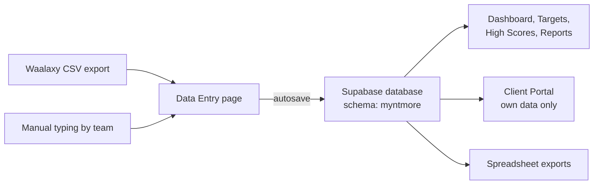
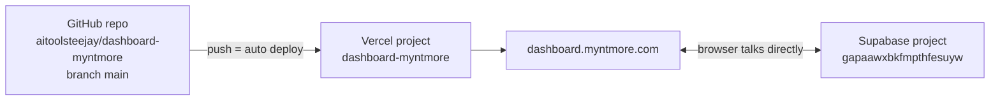
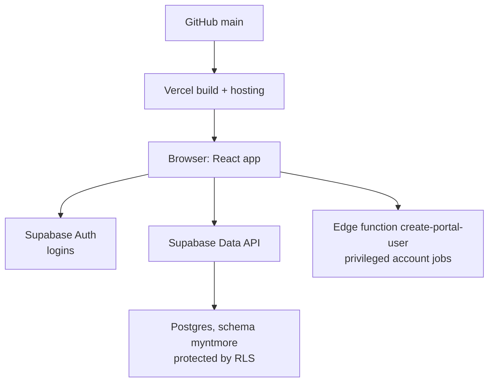

# Dashboard Bible

<aside>
📊

**The single source of truth for the Myntmore Command Center ([dashboard.myntmore.com](https://dashboard.myntmore.com)).**

1) It is Myntmore's internal website where the team types in every client's weekly numbers. 2) It turns those numbers into targets, scores and reports automatically. 3) It also has a locked-down client portal where each client sees only their own results.

**Who uses it:** the Myntmore team (admins and members) every week, and clients through the portal.

**Last updated:** 30 Sep 2026. Built from the repo README, the dashboard pages in this handover, and live Vercel data.

**Rules for this page:** no secret values here (only the *names* of settings). Logins live in [🔐 Systems & Access](https://app.notion.com/p/7cd1a87e3e144a389f96190db58dd3c3?pvs=21). If something is unknown, it goes under Open questions, never guessed.

</aside>

---

## ⏱️ The dashboard in 60 seconds

**In short:** people type numbers in, the website saves them to a database, and everyone (including clients) reads them back as dashboards and reports.

### How data flows



| Step | What happens |
| --- | --- |
| 1. Input | The team types weekly numbers, or imports a Waalaxy CSV (fills only Requests Sent, Accepted, Answered). |
| 2. Save | The page autosaves straight to Supabase. There is no server in between. |
| 3. Calculate | Totals, averages, ACH% (achievement %) and high scores are worked out from the raw numbers. Never type a total by hand. |
| 4. Read | Team sees the Dashboard and Reports. Clients see the Portal. Admins download spreadsheet exports. |

### Where it lives



| Thing | Value |
| --- | --- |
| Live URL | [dashboard.myntmore.com](https://dashboard.myntmore.com) (use this one). Also attached: `dashboard-myntmore-five.vercel.app` (older docs call this "production"). |
| Code | [github.com/aitoolsteejay/dashboard-myntmore](https://github.com/aitoolsteejay/dashboard-myntmore), branch `main` (company-owned account) |
| Hosting | Vercel team "aitoolsteejay's projects" (`team_gsSo95qOCAOfp7ZG6uQKGElO`), project `dashboard-myntmore` (`prj_l7CGC6hwPuPSm09RQE5dLjKroJrC`), Node 24.x |
| Database + logins | Supabase project `gapaawxbkfmpthfesuyw`, schema `myntmore` (shared with other internal tools and the website) |
| Owner (today) | Sanyam (admin contact in the README) |
| Tests | None automated. Run `npm run check` and test by hand. |

<aside>
⚠️

**Two things that surprise everyone:** (1) Pushing code **never** changes the database. Database changes are `.sql` files someone runs by hand in Supabase. (2) The Supabase project is shared, so every SQL statement must target the `myntmore` schema only.

</aside>

---

## 🛠️ Most common jobs

**In short:** step-by-step recipes for the 8 things you will do most. Do them in this order the first time, with a senior watching.

### 1. Weekly data entry (full routine)

*Recurring task: every Monday. Loom 10 covers this (not recorded yet).*

**Who does what (confirmed 30 Sep 2026):** each **account manager** enters the numbers for **their own clients**. The **dashboard owner** (the new intern) does not type in every client. Their job is to keep the tool working, check on Monday that every client's data is complete, fix any problems, and help the account managers when they get stuck.

1. Log in at [dashboard.myntmore.com](https://dashboard.myntmore.com).
2. In the top bar, pick the **reporting week**. Weeks start on Monday. Check the date range is right.
    
    <aside>
    💡
    
    The week you pick follows you to every page. A week belongs to the month its **Monday** falls in.
    
    </aside>
    
3. Open **Data Entry** and choose the first of **your** clients (account managers do their own clients).
4. Fill in the **Content** and **Lead Gen** numbers. Only the services that client is on will show.
5. For each campaign: export the campaign from Waalaxy (Statistics area), then click **Import from Waalaxy CSV**.
6. Read the summary. The import fills only **Requests Sent, Accepted and Answered**.
7. Type the rest by hand: positive and negative replies, hot leads, meetings, notes.
8. Click **Save** (the import does not save by itself). Wait for the success message.
9. Repeat steps 3 to 8 for each of your clients.
10. **Dashboard owner, Monday check:** make sure every active client has this week's numbers. If a client is missing or looks wrong, chase the account manager who owns it and help them fix it.
11. Enter internal numbers: **Myntmore Content**, **TJ Personal Brand**, **Sales & Outreach**, and **Processes** updates.
12. Open **Dashboard**. Look for missing data and anything below target.
13. Create or update **Actionables** for problems (owner + due date).
14. Spot-check the **client portal** for one or two clients.
- [ ]  Every account manager has entered their clients' numbers (dashboard owner checks on Monday)
- [ ]  Every active client has this week's numbers
- [ ]  Every campaign has its CSV imported and manual fields filled
- [ ]  Myntmore, TJ, Sales and Processes done
- [ ]  Dashboard reviewed, actionables updated
- [ ]  Portal spot-checked

<aside>
⚠️

Type **0** when the real value is zero. Leave it **empty** only when you have no data. The app treats these differently.

</aside>

### 2. Add a client

*Admin only. Loom 11 covers this (not recorded yet).*

1. Log in as an **admin**.
2. Open **Clients** and use the create button to open the create/edit form.
3. Fill in the client's name, birthday and Myntmore start date (these drive reminder banners), and status `active`.
4. Turn on the services they bought: **Content** and/or **Lead Gen**.
5. Assign the content manager and lead-gen manager.
6. Go to **Settings → Client Settings → Metric Fields** and check which metrics are switched on for this client.
7. Add any **campaigns** the client has, so their weekly campaign rows can be entered.
8. Set their targets (job 4).
9. If they need portal access, create a login (job 3).
- Why step 6 matters
    
    Each client has a list of "active metrics". Empty (`null`) means *all standard metrics*. A saved list means *only these*. A metric added to the app later will **not** appear for a client with a saved list until an admin ticks it in Metric Fields.
    

### 3. Create or disable a client portal login

*Admin only.*

**Create:**

1. Log in as an **admin**.
2. Go to **Settings → Client Settings** and use **portal-account linking** for that client.
3. The app calls the Supabase edge function `create-portal-user`, which creates the login safely on the server.
4. Test it: log in as the client in a private browser window. You should land on `/portal` and see only that client.
5. Send the password through a separate secure channel. Never paste it into Notion, Slack history or Git.

**Disable a user (team member or client):**

1. Go to **Settings → Team**.
2. Disable the user. The app blocks you from disabling yourself.
3. Check: a disabled account is signed out and cannot see anything, even in an old tab.

<aside>
🚫

Never edit passwords in SQL. Never delete and re-create a user just to reset a password. Use the dashboard's account flow.

</aside>

### 4. Set monthly (or weekly) targets

*Admin only.*

1. Go to **Settings → Targets**.
2. Pick the tab: **Client** (weekly or monthly), **TJ** (weekly or monthly) or **Sales** (weekly only).
3. Pick the client (Client tab), then the period, then type each target.
4. You do **not** need to re-enter targets every month. If a month has no target, the app uses the most recent one.
5. Check progress on the **Monthly Targets** page (Hit / On Track / Slightly Behind / Behind / No Data).

<aside>
💡

**Myntmore Content is different:** its targets are typed right on the data-entry card on the Myntmore Content page, not in Settings.

</aside>

### 5. Update actionables

1. Open **Actionables** (kanban board or table view).
2. Drag a card to change its status, or edit it to change owner and due date.
3. Add a new actionable for each problem you found in the weekly review. Always set an owner and a due date.
4. Some actionables are **client-visible** and show in that client's portal action plan. Clients can update the status and comment on their own items.

### 6. Export data or make a report

1. **Spreadsheets (admin):** go to **Settings → Export**. Options include a full lifetime export (one sheet per area) and a weekly summary.
2. **Reports page:** open **Reports** for aggregated analysis.
3. An end-of-month (EOM) plain-text report generator also exists in the code (`eomReport.ts`).

<aside>
✅

Per-client **custom metrics** are in the exports, Reports and Monthly Progress (added Oct 2026).

</aside>

### 7. Make a code change and deploy

1. Pull the latest `main`. Run `git status`. Keep anyone else's unfinished changes untouched.
2. Find the whole flow you are changing: route → component → query → table → RLS policy → roles.
3. Make a small, focused change.
4. Run `npm run check` (typecheck + build) and `git diff --check`. Fix every error.
5. Test the feature by hand at `http://localhost:5173`: empty, zero, partial and full data.
6. If the database must change: write a new `.sql` file in `supabase/`, back up the tables, and have an admin run it in the Supabase SQL editor **before** the code goes live.
7. Commit only the files you meant to change. Explain *why* in the message.
8. `git push origin main`. Vercel deploys automatically.
9. In Vercel, wait for the deployment to show **Ready**.
10. Smoke-test production: log in, dashboard loads, switch clients, one read-only view, log out.

### 8. What to do if it's broken

1. **Don't panic, don't delete anything.** Write down the page URL, client, week, your role and the exact error.
2. Did a deploy just happen? Check Vercel → Deployments. If the newest one broke things, **roll back** to the last good one (see Deploying & rollback).
3. Is it one page or everything? Everything down = check Vercel status and Supabase status first.
4. Look in the **Troubleshooting** table below for the symptom.
5. If client data shows under the wrong client, or a client sees someone else's data: **stop all writes** and treat it as a security incident.
6. Still stuck: ask Sanyam / the admin with the notes from step 1. *Loom 09 (debugging) covers this, not recorded yet.*

---

## 📖 Jargon buster

**In short:** every technical word on this page, in one line.

| Word | Plain meaning |
| --- | --- |
| Repo (repository) | The folder of code, stored on GitHub, with its full history. |
| Branch `main` | The "official" copy of the code. Whatever is on `main` is what runs live. |
| Commit / push | Commit = save a change with a note. Push = upload it to GitHub. |
| Deploy | Vercel builds the code and puts the new version on the live website. |
| Rollback | Switch the live site back to an older, working deploy. |
| Vercel | The hosting company that serves the website. |
| Env var (environment variable) | A named setting (like a database address) given to the app from outside the code. |
| `VITE_` prefix | Any env var starting with `VITE_` is baked into the website and visible to anyone. Never put secrets there. |
| Supabase | The service that holds the database and handles logins. |
| Postgres | The type of database Supabase uses. |
| Schema | A named section of the database. The dashboard's tables all live in `myntmore`. |
| Table / row / column | Like a spreadsheet tab / a line / a heading. |
| jsonb | A column that holds a bundle of values, e.g. all of a week's content metrics keyed by code (`C01`, `L10`…). |
| Migration | A `.sql` script that changes the database's structure or fixes data. Here they are run **by hand**. |
| RLS (Row Level Security) | Database rules that decide which rows each user may read or change. This is the real lock on client data. |
| Policy | One RLS rule on one table. |
| Edge function | A small piece of code that runs on Supabase's servers, for jobs the browser must not do (like creating logins). |
| Service-role key | The "master key" for Supabase. Only allowed inside edge functions. Never in the browser, Git or Notion. |
| Publishable (anon) key | The public key the website uses. Safe only because RLS protects the data. |
| Route / route guard | Route = a page address like `/data-entry`. Guard = code that bounces you if your role can't see it. |
| Upsert | "Insert, or update if it already exists." How saves work. |
| Autosave | The form saves by itself a moment after you stop typing. |
| ACH% | Achievement %: actual ÷ target. Colour-coded everywhere. |
| MTD | Month to date: every week of the chosen month up to the chosen week. |
| Metric id | Short code for a field: `C` = content, `L` = lead gen, `X` = client custom, `TJ…` = TJ brand, `Y` = TJ custom, `MM…` = Myntmore content. |
| Typecheck / build | Automatic checks that the code is valid and can be packaged. Passing does **not** prove the feature works. |
| IST | India Standard Time (UTC+5:30). The team's time zone; date bugs usually come from here. |

---

## 🧭 Every section of the app

**In short:** what each menu item is for, who can use it, and where its data is stored.

| Section (address) | What it's for | Who | Data table(s) |
| --- | --- | --- | --- |
| **Dashboard** (`/dashboard`) | Weekly command centre: per-client rows (expand for Content + Lead Gen), goal cards, ACH% tables, best-ever week/month, TJ brand, Sales, Myntmore Content, Processes, birthday/anniversary banner. Weekly ⇄ Monthly (MTD) toggle. | Internal | Reads almost everything |
| **Clients** (`/clients`, `/clients/:id`) | Client list and each client's workspace. Create/edit, assign managers, turn services on/off, archive/restore. | Internal read, admin write | `clients`, `client_settings`, `client_assignments` |
| **Data Entry** (`/data-entry`) | Weekly per-client Content/Lead Gen form, autosaved, grouped by section. Waalaxy CSV import for campaign weeks. | Internal | `weekly_data`, `campaigns`, `campaign_weekly_data` |
| **Actionables** (`/actionables`) | Kanban + table of tasks with owners and due dates. Client-visible ones also show in the portal. | Internal (clients: own items) | `actionables` |
| **Monthly Targets** (`/monthly-targets`) | Per-client monthly target vs actual status, with days-left banner. | Internal | `targets`, `weekly_data` |
| **Client Leaderboard** (`/client-leaderboard`) | Ranks clients by a chosen metric. | Internal | `weekly_data` |
| **High Scores** (`/high-scores`) | Every client's lifetime best week/month. ★ = new record (and above 0). | Internal | `high_scores` |
| **Reports** (`/reports`) | Aggregated performance analysis from the same data as the dashboard. | Internal | Reads many |
| **Processes** (`/processes`) | Internal recurring processes with weekly status updates. | Internal update, admin create/delete | `myntmore_processes`, `process_weekly_updates` |
| **Sales & Outreach** (`/sales`) | Company-wide weekly cold email and outreach numbers (TJ/Jahnvi/Shirin outreach, meeting tracker). | Internal | `sales_weekly_data` |
| **Myntmore Content** (`/mm-content`) | Myntmore's own channels: LinkedIn, Instagram, Website (+ SEO section), Quora/Reddit/Medium, Google/Meta Ads. Targets typed inline. | Internal | `mm_weekly_data` |
| **TJ Personal Brand** (`/tj-personal-brand`) | TJ's Instagram, YouTube, Newsletter, Video Pipeline. One row per week. | Internal | `tj_weekly_data`, `tj_custom_metrics` |
| **Finance** (`/finance`) | Financial and expense data entry. | **Admin only** | `finance_data`, `expenses` |
| **Settings** (`/settings/*`) | Team, Targets, Export, Client Settings (Metric Fields, custom metrics, portal accounts), TJ Channel Assignments (+ TJ custom metrics). | **Admin only** | `profiles`, `user_roles`, `invites`, `targets`, `custom_metrics`, `tj_channel_assignments`… |
| **Client Portal** (`/portal`) | What clients see: weekly/monthly performance by section, campaigns, action plan. | Client (own data only) | Reads own rows via RLS |
| Login / Accept invite (`/login`, `/accept-invite`) | Sign in, and accept an invitation link. | Public | Supabase Auth, `invites` |
- Settings, tab by tab
    - **Team** (`/settings/team`): invite users, promote/revoke admin, disable users. Has a guard so you can't disable yourself.
    - **Targets** (`/settings/targets`): three tabs, Client (weekly/monthly), TJ (weekly/monthly), Sales (weekly).
    - **Export** (`/settings/export`): spreadsheet downloads.
    - **Client Settings** (inside Settings, no own address): per-client active metrics (Metric Fields), custom metrics (`X##`), portal-account linking.
    - **TJ Channel Assignments** (inside Settings): who owns each TJ channel, plus "Add Custom Metric" for TJ (`Y##`), no code change needed.
- How the numbers are calculated (read before changing any metric)
    - **Weeks start Monday.** A week belongs to the month its Monday is in.
    - **Percentages are averaged, never added up.** True rates (like Acceptance Rate = accepted ÷ sent) are volume-weighted: add up the top and bottom across weeks, then divide once. The pairs are in `RATE_DEPENDENCIES` (`src/utils/rateAggregation.ts`).
    - **"Auto" metrics** are calculated, e.g. `C09` Total Posts = `C06+C07+C08`. Some are also saved at save time (`TJI04`, `MML02→MML12`).
    - **LinkedIn impression split:** in-network and out-of-network are *percentages* of total impressions. Don't add them to get impressions.
    - **Targets fall back:** if a period has no target, the most recent target is used (`findTarget()` in `src/utils/targets.ts`).
    - **High scores:** per-client are stored in `high_scores`; TJ and Myntmore Content are calculated on the fly (Myntmore: weekly only).
    - **Empty ≠ zero.** Empty = no data. 0 = a real zero.

---

## 👥 Roles & permissions

**In short:** four kinds of account. The database (RLS) enforces this, not just the buttons.

| Role | Can do | Can't do |
| --- | --- | --- |
| **Admin** | Everything: clients, team, targets, exports, passwords, finance, settings. | Disable their own account (blocked). |
| **Member** | Day-to-day work: data entry, actionables, most channel data, process updates. | Client create/edit, targets, team, finance, custom-metric writes, portal-account linking. |
| **Client (portal)** | See their own performance, campaigns and action plan. Update status/comments on their own action items. | See any internal page or any other client's data. |
| **Disabled** | Nothing. Signed out even in old tabs. | Everything. |
- Technical detail: how roles are stored and checked
    - `myntmore.profiles`: one row per user (name, email, department, disabled status, linked `client_id` for portal users).
    - `myntmore.user_roles`: `admin` or `member` for internal staff.
    - Three layers: (1) route guards `requireAdmin` / `requireInternalUser` in `src/utils/routeGuards.ts` plus a redirect in `__root.tsx` that pushes client sessions to `/portal`; (2) queries filtered by `client_id`/week; (3) **RLS**, the real boundary.
    - Helper functions: `is_internal_user()`, `has_role(user_id, role)`, `is_own_client(client_id)`, `is_own_campaign(campaign_id)`, `is_assigned(...)`, `get_invite_by_token(...)`, `client_update_actionable(...)` (lets a client update their own actionable).
    - Extra safety net: `assertClientRows()` in `src/utils/clientScope.ts` checks portal queries stayed on one client.
    - ⚠️ The sources disagree on how portal users are marked: the README says they have **no** `user_roles` row; the older Technical Documentation says they use a "member-compatible" role plus department and linked client. See Open questions.

---

## 🔑 Accounts you need

**In short:** ask for these on day one. Logins and where they're stored are in [🔐 Systems & Access](https://app.notion.com/p/7cd1a87e3e144a389f96190db58dd3c3?pvs=21).

| Account | Why | Owner |
| --- | --- | --- |
| Dashboard admin login | Run every job on this page | Created by an existing admin in Settings → Team |
| GitHub `aitoolsteejay` | Read and push the code | Company account (confirmed 30 Sep 2026: `aitoolsteejay` owns GitHub, Vercel and the Gemini key) |
| Vercel team "aitoolsteejay's projects" | Watch deploys, logs, roll back | Company account |
| Supabase (project `gapaawxbkfmpthfesuyw`) | Run SQL migrations, check data and logs, edge functions | Company account |
| Waalaxy | Export campaign CSVs each week | See Systems & Access |
- [ ]  Dashboard admin login works
- [ ]  GitHub access to aitoolsteejay/dashboard-myntmore
- [ ]  Vercel team access
- [ ]  Supabase project access (SQL editor)
- [ ]  Waalaxy access

---

## 🏗️ Architecture & stack

**In short:** a React website (a "single-page app") that talks straight to Supabase from the browser. No server of our own in the middle.



| Area | Tool |
| --- | --- |
| Frontend | React 19, TypeScript, Vite 7 |
| Page routing | TanStack Router (file-based; route list is generated) |
| Data caching | TanStack Query (per the Technical Documentation) |
| Data + logins | Supabase (Postgres + Auth), publishable key in the browser |
| Styling | Tailwind CSS 4, Radix UI (shadcn-style parts in `src/components/ui/`) |
| Charts | Recharts |
| Forms | React Hook Form + Zod |
| Drag and drop | `@dnd-kit` (Actionables board) |
| Spreadsheets | `write-excel-file` |
| Hosting | Vercel, auto-deploys from `main`; all addresses are sent to `index.html` |
- Technical detail: what the app sets up when it starts
    - TanStack Query for remote data and cache refresh.
    - `AuthProvider` (`src/lib/auth.tsx`): session, profile, role, client link.
    - `WorkspaceProvider` (`src/lib/workspace.tsx`): the shared selected week. Saved in the browser under `myntmore.workspace.v1`.
    - Navigation and toast messages.
    - After a deploy, it spots old JavaScript files in open tabs and reloads once, to avoid blank pages.

---

## 📁 Repo structure

**In short:** pages live in `src/routes/` (thin) and `src/components/` (real code). Metric lists live in `src/data/`. SQL lives in `supabase/`.

| Path | What's there |
| --- | --- |
| `src/routes/` | One small file per page address. Mostly just shows a component. |
| `src/components/` | One folder per feature: `dashboard/` (DashboardPage.tsx, the biggest file), `data-entry/`, `clients/`, `portal/`, `monthly/`, `leaderboard/`, `high-scores/`, `reports/`, `sales/`, `settings/`, `tj-brand/`, `mm/`, `monday/` (campaign boards), `actionables/`, `processes/`, `finance/`, `auth/`, `ui/` |
| `src/data/metrics.ts` | Client metric list: `CONTENT_METRICS`, `LEADGEN_METRICS`, `ALL_METRICS` |
| `src/data/company_metrics.ts` | TJ and Myntmore Content metric lists |
| `src/hooks/` | `useAutoSave.ts`, `useEffectiveMetrics.ts`, `useEffectiveTjMetrics.ts` |
| `src/lib/` | `auth.tsx`, `workspace.tsx`, `export.ts`, `health.ts`, `notifications.ts`, `metrics.ts` (legacy) |
| `src/utils/` | Dates (`dateUtils.ts`, `weekUtils.ts`), maths (`metricCalculations.ts`, `rateAggregation.ts`, `targets.ts`), high scores, `waalaxyImport.ts`, `routeGuards.ts`, `clientScope.ts`, `eomReport.ts`, `campaignSync.ts` |
| `src/integrations/supabase/` | `client.ts` (connects using the env vars) and `types.ts` (generated) |
| `supabase/` | Hand-written SQL (RLS, migrations, data fixes) and edge functions (`functions/create-portal-user`) |
| `docs/` | Older docs, refreshed in Oct 2026. The README is still the main source. |

<aside>
🚫

**Never hand-edit these two generated files:** `src/routeTree.gen.ts` (made from `src/routes/`) and `src/integrations/supabase/types.ts` (regenerate after any schema change).

</aside>

- Full folder map (from the README)
    
    ```
    src/
      routes/                  Thin TanStack Router route files
      components/
        dashboard/             DashboardPage.tsx (largest file)
        data-entry/            Weekly per-client entry
        clients/               Client CRUD
        portal/                ClientPortalPage, ClientActionPlan, campaigns view
        monthly/               MonthlyProgressPage
        leaderboard/           Client leaderboard
        high-scores/           Lifetime high scores
        reports/               Reports page
        sales/                 Sales & Outreach entry
        settings/              Team, Targets, Export, Client Settings, Metric Fields, TJ Channel Assignments
        tj-brand/              TJBrandPage.tsx
        mm/                    MMContentPage.tsx
        monday/                EditCampaignModal, CampaignMonthTable, etc.
        actionables/           ActionablesPage.tsx
        processes/             Processes tracker
        finance/               Finance entry
        auth/                  Login, invite acceptance
        ui/                    Shared Radix-based parts
        AppSidebar.tsx         Left nav
        AppTopbar.tsx          Week selector, command palette, badges
        MetricCard.tsx         Shared metric input card
        StatusBadge.tsx        Status pill
      data/
        metrics.ts             CONTENT_METRICS, LEADGEN_METRICS, ALL_METRICS
        company_metrics.ts     TJ + MM catalogs
      hooks/                   useAutoSave, useEffectiveMetrics, useEffectiveTjMetrics, use-mobile
      lib/                     auth, export, health, notifications, metrics (legacy), utils, week, workspace
      utils/                   dateUtils, weekUtils, metricCalculations, readMetric, dataUtils, format,
                               targets, rateAggregation, highScores, tjHighScores, mmHighScores,
                               campaignSync, campaignRollup, clientScope, routeGuards, eomReport,
                               waalaxyImport, sort
      integrations/supabase/   client.ts, types.ts (generated)
      types/                   Shared TypeScript types
    supabase/                  Hand-written SQL + edge functions
    docs/                      Older docs (refreshed Oct 2026)
    ```
    

---

## 💻 Local setup

**In short:** install Node, copy the example settings file, fill in two values from the password vault, run `npm run dev`.

1. Install **Node.js 20 or newer** and npm.
2. Get access to the GitHub repo and the Supabase project.
3. Run:
    
    ```bash
    git clone git@github.com:aitoolsteejay/dashboard-myntmore.git
    cd dashboard-myntmore
    npm install
    cp .env.example .env.local
    npm run dev
    ```
    
4. Open `.env.local` and fill in these two names (values are in the password vault, **not** here):
    - `VITE_MYNTMORE_SUPABASE_URL`
    - `VITE_MYNTMORE_SUPABASE_PUBLISHABLE_KEY`
5. Restart `npm run dev` after editing, then open `http://localhost:5173`.

<aside>
⚠️

Local dev points at the **live** Supabase data. Anything you save locally is saved for real. Test on a dummy client, or read only.

</aside>

| Command | What it does |
| --- | --- |
| `npm run dev` | Start the local site |
| `npm run typecheck` | Check the TypeScript |
| `npm run build` | Build the production version into `dist/` |
| `npm run check` | Typecheck + build. **Run before every push.** |
| `npm run preview` | Serve the built version locally |
- Secrets rules
    - The Supabase **service-role key** only lives inside the `create-portal-user` edge function (server side). Never in a `VITE_` variable, Git, chat or docs.
    - Never commit `.env.local`, `dist/` or `.DS_Store`.
    - Never log passwords, tokens, keys or sensitive rows.

---

## 🚀 Deploying & rollback

**In short:** push to `main` and Vercel deploys by itself. If it breaks, roll back in Vercel. Rolling back code does **not** undo database changes.

### Deploy

1. `npm run check` and `git diff --check` pass.
2. Any needed `.sql` has already been run in Supabase by an admin.
3. `git push origin main`.
4. Vercel → project `dashboard-myntmore` → Deployments: wait for **Ready**.
5. Smoke-test [dashboard.myntmore.com](https://dashboard.myntmore.com): login, dashboard loads, switch clients, one read-only view, logout. For data-entry changes, check one controlled save lands on the right client and week.

### Roll back

1. Vercel → Deployments → find the last good deployment (marked as a rollback candidate).
2. Use **Instant Rollback / Promote** on it. *Or* revert the bad commit in Git and push.
3. If the bad release also ran SQL, that needs its own fix; the rollback won't reverse it.
- Live Vercel facts (checked 30 Sep 2026)
    - Latest production deploy: **Ready**, 30 Sep 2026, commit `6c1af44` "Rewrite [README.md](http://README.md) as a comprehensive, current reference", by `aitoolsteejay`.
    - Previous rollback candidate: commit `d437fc6` (lifetime-high bug fixes).
    - Domains on the project: `dashboard.myntmore.com` (verified), `dashboard-myntmore-five.vercel.app`, plus auto Vercel URLs.
    - Deployment protection: Vercel login required on everything **except custom domains**. So use `dashboard.myntmore.com`; `.vercel.app` links may ask for a Vercel login.
    - Node version on Vercel: 24.x. Framework preset: not set.
    - Environment variables listed in Vercel: **none were returned**. See Open questions.

---

## 🗄️ Database: tables & migrations

**In short:** every table is in the `myntmore` schema with RLS on. Changes are `.sql` files in `supabase/` that an admin runs **by hand** in the Supabase SQL editor.

<aside>
🚨

**Manual migrations!** There is no migration runner. A code deploy never applies SQL. Run the SQL yourself, ideally **before** the code that needs it goes live. The Supabase project is shared: always write `myntmore.table_name`, never touch other schemas.

</aside>

### Tables

| Group | Table | Holds |
| --- | --- | --- |
| Clients | `clients` | Client name, birthday/start date, status, service flags |
| Clients | `client_settings` | Services on/off + active-metric lists |
| Clients | `client_assignments` | Content / lead-gen manager per client |
| Clients | `weekly_data` | One row per client per week: `content_metrics`  • `leadgen_metrics` (jsonb) |
| Clients | `custom_metrics` | Admin-added client metrics (`X##`) |
| Clients | `campaigns`, `campaign_weekly_data` | LinkedIn campaigns and their weekly numbers (rolled up into `weekly_data`) |
| Clients | `targets` | Weekly/monthly targets. `client_id` NULL = TJ or Sales targets |
| Clients | `high_scores` | Per-client lifetime bests |
| Clients | `client_alerts`, `client_context_notes`, `client_health_scores`, `client_notifications`, `aha_moments` | Alerts, notes, health score history, reminder state, client quotes |
| TJ brand | `tj_weekly_data`, `tj_custom_metrics`, `tj_channel_assignments` | TJ's weekly data, custom metrics (`Y##`), channel owners |
| Internal | `mm_weekly_data` | Myntmore's own channels, per week |
| Internal | `sales_weekly_data` | Sales & Outreach, per week |
| Internal | `myntmore_processes`, `process_weekly_updates` | Processes and their weekly updates |
| Internal | `actionables` | Tasks (internal + client-visible) |
| Internal | `growth_initiatives`, `growth_initiative_comments`, `initiatives`, `hot_leads` | Initiatives and hot leads |
| Finance | `finance_data`, `expenses` | Admin-only money data |
| Access | `profiles`, `user_roles`, `invites` | Users, roles, pending invites (passwords live in Supabase's own `auth.users`, don't touch it) |

### How to run a migration safely

1. Write a **new** `.sql` file in `supabase/` (don't rewrite old ones).
2. List every table it touches. **Export (back up)** those tables first.
3. Write down row counts, nulls, duplicates, and ownership mismatches.
4. Wrap it in `begin; … commit;`. Use `add column if not exists` style guards. Target `myntmore.` explicitly.
5. Have an admin paste and run it in the Supabase SQL editor.
6. Re-check the counts. Confirm RLS is still on.
7. Test as admin, member, client, disabled and logged-out.
8. Regenerate `src/integrations/supabase/types.ts` if tables/columns changed.
9. Keep the backup until the change is proven stable.
- Migration template + RLS patterns
    
    ```sql
    begin;
    alter table myntmore.example
      add column if not exists new_field text;
    -- add or adjust RLS deliberately
    commit;
    ```
    
    ```sql
    -- Everyone internal can read and write:
    create policy X_internal_all on myntmore.X for all to authenticated
      using (myntmore.is_internal_user()) with check (myntmore.is_internal_user());
    
    -- Internal can read, only admins can write (use when the UI has admin-only buttons):
    create policy X_internal_read on myntmore.X for select to authenticated
      using (myntmore.is_internal_user());
    create policy X_admin_all on myntmore.X for all to authenticated
      using (myntmore.has_role(auth.uid(), 'admin')) with check (myntmore.has_role(auth.uid(), 'admin'));
    
    -- Client portal can read only its own rows:
    create policy X_portal_own_read on myntmore.X for select to authenticated
      using (myntmore.is_own_client(client_id));
    ```
    
    - Key SQL files: `supabase/secure_dashboard_rls.sql` (current RLS hardening reference), `supabase/campaign_client_integrity.sql` (campaign rows must match their campaign's client), `supabase/enable_newsletter_metrics_for_amey.sql` (pattern for adding metric ids to a client's list without overwriting it).
    - Don't blindly run every old SQL file against production. Check what it does and when it was written first.
    - Campaign weekly rows upsert on `(campaign_id, week_start)`.

<aside>
🚫

Never run `DROP`, `TRUNCATE`, a `DELETE` without a `WHERE`, or any "reset" on production.

</aside>

---

## 🔌 Integrations

**In short:** only three outside connections: Supabase, Vercel/GitHub, and Waalaxy CSV files (uploaded by hand).

| Integration | How it works | Notes |
| --- | --- | --- |
| Supabase | Database, logins, RLS, edge function `create-portal-user` | Project `gapaawxbkfmpthfesuyw`, schema `myntmore`, shared with other tools |
| Waalaxy | **No API link.** You export a campaign CSV from Waalaxy's Statistics area and import it on Data Entry. | Parsed in the browser (`waalaxyImport.ts`). Checks it's a Waalaxy export, counts dates inside the chosen week, flags duplicate rows. Fills Requests Sent, Accepted, Answered only. Doesn't auto-save. |
| GitHub → Vercel | Push to `main` = automatic production deploy | Company account `aitoolsteejay` |
- Waalaxy import detail
    - "Answered" is channel-agnostic: Waalaxy's last detected reply may be from LinkedIn or email.
    - Positive/negative replies, hot leads, meetings and notes are always typed by hand.
    - `campaignSync.ts` rolls campaign weekly rows up into the client's weekly totals.

---

## 🔁 Recurring tasks

**In short:** one weekly job lives here. It's tracked in [🔁 Recurring Tasks](https://app.notion.com/p/8ca740ba253b458784073907050d3c6b?pvs=21).

| Task | When | How |
| --- | --- | --- |
| [Weekly dashboard data entry (Mondays)](https://app.notion.com/p/Weekly-dashboard-data-entry-Mondays-3eb4ee2c51c181fabb1be444beb19c15?pvs=21) | Every Monday | Job 1 above. Account managers enter their own clients' numbers. The dashboard owner (intern) checks on Monday that every client is complete, fixes issues and supports the account managers. Tools: dashboard + Waalaxy. Loom recorded (see Loom Videos to Record). |
| Monthly Vercel/GitHub/Supabase check | Monthly | Part of the general monthly maintenance on the handover hub (Supabase storage, Vercel, GitHub). See [Monthly maintenance](https://app.notion.com/p/Monthly-maintenance-3eb4ee2c51c1819398ffcb4b1e6c2e1c?pvs=21). |
| Set new month's targets | When targets change | Job 4. Optional: old targets carry forward. |

---

## ⚠️ Known issues, tech debt & security

**In short:** the app works, but there are sharp edges. Know these before you change anything.

### Known issues & tech debt

| Issue | Why it matters |
| --- | --- |
| **Two metrics files:** `src/data/metrics.ts` (main) and `src/lib/metrics.ts` (legacy) | Changing one may not update every page. Search imports before editing. Should be merged. |
| **No automated tests** | Every change must be tested by hand. |
| **Manual migrations** | Easy to forget; code and database can get out of step. |
| **Active-metric list snapshot** | New metrics don't appear for clients with a saved list until an admin ticks them. |
| Myntmore Content has no custom metrics and no monthly high score | Every new MM field needs a code change. |
| `DashboardPage.tsx` is very large | Hard to change safely; test the whole dashboard after edits. |
| 🔴 **High risk: no database backups.** Supabase is on the **free plan** with **no backups** (confirmed 30 Sep 2026). | If data is deleted or corrupted, there is no way to get it back. Every client's history lives here. *Suggestion (not decided):* take a regular manual export or `pg_dump` of the `myntmore` schema (e.g. weekly, after Monday data entry) and store it safely, or upgrade Supabase to the Pro plan, which includes daily backups. |
- The recurring bug list (read before writing code)
    1. **Time zones:** team is in IST. Don't mix local and UTC date methods. Use `getTodayIST()` for "today".
    2. **Percentages are averaged, rates are volume-weighted.** Decide by `metric.type === 'percentage'`, never a hardcoded list.
    3. **Booleans:** `Number(true)` = 1, so generic "add up every number" code corrupts yes/no fields. Exclude boolean ids.
    4. **Null vs 0:** use `!== null` / `!== undefined`, never `if (value)`.
    5. **New metrics** get missed by any code that lists ids by hand (portal groups in `ClientPortalPage.tsx`, `export.ts`, `ReportsPage.tsx`).
    6. **Look metrics up by id**, never by position in a list.
    7. **Always use `findTarget()`** for targets.
    8. **RLS must match the UI.** `clients`, `targets`, `tj_custom_metrics` and `myntmore_processes` once let members write what only admins should; fixed by splitting read/admin policies.
    9. **Autosave must keep the original client and week.** Test: edit Client A, switch to Client B fast, reload both, only A changed.

### Security rules

- [ ]  Service-role key only in the edge function, never in `VITE_` vars, Git, chat or Notion
- [ ]  Every new table: RLS on and reviewed before any real data
- [ ]  Every client-owned query filtered by `client_id` (and cache keys include client + week)
- [ ]  Hiding a button is **not** security
- [ ]  Test as admin, member, client, disabled and logged-out
- [ ]  Logout must hide everything at once; if it doesn't, treat it as a security issue
- [ ]  Wrong-client data = stop writes, capture details, back up, fix only identified rows

---

## 🩺 Troubleshooting

**In short:** find your symptom, check the likely cause, apply the fix. When in doubt, stop and ask before changing data.

| Symptom | Likely cause | Fix |
| --- | --- | --- |
| "Missing Supabase configuration" when the site loads (local) | Env var names wrong or missing in `.env.local` | Names must be exactly `VITE_MYNTMORE_SUPABASE_URL` and `VITE_MYNTMORE_SUPABASE_PUBLISHABLE_KEY`. Restart `npm run dev`. |
| Blank page right after a deploy | Old tab loading old files, or a broken build | Hard refresh. If still blank, check Vercel build logs; roll back if the new deploy is bad. |
| Deploy fails in Vercel | TypeScript or build error | Run `npm run check` locally, fix, push again. |
| Save error: missing / unknown column | Code expects a column the database doesn't have (SQL not run), or wrong jsonb key | Compare with `supabase/*.sql`. Run the pending migration, or fix the key. |
| Save fails (permission / RLS error) | Your role isn't allowed, or the policy is wrong | Check your role. Capture the exact toast + network response. Don't loosen RLS without review. |
| Saved values vanish after reload | Save didn't finish; wrong upsert conflict columns; 0 read as empty; older save overwrote newer | Check autosave status, `onConflict` target vs the table's unique key, null/0 handling, stale-request guard. |
| A metric doesn't show for one client | Client's active-metric list was saved before the metric existed, or service is off | Settings → Client Settings → Metric Fields: tick it. Check Content/Lead Gen is on. |
| Monthly number looks added up instead of averaged (or the reverse) | Code uses a hardcoded id list instead of `metric.type` | Fix the consumer to use `type === 'percentage'` / `RATE_DEPENDENCIES`. |
| ACH% is wrong or target shows 0 | A reader skipped `findTarget()` fallback | Use `findTarget()`. |
| Date is off by one day / "today" is wrong in the morning | Local vs UTC mix-up (IST) | Use `getTodayIST()` and fully-UTC week helpers. |
| False "Target hit ✓" or false ★ record | null treated as 0, or 0 treated as a record | Explicit null checks; records need value &gt; 0. |
| Waalaxy import fills nothing | Wrong file, or wrong week selected | Re-export from Waalaxy Statistics; check the selected week covers the dates. |
| Data appears under the wrong client / a client sees others' data | Scoping bug (query, cache key, delayed autosave, RLS) | **Security incident.** Stop writes. Record user, client, campaign, week, times, row ids. Export tables. Check `is_own_client()` RLS and `assertClientRows()`. Fix only identified rows in a transaction. |
| After logout, dashboard still visible | Sign-out or redirect not completing | Treat as security issue. Confirm sign-out, cleared auth state, redirect to `/login`, back/forward buttons. |
| Portal user can't log in | Account not linked, disabled, or wrong password | Check Settings → Team / Client Settings. Reset through the dashboard flow, never SQL. |
- What to capture in any bug report
    - Exact page URL
    - Selected client and week
    - Your role
    - Exact error message (toast) and failed network response
    - Steps to reproduce, screenshot if useful
    - **Never** include passwords, tokens, keys or sensitive exports
    - Where to look: Vercel → Deployments (build logs) and runtime logs; Supabase → logs; browser console and network tab

---

## 🎥 Related Loom videos

**In short:** three walkthroughs are planned. None are recorded yet. Tracked in [🎥 Loom Videos to Record](https://app.notion.com/p/fc74d12d9bc544078f7d3e4d582d7541?pvs=21).

| Video | What it shows | Status |
| --- | --- | --- |
| [08 · Weekly dashboard data entry](https://app.notion.com/p/08-Weekly-dashboard-data-entry-3eb4ee2c51c1811888edd4da21e89b4c?pvs=21) | Pick week, client numbers, Waalaxy CSV, manual replies/leads/meetings, Myntmore/TJ/sales, review gaps, actionables, portal check | To record (High, 5–10 min) |
| [09 · Dashboard admin: clients, portal users, targets](https://app.notion.com/p/09-Dashboard-admin-clients-portal-users-targets-3eb4ee2c51c1814c93dfd58f874de671?pvs=21) | Add a client, create a portal login, set monthly targets, disable a user, where the Supabase data sits | To record (Medium, 5–10 min) |
| [11 · Debugging a broken tool or deploy](https://app.notion.com/p/11-Debugging-a-broken-tool-or-deploy-3eb4ee2c51c1815da3f8e0f2a399ca21?pvs=21) | Vercel build/runtime logs, Supabase logs, common failures, when to roll back | To record (Medium, 5–10 min) |

---

## ❓ Open questions

**In short:** things nobody has written down yet. Answer them with Sanyam before the handover ends, then move the answer into the right section.

<aside>
✅

**Answered on 30 Sep 2026 (by Sanyam):** weekly data entry day and ownership, and Supabase backups. The answers are now in Job 1, Recurring tasks and Known issues. Also confirmed: `aitoolsteejay` is the company account that owns GitHub, Vercel and the Gemini key.

</aside>

- [ ]  **Env vars on Vercel:** Vercel returned **no** environment variables for this project. How does the production build get the Supabase URL and key? (Fallback in `client.ts`? Set somewhere else? Hidden from the API?)
- [ ]  **Edge function secrets:** which secret names does `create-portal-user` use, and how is it deployed (Supabase CLI? dashboard)?
- [ ]  **Portal user role:** README says portal users have no `user_roles` row; older Technical Documentation says they use a member-compatible role + department. Which is true today?
- [ ]  **Exact UI steps** for creating a portal login and adding a client (button names, required fields).
- [ ]  **Where is the EOM report** generated in the UI, and who receives it?
- [x]  **~~Weekly data entry:** which day, deadline, and who owns which clients?~~ **Answered 30 Sep 2026:** every Monday; account managers enter their own clients, the dashboard owner checks and supports.
- [x]  **~~Supabase backups:** is point-in-time recovery or scheduled backup on? What plan and storage limits?~~ **Answered 30 Sep 2026:** free plan, no backups. Logged as a High risk in Known issues. (Storage limits still to check.)
- [ ]  **Which old SQL files** in `supabase/` have already been run on production? Is there a log?
- [ ]  **Preview deployments:** are non-`main` branches used for previews, or does everything go straight to `main`?
- [ ]  **TanStack Query:** listed in the Technical Documentation but not in the README stack table. Confirm.
- [ ]  **Monthly Targets page:** only progress review (README), or can targets be set there too (Technical Documentation)?
- [ ]  **Is `dashboard-myntmore-five.vercel.app` still needed**, or should everyone use only `dashboard.myntmore.com`?

---

## 🔗 Related handover pages

**In short:** the source pages this Bible was built from, and the trackers it belongs to.

- [Myntmore Handover — Sanyam](https://app.notion.com/p/Myntmore-Handover-Sanyam-3eb4ee2c51c181be8493db88e803fbd6?pvs=21) (hub)
- [README — Myntmore Command Center dashboard (dashboard-myntmore repo)](README%20%E2%80%94%20Myntmore%20Command%20Center%20dashboard%20(dashbo%203eb4ee2c51c181ad97b2dce97f9a1723.md) (full repo README copy)
- [Myntmore Dashboard - User Manual](Myntmore%20Dashboard%20-%20User%20Manual%203eb4ee2c51c1818ca003e9fd28ebff64.md)
    - [Myntmore Dashboard — Technical Documentation](Myntmore%20Dashboard%20-%20User%20Manual/Myntmore%20Dashboard%20%E2%80%94%20Technical%20Documentation%203eb4ee2c51c181de88dfeceaa729a5e6.md)
    - [Myntmore Dashboard — Non Technical Documentation](Myntmore%20Dashboard%20-%20User%20Manual/Myntmore%20Dashboard%20%E2%80%94%20Non%20Technical%20Documentation%203eb4ee2c51c1816b8f9df3799644d91a.md)
- [dashboard-myntmore](https://app.notion.com/p/dashboard-myntmore-3eb4ee2c51c181969c54e2078ddfb3dd?pvs=21) (row in Apps & Repos)
- [Weekly dashboard data entry (Mondays)](https://app.notion.com/p/Weekly-dashboard-data-entry-Mondays-3eb4ee2c51c181fabb1be444beb19c15?pvs=21) (row in Recurring Tasks)
- [Runbooks](https://app.notion.com/p/Runbooks-3eb4ee2c51c181e1a93ff22f2ae3304c?pvs=21)
- [Website Bible](../Website/Website%20Bible%203eb4ee2c51c1816395c4f569bc88f4f2.md) (sister page for [www.myntmore.com](http://www.myntmore.com))
- Databases: [💻 Apps & Repos (Vercel + GitHub)](https://app.notion.com/p/c38cf1ff94a94ff4901e4f8ef270dba0?pvs=21) · [🔐 Systems & Access](https://app.notion.com/p/7cd1a87e3e144a389f96190db58dd3c3?pvs=21) · [🔁 Recurring Tasks](https://app.notion.com/p/8ca740ba253b458784073907050d3c6b?pvs=21) · [🎥 Loom Videos to Record](https://app.notion.com/p/fc74d12d9bc544078f7d3e4d582d7541?pvs=21) · [✅ Handover Checklist](https://app.notion.com/p/bfde3c59483f4d5893b05e0b39f45d62?pvs=21)