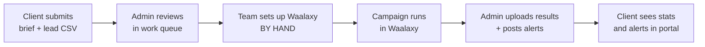
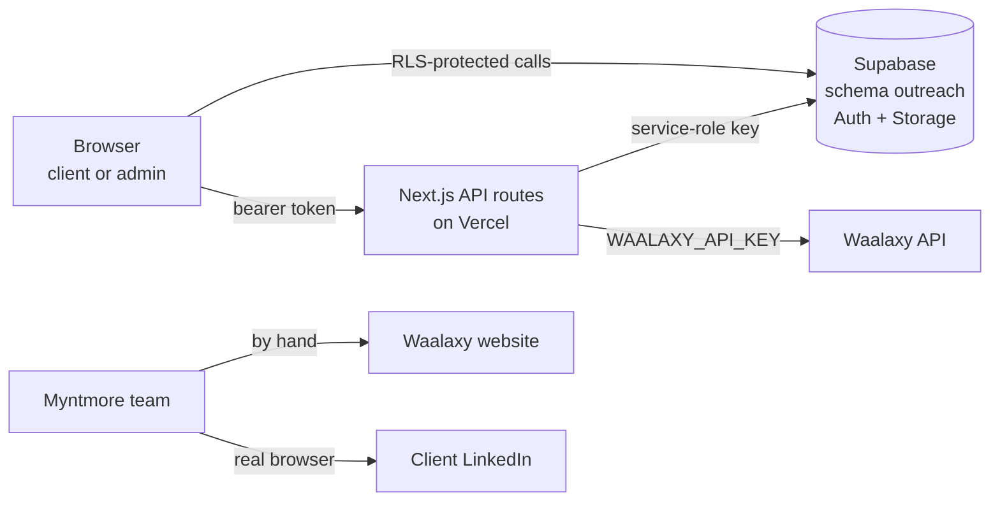

# Outreach Tool Bible

<aside>
📨

**What it is:** The Myntmore Outreach Tool ([outreach.myntmore.com](http://outreach.myntmore.com)) is a web portal for our *done-for-you* LinkedIn outreach service. Clients use it to hand us a lead list and a message sequence, and to see results. It is **NOT** self-serve automation: nothing in the app sends a LinkedIn request. The Myntmore team sets up and runs every campaign in Waalaxy by hand.

**Who uses it:** clients (submit campaigns, track results, share LinkedIn logins and 2FA codes) and the Myntmore team, called *admins* (review, set up, report, post alerts, manage accounts).

**Last updated:** 30 Sep 2026. Main source: the repo README (copy in Reference Docs). Anything we don't know is listed under Open questions.

</aside>

---

## ⏱️ The tool in 60 seconds

**In short:** clients give us a brief and a lead list in the portal, we do the LinkedIn sending in Waalaxy by hand, and we put the results back in the portal.



| Step | Who | Where | Campaign status after |
| --- | --- | --- | --- |
| 1. Submit brief + lead CSV + messages | Client | Portal: 3-step wizard | Submitted |
| 2. Review the brief and list | Admin | Portal: work queue → Manage campaign | In review |
| 3. Log into client's LinkedIn (2FA relay), create campaign, paste messages, import leads | Admin | Real browser + Waalaxy + portal | In setup |
| 4. Campaign sends requests and follow-ups | Waalaxy | Waalaxy | Live |
| 5. Report numbers, post alerts | Admin | Portal: Manage campaign | Live → Completed |

**Where it lives:** GitHub repo `aitoolsteejay/outreach-tool` (branch `main`, company account) → Vercel project `outreach-tool` (team aitoolsteejay) → live at [**outreach.myntmore.com**](http://outreach.myntmore.com) (also `outreach-tool-ecru.vercel.app`). Data, logins and uploaded files live in **Supabase** (Postgres schema `outreach`).

<aside>
⚠️

This app holds **client LinkedIn passwords** (encrypted) and **2FA codes** (plain text). Treat it like a password vault. Never paste a client password or code into Notion, Slack or email.

</aside>

---

## 🧰 Most common jobs

**In short:** these are the recipes you will use every week. Follow them in order. Each one says which screen to use.

### 1. Onboard a new client

1. Log in at [outreach.myntmore.com](http://outreach.myntmore.com) with your admin account.
2. Open **Account management** and create a **client** account with the client's email. If that email already has a Myntmore login for another tool, the app grants Outreach access to that login instead of making a new one.
3. Send the login to the client yourself. Clients can't sign themselves up: an admin always creates the account and sends them the login details.
4. Ask the client to do two things in their dashboard: submit their **LinkedIn email + password**, and submit their first campaign through the wizard.
5. Check the client's lead labels exist (Hot / Cold are created automatically).
- [ ]  Account created as role *client* (not admin)
- [ ]  Login sent to the client by an admin
- [ ]  Client has logged in once
- [ ]  LinkedIn credentials submitted
- [ ]  First campaign submitted

### 2. Review a submitted campaign

1. Open the **work queue** and filter by status *Submitted*.
2. Click the campaign to open **Manage campaign**. Read the brief: goal, offer, tone, connection note (max 300 characters), 1–3 follow-ups and their wait days.
3. Check the messages make sense and the placeholders are right (`{{first_name}}`, `{{last_name}}`, `{{company}}`).
4. Download the lead list and open it. Check it has LinkedIn URLs and looks like the right people.
5. If something is wrong, **post an alert** on the campaign telling the client what to fix.
6. If it is fine, set the status to **In review**, then **In setup** when you start building it.

<aside>
💡

If a client edits their brief later, the app posts an automatic alert for admins (the client doesn't see it). Waalaxy will **not** notice the change, so you must update the messages in Waalaxy by hand.

</aside>

### 3. Set it up in Waalaxy by hand

1. Make sure you can log into the client's LinkedIn (see recipe 4).
2. In **Waalaxy's own website**, create the campaign and paste the connection note and each follow-up with its wait time. The app cannot do this for you.
3. Get the leads into Waalaxy. Two ways:
    1. **Manual:** in Manage campaign, click *Download this campaign's lead list* and import that CSV in Waalaxy.
    2. **Push:** in Manage campaign, use *Link + push to Waalaxy*. Pick the Waalaxy campaign and prospect list from the dropdowns, then push. Read every result code shown. Only `success` is a known good code.
4. Launch the campaign in Waalaxy.
5. In the portal, set status to **Live** and update progress.

### 4. Handle a LinkedIn 2FA request

1. In Account management, open the client and their **LinkedIn credential** panel.
2. Click **reveal password** (this is logged with your name and time). Log into the client's LinkedIn in a real browser.
3. If LinkedIn asks for a code, click **request code**. The client sees the request in their dashboard and types the code in.
4. If LinkedIn asks the client to tap "Yes" on their phone, click **request phone approval**. The client confirms in their dashboard.
5. Click **reveal code** to see the code they sent (also logged), and type it into LinkedIn quickly. Codes expire in minutes.
6. When you are in, click **mark logged in**. If it failed, click **mark failed** and write the reason, or **reset** to ask the client to log in again.

<aside>
🔒

Only reveal a password when you are about to log in. Never copy it anywhere else.

</aside>

### 5. Update performance and reporting

1. In Waalaxy, export the campaign's **contact export** CSV.
2. In the portal's Manage campaign, **upload the Waalaxy export**. The app counts sent / accepted / replied from each lead's dates and updates every lead's status. Re-uploading a newer export updates rows, it does not duplicate them.
3. Type the **positive replies** number by hand (the export can't tell a positive reply from any reply).
4. Or, if you have no export, type all four numbers by hand.
5. Update **progress**. Set **Completed** when the campaign is done.
6. Separately, the weekly [dashboard.myntmore.com](http://dashboard.myntmore.com) data entry also uses Waalaxy CSVs (a different tool).

### 6. Handle alerts and account restrictions

1. Post an **alert** for anything the client should know. Pick the scope: whole account, one campaign, or one lead (by name or URL). Pick a severity.
2. Check the work queue for campaigns with an **unresolved-alert** marker, including the automatic "client edited this campaign" alert. Act on it, then **resolve** it.
3. If a client's LinkedIn login fails or the account is restricted: mark the credential **failed** with a reason, pause the campaign in Waalaxy by hand, and post an account-wide alert. (There is no written process for restrictions yet — see Open questions and Loom 13.)
4. A client cannot delete a campaign while it has an open alert.

### 7. Make a code change and deploy

1. Clone `aitoolsteejay/outreach-tool` and set up locally (see Local setup).
2. Make your change on a new branch.
3. Check it, in this order: `npx tsc --noEmit` → `npm run lint` → `npm test` → `npm run build`. All must pass.
4. If you added a migration file, **run it on the live Supabase database by hand** before or right after deploying. Deploy does not do it.
5. Merge to `main`. Vercel builds and deploys to production automatically (all recent production deploys came from `main`).
6. Open [outreach.myntmore.com](http://outreach.myntmore.com) and check the screen you changed.

### 8. What to do if it's broken

1. **Don't panic, don't delete anything.** Note the time and what you clicked.
2. Check whether the site loads at all. Then check Vercel → project `outreach-tool` → Deployments (did the last deploy fail?) and Logs (errors?).
3. If the last deploy broke it: in Vercel, **roll back** to the previous working deployment (see Deploying & rollback).
4. If only Waalaxy features fail with a 501 error: `WAALAXY_API_KEY` is missing. The rest of the app still works.
5. If password reveal/submit fails: check `CREDENTIALS_ENCRYPTION_KEY` in Vercel. **Never replace it with a new key** without reading the credentials section.
6. Use the Troubleshooting table below. Still stuck? Watch Loom 09 and ask the team.

---

## 📖 Jargon buster

**In short:** the words you will hear, in plain English.

| Word | What it means here |
| --- | --- |
| **Portal / the tool** | This web app, [outreach.myntmore.com](http://outreach.myntmore.com). |
| **Waalaxy** | A paid third-party tool that actually sends LinkedIn connection requests and messages. We set it up by hand. |
| **Done-for-you** | We run the campaign for the client. The client does not press any "send" button. |
| **Brief** | What the client wants: goal, offer, tone, connection note, follow-ups and wait days. |
| **Sequence** | The connection note plus 1–3 follow-up messages, in order. |
| **Connection note** | The short message sent with a LinkedIn connection request. Max 300 characters (LinkedIn's limit). |
| **Follow-up delay** | Days to wait before a follow-up (1–60, default 3). Follow-up 1 counts from when the request is accepted. Each later one counts from the previous follow-up. |
| **Placeholder** | A token like `{{first_name}}` that Waalaxy replaces with the lead's real name. |
| **Lead list / CSV** | A spreadsheet file of people to contact. Only `linkedin_url` is required. |
| **Contact export** | A CSV you download from Waalaxy with each lead's dates (request sent, connected, replied). We upload it to update stats. |
| **2FA** | Two-factor authentication. LinkedIn asks for a code (or a phone tap) on a new login. |
| **2FA relay** | The back-and-forth where we ask for a code in the portal, the client types it in, and we use it to log in. |
| **Alert** | A notice from admins to a client, about the whole account, one campaign, or one lead. |
| **Lead status vs lead label** | *Status* (Not yet sent → Sent → Accepted → Replied) comes from Waalaxy dates; only admins change it. *Label* (Hot/Cold etc.) is the client's own tag and means nothing to outreach progress. |
| **Admin / client** | The only two roles. Admin = Myntmore team. Client = a customer. |
| **Revoke** | Remove someone's access without deleting their data (a "soft delete"). It can be restored. |
| **Supabase** | Hosted database + login system + file storage we use. |
| **Schema `outreach`** | A folder of tables inside the database that belongs only to this app. Other Myntmore tools share the same Supabase logins. |
| **RLS (Row-Level Security)** | Database rules that make sure a client only sees their own rows. |
| **Service-role key** | A master database key that skips RLS. Server-only. Very dangerous if leaked. |
| **Encryption key** | `CREDENTIALS_ENCRYPTION_KEY`. Scrambles LinkedIn passwords before saving. Lose it and every saved password is gone for good. |
| **Env var** | A setting (often a secret) stored in Vercel, not in the code. |
| **Migration** | A SQL file that changes the database structure. Here you must run it by hand. |
| **Deploy / rollback** | Deploy = put new code live. Rollback = go back to an older live version. |
| **Bootstrap admin** | A one-time form on the login page to make the very first admin. It disappears once an admin exists. |

---

## 🖥️ Every screen and feature

**In short:** there are only two pages, `/login` and `/dashboard`. The dashboard shows a totally different screen for clients and for admins. `/` just redirects to `/login`.

### 👤 What clients see

| Feature | What it does |
| --- | --- |
| **Login** | Email + password sign-in. |
| **Hero stats** | Summary row: submitted / live / in-review counts, leads reached, average progress, acceptance rate, reply rate. Filter by all-time or last 7/30/90 days, and by campaign. The top banner shows unresolved alerts. |
| **New campaign wizard (3 steps)** | 1) Name, goal (book discovery calls / build partnerships / recruit candidates / start investor conversations), offer, tone. 2) Upload lead CSV, with a column-mapping screen if headers don't match. 3) Connection note (300 chars) + 1–3 follow-ups with wait days, with "Insert placeholder" buttons. |
| **Download template** | Sidebar button that gives a correctly-headed example CSV. |
| **Campaign list + detail view** | Full-page view with: the brief (editable until Completed), performance numbers and rates, the per-lead list with status and label (shows 5, expandable), alerts for this campaign. |
| **Add leads** | Upload another CSV into a running campaign. Duplicates (same LinkedIn URL) are skipped. Double-clicks / two tabs are guarded against. |
| **Remove campaign** | Only while status is *Submitted* and there is no open alert. |
| **Lead labels** | Sidebar item. Add, rename, recolour (8 fixed colours) or delete labels. Default Hot / Cold. Deleting a label just un-labels leads. |
| **LinkedIn credentials** | Submit LinkedIn email + password once. Later, type in a 2FA code or confirm a phone approval when an admin asks. |
| **Alerts** | See admin notices (account, campaign or lead). Never sees the automatic "you edited this campaign" alert. |
- Lead CSV rules (technical)
    - Expected columns: `first_name, last_name, job_title, company, linkedin_url, email, notes`. Only `linkedin_url` is required.
    - Wrong headers → column-mapping screen. It guesses from synonyms (e.g. "Surname" → `last_name`) and warns if two fields use the same column. The file is rewritten into the standard shape before upload.
    - Max file size 10 MB. Files go to the private Supabase Storage bucket `outreach-leads`.
    - On submit: upload CSV → insert `campaigns` row → insert `lead_files` row. If a later step fails, earlier ones are undone.
    - De-duplication is by `linkedin_url`, ignoring case and spaces.

### 🛠️ What admins see

| Feature | What it does |
| --- | --- |
| **Work queue** | Every client's campaigns in one list, filter by status, with an unresolved-alert marker. |
| **Manage campaign** | Read-only brief; edit status (Submitted → In review → In setup → Live → Completed) and progress; enter metrics; download lead CSV; link + push to Waalaxy; post / resolve alerts. |
| **Metrics entry** | Type 4 numbers, or upload the Waalaxy contact export (counts from `connectionRequestDate` / `connectedAt` / `lastReplyDetectedDate`). Positive replies are always typed by hand. |
| **Link + push to Waalaxy** | Pick an existing Waalaxy campaign and prospect list (live dropdowns), push the lead list. Shows every per-lead result code and an overall synced / partial / failed status. |
| **Account management** | Create client or admin; grant access to an existing Myntmore login; change role; revoke (keeps data, shows "Revoked" badge); restore with one click. You can't change your own account, and the last active admin can never be removed or demoted. |
| **LinkedIn credential panel (per client)** | See status; reveal password (logged); reveal 2FA code (logged); request code; request phone approval; mark logged in; mark failed with reason; reset (ask client to log in again). |
| **Account-wide alerts** | Post / resolve alerts not tied to a campaign. |
| **Export** | All campaigns as one CSV (name, client, status, progress, leads, sent/accepted, acceptance rate, replies, positive replies, reply rate). Always fresh data. |

### 🎭 Roles

**In short:** two roles only, `admin` and `client`. Having a Supabase login is not enough: you need a row in `outreach.profiles`.

- **Client:** sees and changes only their own campaigns, leads, labels, alerts and LinkedIn status.
- **Admin:** sees and changes everything, including other admins' accounts (except their own role).
- **Current admins (30 Sep 2026):** Sanyam and TJ. When Sanyam leaves, add the new owner as an admin first, then remove Sanyam (the last active admin can never be removed, so order matters).
- **First admin:** made once through the bootstrap form on `/login`. The form then vanishes forever.
- **Revoked:** can't use the app, but their campaigns stay. Restore brings them back.
- How roles are enforced (technical)
    - `lib/roles.ts` lists the two roles and matches a database check constraint.
    - `outreach.set_member_access(target_id, requested_role, revoke_access)` is the only way to change a role or revoke. It locks the row and refuses to demote/revoke the last active admin. Calling it with `revoke_access = false` also clears `access_revoked_at` — that is how "restore" works.
    - `outreach.claim_bootstrap_admin(...)` uses `pg_advisory_xact_lock` so two people can't both become the first admin.
    - If the bootstrap email already has a Myntmore login for another tool, the form asks for that account's existing password to prove ownership.

---

## 🚧 The Waalaxy boundary (why it's manual)

**In short:** Waalaxy's API is very limited, so a person must build and launch every campaign in Waalaxy's website. The app only handles everything around that.

| Waalaxy's API CAN | Waalaxy's API CANNOT |
| --- | --- |
| List campaigns (id + name only, no stats) | Create a campaign |
| List prospect lists | Set or edit the connection note / follow-up text |
| Import prospects into a list and enrol them in an **existing** campaign | Launch or pause a campaign |
|  | Handle LinkedIn 2FA |
|  | Return performance numbers |

**So the app does:** intake (brief + list), list cleaning (mapping, de-dup), LinkedIn login capture and 2FA relay, linking a campaign to Waalaxy and pushing leads, pulling results back via the contact export, and status + alerts for both sides.

**People do:** create the Waalaxy campaign, paste the messages, launch/pause it, log into the client's LinkedIn in a real browser.

<aside>
🚫

There is no button anywhere in this app that sends a LinkedIn connection request. If someone asks "why didn't the tool send it?", this is why.

</aside>

- Waalaxy code details (technical)
    - Client: `lib/waalaxy.ts` (server-only). Uses `WAALAXY_API_KEY`.
    - If the key is missing, every Waalaxy route returns **501 "not configured"**. Nothing else breaks.
    - Push route: `POST /api/admin/campaigns/[id]/push-to-waalaxy`. It downloads the lead CSV, parses it, imports each row, and saves per-lead result codes plus `synced` / `partial` / `failed` on the campaign.
    - Waalaxy's result codes are not fully documented. Only `success` is treated as good. The raw breakdown is always shown on purpose.
    - An earlier attempt to automate LinkedIn outreach with Make + PhantomBuster failed because LinkedIn blocked it (Apps & Repos row "Make LinkedIn outreach automation").

---

## 🔐 LinkedIn credentials, encryption and the 2FA relay

**In short:** passwords are encrypted with one secret key; 2FA codes are stored as plain text; every reveal is logged. Protect the key like gold.

<aside>
🔥

**If `CREDENTIALS_ENCRYPTION_KEY` is lost or changed, every stored LinkedIn password becomes unreadable for ever.** Clients would all have to re-enter them. Keep a copy in the password vault (checklist task, not done yet). Never put it in the code, Notion or chat.

</aside>

### How it works

1. Client submits LinkedIn email + password in their dashboard.
2. The server encrypts the password (AES-256-GCM) and saves it in `outreach.linkedin_credentials`.
3. Admin requests a code or phone approval → status changes → client sees the request.
4. Client types the code (only accepted while status is waiting for one) → saved as **plain text**.
5. Admin reveals password and code (both logged with who + when), logs in, marks the result.

### Credential status actions (admin)

| Action | Use when |
| --- | --- |
| `request_code` | LinkedIn asks for a verification code |
| `request_approval` | LinkedIn asks the client to tap "Yes" on their phone |
| `mark_logged_in` | You got in |
| `mark_failed` | Login failed (write the reason) |
| `reset` | Ask the client to log in / submit again |

### Security rules

- The credentials table has **no database access for browsers at all**. Only server routes can touch it.
- The admin status view never returns the password or code, only a `has_code` yes/no.
- Revealing is a separate, logged click (`revealed_at/by`, `code_revealed_at/by`, also `last_attempt_at/by`).
- 2FA codes are plain text. The README calls this a probably-OK trade-off (codes expire in minutes). **Decision: leave as is (accepted risk, Sanyam/TJ, 30 Sep 2026).**
- Real client data (names, LinkedIn URLs) must never be committed to GitHub. Seed files made from real exports (`supabase/seed-*.sql`) stay untracked.
- Encryption details (technical)
    - Code: `lib/crypto.ts`. AES-256-GCM, a new random IV every time, auth tag checked on decrypt (tampered data throws an error).
    - Columns: `encrypted_password`, `password_iv`, `password_auth_tag`.
    - Key must decode to exactly 32 bytes. The README says to generate one with `openssl rand -base64 32` — but only for a brand-new setup. Generating a new one for the live site breaks every saved password.
    - A missing or bad key fails loudly on the first encrypt/decrypt; it never silently saves something unsafe.
    - Routes: `GET/POST /api/client/linkedin-credentials`, `POST /api/client/linkedin-credentials/code`, `GET/PATCH /api/admin/linkedin-credentials/[clientId]`, `POST .../reveal`, `POST .../reveal-code`.

---

## 🗃️ Data model

**In short:** seven tables in the `outreach` schema of Supabase, plus one private file bucket for lead CSVs.

| Table | Plain English | Key columns |
| --- | --- | --- |
| `profiles` | Who can use this app, and their role. No row = no access. | `id` (= Supabase login id), `role`, `access_revoked_at` |
| `campaigns` | One row per campaign: brief, messages, Waalaxy link, stats. | `client_id`, `goal`, `offer`, `tone`, `messaging_strategy`, `connection_note`, `follow_up_count`, `follow_up_messages`, `follow_up_delay_days`, `status`, `progress`, `waalaxy_*`, `connections_sent`, `connections_accepted`, `replies_received`, `positive_replies` |
| `lead_files` | Pointer to the campaign's CSV in Storage (not the leads themselves). | `campaign_id`, `client_id`, `storage_path` |
| `campaign_alerts` | Admin notices. No campaign = account-wide. | `client_id`, `campaign_id`, `lead_reference`, `severity`, `message`, `resolved`, `created_by` |
| `linkedin_credentials` | One per client. Encrypted password, plain 2FA code, audit log columns. | see Credentials section |
| `lead_statuses` | One row per lead per campaign, from the Waalaxy export. Status is worked out from 3 dates; there is no status text column on purpose. | `campaign_id`, `client_id`, `linkedin_url`, `connection_request_date`, `connected_at`, `replied_at`, `category_id` |
| `lead_categories` | Client's own labels. | `client_id`, `name`, `color`, `position` |

<aside>
⚠️

`campaigns` and `lead_files` were first made **by hand** in the Supabase dashboard, before migrations existed. A default value written in a migration might not really be on the live table. If you see `null value in column "x" violates not-null constraint`, pass the value explicitly in code.

</aside>

- Database functions and RLS (technical)
    - Helper functions (all `security definer`, `set search_path = ''`): `outreach.is_admin_user(uuid)`, `outreach.has_outreach_access(uuid)`, `outreach.has_admin()`, `outreach.claim_bootstrap_admin(...)`, `outreach.find_auth_user_by_email(text)`, `outreach.set_member_access(...)`.
    - `find_auth_user_by_email` replaced an old lookup that silently broke once the shared login table passed 1,000 users.
    - Client RLS policies look like `client_id = auth.uid() and has_outreach_access(auth.uid())`. Admin policies use `is_admin_user(auth.uid())`.
    - `lead_statuses` is unique on (`campaign_id`, `linkedin_url`), so re-uploading an export updates rows.
    - Deleting a label sets `category_id` to null on its leads (`on delete set null`).
    - Storage bucket: `outreach-leads`, private, 10 MB limit.

---

## 🔑 Accounts you need

**In short:** GitHub, Vercel, Supabase and Waalaxy under the company, plus an admin login in the portal.

| Account | Why | Status |
| --- | --- | --- |
| GitHub `aitoolsteejay` | Repo `outreach-tool` | Company account |
| Vercel team aitoolsteejay | Hosting, env vars, logs, rollback | Company account |
| Supabase | Database, logins, file storage, running migrations | **Free plan, no backups.** Project name / owner not documented (Open questions) |
| Waalaxy | Building and running campaigns, API key | "Needs info" in Systems & Access |
| Portal admin login | Running the admin side | Ask an existing admin (Sanyam or TJ) to create one for you |
| Client LinkedIn accounts | Logging in to run campaigns | Via the portal only. Marked "Risk". These do **not** go through the monthly-renewed proxies; the proxies are a separate thing. |
| Password vault | Env var values, encryption key | All secret values live here, never in Notion |

---

## 🏗️ Architecture and stack

**In short:** one Next.js app on Vercel talking straight to Supabase. Browser calls are protected by database rules (RLS); a few sensitive jobs go through server API routes.



| Part | What we use |
| --- | --- |
| Framework | Next.js 16 (App Router), React 19, TypeScript. Built with `next build --webpack` (not Turbopack). |
| Hosting | Vercel, project `outreach-tool`, team aitoolsteejay |
| Database / login / files | Supabase: Postgres schema `outreach`, Auth (shared with other Myntmore tools), private Storage bucket `outreach-leads` |
| Styling | Mostly hand-written CSS in `app/globals.css`. Tailwind v4 is available too. |
| Database access | Supabase JS client directly. No ORM. |
| Tests | Node's built-in test runner. Only `lib/csv.ts` and `lib/crypto.ts` are tested. |
| Node | 22.13 or newer |
- Why the dashboard is one big file (technical)
    - `app/dashboard/page.tsx` is about 1,700 lines. It loads the user's `profiles.role` and shows either the client UI or the admin UI.
    - This is on purpose: both sides share campaigns, alerts, profile state and the same look. The two halves barely touch except at the top (loading) and bottom (shared modals like lead labels).
    - Two Supabase clients: `lib/supabase/client.ts` (browser, RLS applies) and `lib/supabase/admin.ts` (service role, skips RLS, only used in `app/api/**`).
    - Every API route except bootstrap needs the user's Supabase access token. `require-user.ts` = any signed-in, non-revoked member; `require-admin.ts` = admin only.
    - **Rule for new API routes:** the service-role client skips all database rules, so every route must check who the caller is and that they own the row. Nothing else protects it.
    - A client editing their brief goes through `PATCH /api/client/campaigns/[id]` (not a direct table update) because the same row has admin-only columns.
- All API routes (technical)
    
    
    | Route | Who | Does |
    | --- | --- | --- |
    | `POST /api/bootstrap/admin` | public | Create first admin (self-disables) |
    | `POST /api/admin/users` | admin | Create account / grant access |
    | `PATCH /api/admin/users/[id]` | admin | Change role |
    | `DELETE /api/admin/users/[id]` | admin | Revoke access |
    | `GET/POST /api/admin/campaigns/[id]/waalaxy` | admin | Read / set Waalaxy link |
    | `POST /api/admin/campaigns/[id]/push-to-waalaxy` | admin | Push leads to Waalaxy |
    | `GET /api/admin/campaigns/[id]/leads-csv` | admin | Download client's CSV |
    | `GET /api/admin/waalaxy/campaigns` and `/lists` | admin | Dropdown data from Waalaxy |
    | `GET/PATCH /api/admin/linkedin-credentials/[clientId]` | admin | Status / change status |
    | `POST .../reveal` and `.../reveal-code` | admin | Audited reveal of password / code |
    | `PATCH /api/client/campaigns/[id]` | owner | Edit brief (+ auto alert) |
    | `POST /api/client/campaigns/[id]/leads` | owner | Add + de-dup leads |
    | `PATCH /api/client/lead-statuses/[id]` | owner | Set / clear a lead's label |
    | `GET/POST /api/client/linkedin-credentials` | user | Own status / submit login |
    | `POST /api/client/linkedin-credentials/code` | user | Submit 2FA code / phone approval |

---

## 📁 Repo structure

**In short:** pages in `app/`, server routes in `app/api/`, helpers in `lib/`, database files in `supabase/`, tests in `tests/`, and a separate marketing page in `marketing/`.

```
app/
  page.tsx            "/" -> redirect to /login
  layout.tsx          root layout, Inter font, meta tags
  globals.css         most of the styling
  login/page.tsx      sign-in + one-time admin bootstrap
  dashboard/page.tsx  the whole tool (client + admin)
  api/                server routes (bootstrap, admin/*, client/*)
lib/
  csv.ts              CSV parsing, column mapping, Waalaxy export parsing
  waalaxy.ts          Waalaxy API client (server only)
  crypto.ts           AES-256-GCM encrypt/decrypt
  roles.ts            the two roles
  supabase/           client.ts, admin.ts, require-user.ts, require-admin.ts
supabase/
  migrations/         SQL, run in filename order, by hand
  seed-dummy-client-data.sql   fake data, safe
  seed-*.sql          real-client data, NEVER commit
tests/                csv.test.ts, crypto.test.ts
marketing/            landing.html (static) + README.md
```

---

## 💻 Local setup

**In short:** install Node 22.13+, copy the env file, fill in 5 values from the password vault, run `npm run dev`.

1. `git clone` the repo `aitoolsteejay/outreach-tool`.
2. `npm install`
3. `cp .env.example .env.local` and fill in the values (from the vault, never from Notion).
4. `npm run dev` → open [http://localhost:3000](http://localhost:3000) (it goes to `/login`).
5. For a brand-new empty database: apply all migrations, then optionally load `supabase/seed-dummy-client-data.sql`, then use "Create an admin account" once.

| Env var (names only) | Used for | Server-only? |
| --- | --- | --- |
| `NEXT_PUBLIC_SUPABASE_URL` | Supabase project URL | No (public) |
| `NEXT_PUBLIC_SUPABASE_PUBLISHABLE_KEY` | Public Supabase key, RLS applies | No (public) |
| `SUPABASE_SERVICE_ROLE_KEY` | Master key for API routes, skips RLS | **Yes — never NEXT_PUBLIC** |
| `WAALAXY_API_KEY` | Waalaxy list / push features | Yes |
| `CREDENTIALS_ENCRYPTION_KEY` | Encrypts LinkedIn passwords (32 bytes) | **Yes — never NEXT_PUBLIC** |

<aside>
💡

You usually can't log in locally with real accounts. The README's trick for UI changes: copy `app/globals.css` (remove the `@import "tailwindcss"` line) into a small static HTML mock using the same class names, open it locally and screenshot it.

</aside>

- Scripts
    - `npm run dev` — dev server
    - `npm run build` — production build (webpack)
    - `npm start` — run a production build
    - `npm run lint` — eslint
    - `npm test` — tests in `tests/*.test.ts`
    - Type check: `npx tsc --noEmit`

---

## 🚀 Deploying and rollback

**In short:** push to `main` and Vercel deploys. To undo, roll back in Vercel. Migrations are separate.

1. Pass the 4 checks: `npx tsc --noEmit` → `npm run lint` → `npm test` → `npm run build`.
2. Merge / push to `main`. Vercel builds a production deploy (recent deploys all came from `main`, e.g. 28–29 Sep 2026 "Rewrite README as a comprehensive reference").
3. Watch Vercel → `outreach-tool` → Deployments until it says **Ready**.
4. Test on [outreach.myntmore.com](http://outreach.myntmore.com).

**Rollback:** Vercel → project `outreach-tool` → Deployments → find the last good one → **Instant Rollback** / "Promote to Production". Then fix the code and redeploy.

<aside>
⚠️

A rollback only changes the **code**. It does not undo a database migration. If your change included a migration, check the old code still works with the new database.

</aside>

- Vercel settings (technical)
    - Framework: Next.js, declared in `vercel.json`.
    - Domains: `outreach.myntmore.com` (verified) and `outreach-tool-ecru.vercel.app`.
    - Env vars live in Vercel project settings. Keep `SUPABASE_SERVICE_ROLE_KEY` and `CREDENTIALS_ENCRYPTION_KEY` server-only.

---

## 🧬 Migrations

**In short:** SQL files in `supabase/migrations/`. Deploying does NOT run them. You run new ones on the live database yourself.

1. Add a new file in `supabase/migrations/` with a timestamp name so it sorts last.
2. Write it so it is safe to run twice (`create table if not exists`, `add column if not exists`, drop-then-create for policies). All existing ones are written like this.
3. Run it on live Supabase: either the Supabase CLI (`supabase db push` / `migration up`) or paste it into the Supabase SQL editor.
4. Deploy the code that needs it.
- [ ]  New migration is idempotent (safe to re-run)
- [ ]  Run on live Supabase
- [ ]  Remember `campaigns` / `lead_files` were made by hand, so defaults may be missing

---

## 🔌 Integrations

**In short:** Supabase and Waalaxy are the only live integrations. Cold email is a separate system.

- **Supabase** — database, logins (shared with other Myntmore tools), file storage.
- **Waalaxy** — API for listing campaigns/lists and pushing leads; its website for everything else; its contact-export CSV for results.
- **LinkedIn** — no API use. The team logs in by hand.
- **Marketing page** — `marketing/landing.html`, a static page not part of the app. Also published as a Claude Artifact (link in `marketing/README.md`). Keep both copies in sync. Its buttons go to the real sales inbox (updated Oct 2026).
- **Context only:** cold email runs separately on Smartlead with 20 sending domains (Domains database). The weekly [dashboard.myntmore.com](http://dashboard.myntmore.com) entry also uses Waalaxy CSVs.

---

## 🔁 Recurring tasks

**In short:** work the queue, relay 2FA, keep numbers fresh, clear alerts.

| When | Task |
| --- | --- |
| Every working day | Check the work queue for *Submitted* campaigns and unresolved alerts (including "client edited brief"). Answer any pending 2FA requests quickly. |
| Weekly | Upload each live campaign's Waalaxy contact export and type positive replies. Also do the separate weekly dashboard entry. |
| Weekly | Check live campaigns in Waalaxy are still running and client LinkedIn accounts are not restricted. |
| Monthly | Part of the Vercel / GitHub / domain check: confirm the latest deploy is Ready and the domain works. Check Supabase storage. |
| When a client leaves | Revoke their access (data is kept). |

See the Recurring Tasks row "Run the outreach tool and look after the cold email domains".

---

## ⚠️ Known issues and security

**In short:** the biggest risks are the encryption key (not backed up yet), no database backups, and the service-role key. Plain-text 2FA codes are a known, accepted risk.

| Issue | Risk | What to do |
| --- | --- | --- |
| `CREDENTIALS_ENCRYPTION_KEY` only in Vercel | 🔴 High: lose it = all passwords lost | Store a copy in the password vault (checklist task, not started) |
| 2FA codes stored as plain text | 🔴 High (**accepted by Sanyam/TJ, 30 Sep 2026**) | Decision: leave as is. Codes expire in minutes. Revisit only if something changes. |
| Who can reveal passwords | 🟠 Medium: every admin can | Admins today are Sanyam and TJ. Review the list when people change; check `revealed_by` columns |
| Supabase is on the Free plan with no backups | 🔴 High: a bad migration or deleted data can't be restored | Suggestion: move to a paid plan with daily backups, or set up a regular database export |
| `SUPABASE_SERVICE_ROLE_KEY` skips all rules | 🔴 High if leaked | Server-only. Never `NEXT_PUBLIC_`. Rotate if exposed. |
| Migrations not run on deploy | 🟠 Medium: code expects columns that don't exist | Always run new migrations by hand |
| `campaigns` / `lead_files` made by hand | 🟡 Low: missing defaults | Pass values explicitly |
| No tests for the dashboard or API routes | 🟠 Medium | Test by hand after every change |
| Waalaxy result codes not documented | 🟡 Low | Read the raw codes after every push |
| Public bootstrap route | 🟡 Low: self-disables once an admin exists | Make sure at least one admin always exists |
| Real client PII in seed files | 🟠 Medium | Never commit `supabase/seed-*.sql` (except the dummy one) |

---

## 🩺 Troubleshooting

**In short:** find the symptom, check the cause, apply the fix.

| Symptom | Likely cause | Fix |
| --- | --- | --- |
| Waalaxy dropdowns / push give **501 "not configured"** | `WAALAXY_API_KEY` missing in Vercel | Add it in Vercel env vars, redeploy |
| Waalaxy dropdowns empty or error | Key wrong / expired, or Waalaxy down | Check the key in Waalaxy, update in Vercel, redeploy |
| Push shows `partial` or `failed` | Some leads rejected by Waalaxy (codes other than `success`) | Read the codes; fix bad rows; or import the CSV by hand |
| Password submit / reveal throws an error | `CREDENTIALS_ENCRYPTION_KEY` missing or not 32 bytes | Restore the **original** key from the vault. Don't generate a new one. |
| Reveal fails for old passwords only | The key was changed | Put the old key back; otherwise clients must re-submit |
| Client can't submit a 2FA code | Status is not "waiting for code" | Admin clicks request code (or request approval) first |
| `null value in column "x" violates not-null constraint` | Old hand-made table has no default | Supply the value in code |
| Error about a missing column / table after deploy | Migration not run on live Supabase | Run the migration in the SQL editor |
| User logs in but sees nothing / is refused | No `outreach.profiles` row, or access revoked | Admin grants access or restores the account |
| Can't demote / revoke an admin | They are the last active admin, or it's your own account | Make another admin first / ask another admin |
| CSV upload rejected | Over 10 MB, or no `linkedin_url` column mapped | Split the file; map the LinkedIn column |
| Waalaxy export upload rejected | The file isn't a Waalaxy contact export | Re-export the contact export from Waalaxy |
| Client can't delete a campaign | Not in *Submitted*, or has an open alert | Expected. Resolve the alert or change it for them. |
| Client changed messages but Waalaxy sends old ones | Waalaxy doesn't know about edits | Update the text in Waalaxy by hand, resolve the alert |
| Whole site down after a deploy | Bad code | Roll back in Vercel, then check build/runtime logs |
| Build fails on Vercel | Type or lint error | Run the 4 checks locally and fix |

---

## 📜 History

**In short:** the tool started as an idea for a white-label self-serve product. What was built is a done-for-you portal because Waalaxy's API can't run campaigns.

| Older spec said | What was actually built (README) |
| --- | --- |
| White-labelled: users never learn Waalaxy exists | Admin screens name Waalaxy openly. Clients don't use Waalaxy. |
| ICP onboarding (titles, industries, size, geography) | Brief = goal (fixed list), offer, tone |
| AI writes the note and follow-ups | Client writes them. No AI message generation in the README. |
| Tool builds a Sales Navigator search link | Client uploads their own CSV |
| "Launch Campaign" button sends everything to Waalaxy via API | No send button. Team builds and launches in Waalaxy by hand. |
| Status pulled back from Waalaxy automatically | Admin uploads the contact export or types numbers |
| "Log in securely via LinkedIn" (marketing copy) | Client types LinkedIn email + password; team logs in by hand |
- Waalaxy alternatives reviewed (by JJ)
    - **Bindago** — reviewed well: see and withdraw invites per person, clean interface, message the moment someone connects (with conditions), accepts Sales Nav / LinkedIn search links, personalisation, like a recent post at any step. Con: no time-of-day scheduling like Waalaxy (weekday/weekend only).
    - **Finzy** — can't use: no direct export, can't pick accounts by hand, campaigns are invites *or* messages with no custom workflow. Good bits: personalisation, AI comments, free InMails.
    - Also looked at: **BotDog**, **Dux-Soup**, **LinkedHelper**.
    - **Decision (8 Oct 2026): stay on Waalaxy.** No move to Bindago.
    - Earlier: a Make + PhantomBuster automation failed because LinkedIn blocked it.

---

## 🎥 Related Loom videos

**In short:** three videos are planned. None are recorded yet (status "To record").

- [12 · Running a client outreach campaign in the Outreach Tool](https://app.notion.com/p/12-Running-a-client-outreach-campaign-in-the-Outreach-Tool-3eb4ee2c51c1815a816ac3c23968cf7b?pvs=21) — 10–15 min
- [13 · Handling client LinkedIn logins and the 2FA relay](https://app.notion.com/p/13-Handling-client-LinkedIn-logins-and-the-2FA-relay-3eb4ee2c51c1813a8972c96b20dd02e8?pvs=21) — 3–5 min
- [11 · Debugging a broken tool or deploy](https://app.notion.com/p/11-Debugging-a-broken-tool-or-deploy-3eb4ee2c51c1815da3f8e0f2a399ca21?pvs=21)

---

## ❓ Open questions

**In short:** things nobody has written down yet. Ask Sanyam before he leaves.

- [x]  How are new clients given their portal password? Who emails them?
    - Answered on 30 Sep 2026: an admin creates the account and sends the login to the client. Clients don't sign up themselves.
- [ ]  Which Supabase project / account holds the `outreach` schema, and who owns it?
- [ ]  Which Waalaxy account and plan is used, who logs in, and when does the API key expire?
- [x]  Is `CREDENTIALS_ENCRYPTION_KEY` backed up anywhere outside Vercel?
    - Answered on 30 Sep 2026: not yet. Backing it up in the password vault is still a High to-do.
- [x]  Should 2FA codes be encrypted or wiped after use?
    - Answered on 30 Sep 2026: neither. Leave as is (accepted risk, Sanyam/TJ).
- [x]  Who are the current admins, and who should be allowed to reveal passwords?
    - Answered on 30 Sep 2026: Sanyam and TJ. When Sanyam leaves, add the new owner as admin and remove Sanyam.
- [ ]  What is the process when a client's LinkedIn gets restricted or banned? (Loom 13)
- [ ]  Is every migration in the repo already applied to live Supabase?
- [ ]  Is there a preview / staging database, or does everything hit live?
- [x]  Do we log into client LinkedIn through proxies (the monthly proxy renewals)? Not stated for this tool.
    - Answered on 30 Sep 2026: no. Client LinkedIn accounts in this tool don't use those proxies; the proxies are separate.
- [x]  Real sales inbox for the marketing page CTAs? Done in Oct 2026.
- [x]  Stay on Waalaxy or move to Bindago? Answered 8 Oct 2026: stay on Waalaxy.
- [ ]  How many clients / campaigns are live right now?

---

## 🔗 Related handover pages

- [README — Myntmore Outreach Tool (outreach-tool repo)](README%20%E2%80%94%20Myntmore%20Outreach%20Tool%20(outreach-tool%20rep%203eb4ee2c51c181759a35f416fd4e1022.md) (full technical source)
- [outreach-tool](https://app.notion.com/p/outreach-tool-3eb4ee2c51c181e9bde4df21f52ba4bb?pvs=21) (Apps & Repos row)
- [Client LinkedIn accounts (via Outreach Tool)](https://app.notion.com/p/Client-LinkedIn-accounts-via-Outreach-Tool-3eb4ee2c51c18174965efcc00817423d?pvs=21) (Systems & Access)
- [Waalaxy](https://app.notion.com/p/Waalaxy-3eb4ee2c51c181718a28dbcd88f84d89?pvs=21) (Systems & Access)
- [Outreach Tool: secure client LinkedIn credentials (vault the CREDENTIALS_ENCRYPTION_KEY, decide on plaintext 2FA codes, review who can reveal passwords)](https://app.notion.com/p/Outreach-Tool-secure-client-LinkedIn-credentials-vault-the-CREDENTIALS_ENCRYPTION_KEY-decide-on-p-3eb4ee2c51c18128ac0eeae3720b4b2e?pvs=21) (Checklist)
- [Run the outreach tool and look after the cold email domains](https://app.notion.com/p/Run-the-outreach-tool-and-look-after-the-cold-email-domains-3eb4ee2c51c18136bb8fe6f82074190a?pvs=21) (Recurring Tasks)
- [Weekly dashboard data entry (Mondays)](https://app.notion.com/p/Weekly-dashboard-data-entry-Mondays-3eb4ee2c51c181fabb1be444beb19c15?pvs=21) (Recurring Tasks)
- [CRM, Automations & Outreach](https://app.notion.com/p/CRM-Automations-Outreach-3eb4ee2c51c1817785cad3a019aadf5c?pvs=21) (Runbook)
- [Myntmore Outreach Tool](Myntmore%20Outreach%20Tool%203eb4ee2c51c181a68d77c90b3e4dfd04.md) (older spec)
- [**LinkedIn Outreach Automation**](LinkedIn%20Outreach%20Automation%203eb4ee2c51c1812382d8fa1793d69dd6.md) (older marketing copy)
- [Walaaxy Alternatives](Walaaxy%20Alternatives%203eb4ee2c51c181d1a66ff5db9b3776f4.md)
- [✅ Handover Checklist](https://app.notion.com/p/bfde3c59483f4d5893b05e0b39f45d62?pvs=21) · [🎥 Loom Videos to Record](https://app.notion.com/p/fc74d12d9bc544078f7d3e4d582d7541?pvs=21) · [🔐 Systems & Access](https://app.notion.com/p/7cd1a87e3e144a389f96190db58dd3c3?pvs=21) · [💻 Apps & Repos (Vercel + GitHub)](https://app.notion.com/p/c38cf1ff94a94ff4901e4f8ef270dba0?pvs=21) · [🌐 Domains](https://app.notion.com/p/cd3c49bf488e438385e7a2e375ba06fb?pvs=21)