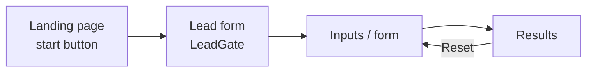
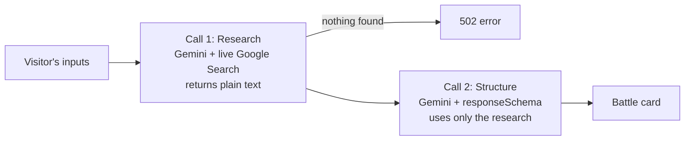
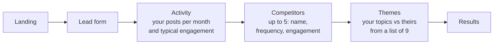

# Lead Magnet Logic (Free Tools)

<aside>
🧲

**How the 9 free tools on** [**myntmore.com/tools**](https://www.myntmore.com/resources/tools) **work, in full detail.** Each tool gives a visitor something useful in exchange for their contact details. Eight call Google Gemini (`gemini-2.5-flash`) on the server; the ROI Calculator is pure maths in the browser. Every lead lands in Zoho CRM (the main record) and in the Supabase `leads` table (a backup that also stores what the visitor typed and what the tool gave back).

**How to use this page:** read Part 1 once, because it applies to every tool. Then open only the tool you're working on in Part 2. The short summary and the add-a-new-tool checklist are in section 11 of the [Website Bible](Website%20Bible%203eb4ee2c51c1816395c4f569bc88f4f2.md).

</aside>

## 🗺️ The 9 tools at a glance

| # | Tool | Page | Backend | Lead form appears | Supabase `source` |
| --- | --- | --- | --- | --- | --- |
| 1 | ROI Calculator | `/tools/roi-calculator` | None (maths in the browser) | Only on PDF export (`LeadGateModal`) | `roi_calculator` |
| 2 | ICP Builder & Value Proposition Generator | `/tools/icp-builder` | Generic proxy `app/api/gemini` | Before the wizard | `icp_builder` |
| 3 | LinkedIn Profile Optimizer | `/tools/linkedin-optimizer` | `app/api/tools/profile-optimizer` | Before the wizard | `profile_optimizer` |
| 4 | DM Angle Generator | `/tools/dm-angle-generator` | `app/api/tools/dm-angles` (+ `/regenerate`) | Before generating | `dm_angle_generator` |
| 5 | Competitor Battle Card Generator | `/tools/battle-card-generator` | `app/api/tools/battle-card-generator` | Before the form | `battle_card_generator` ⚠️ |
| 6 | Case Study & Proposal Generator | `/tools/case-study-generator` | `app/api/tools/case-study-generator` | Before the form | `case_study_generator` ⚠️ |
| 7 | Lead Magnet Idea Generator | `/tools/lead-magnet-ideas` | `app/api/tools/lead-magnet-ideas` | Before the form | `lead_magnet_ideas` |
| 8 | Posting Rhythm Builder | `/tools/posting-rhythm-builder` | `app/api/tools/posting-rhythm` | Before the form | `posting_rhythm_builder` |
| 9 | Founder Presence Analyzer | `/tools/founder-presence-analyzer` | `app/api/tools/founder-presence` | Before the wizard | `founder_presence_analyzer` |

⚠️ = this `source` value was missing from the `leads_source_check` constraint in `supabase/schema.sql`. Both were added in Oct 2026, so every source above now saves.

---

## 🔧 Part 1 · How every tool works

**In plain English:** every tool is built the same way: a landing screen, a lead form, the tool itself, then the results. Learn this once and every tool makes sense.

### Files: where each piece lives

| File | What it does |
| --- | --- |
| `app/tools/<slug>/page.tsx` | Server-rendered page. Holds the SEO metadata and JSON-LD, then renders the tool's client component. |
| `app/tools/<slug>/*Client.tsx` | A `"use client"` state machine that owns the whole flow: which screen is showing, the data, and the API calls. |
| `components/tools/<slug>/` | The presentational pieces for that tool (inputs, result cards, charts). |
| `LandingPage.tsx` | Every tool starts on its own landing page with a "start" button, so the lead form never appears cold. |
| `components/tools/shared/LeadGate.tsx` | The shared lead form used by every tool. |
| `app/api/tools/<name>/route.ts` | The server route that calls Gemini. One per tool, except the ROI Calculator (no AI) and the ICP Builder (uses `app/api/gemini/route.ts`). |
| `lib/tools-registry.ts` | Single source of truth for each tool's name, link and tagline, plus the "Try this next" pairs. |
| `components/tools/shared/RelatedTools.tsx` | Shows the "Try this next" box at the end of each tool. |

### The flow: the screens every tool steps through

Almost every tool's client is a small step machine:



- **Reset** goes back to the form, not to the lead form, so a visitor never has to re-enter their details.
- The **ICP Builder** and **Founder Presence Analyzer** add extra wizard steps between the form and the results.
- The **ROI Calculator** is the exception: there is no gate up front, and the lead form only appears when the visitor clicks "Export Results".

### Lead capture: what happens when someone fills the form

**In plain English:** the form sends the lead to two places at once. Zoho is the main record. Supabase is a backup that also stores what the person typed and what the tool gave them.

**The form fields** (checked in the browser with `zod`)

| Field | Required? |
| --- | --- |
| First name | Yes |
| Last name | Yes |
| Designation | Yes |
| Email | Yes |
| Company | Optional |
| Phone | Optional |
| LinkedIn URL | Optional |

**On submit, two writes happen in parallel**

|  | Zoho (primary record) | Supabase (secondary record) |
| --- | --- | --- |
| How | The `<form>` is a real Zoho Forms HTML form. Its action is set per tool (`ZOHO_FORM_ACTIONS[source]`); It targets a hidden `<iframe>`, so the browser posts to Zoho without leaving the page. | Inserts a row into `leads` with the contact fields and `metadata.designation`, then calls `.select().single()` to get the row `id` back. |
| Why | Leads land in Zoho CRM with no server code, no API key and no CORS problems. | One row = one full session: who they are, what they typed, and what the AI gave them. |
| Watch out | The input names (`SingleLine`, `SingleLine1`, …, `Email`, `Website`) match Zoho's field IDs. They look meaningless, but renaming them breaks the Zoho form. | Failures are only logged with `console.error` and never block the visitor. The tool still runs. |

**Step by step**

1. The visitor submits the form. The Zoho post and the Supabase insert start at the same time.
2. The Supabase insert runs in a `Promise.all` with a 600 ms timer, so the "Saving…" state always shows for at least 600 ms and never flickers.
3. LeadGate calls `onComplete(leadData)` with the new row `id`, and the tool keeps that id.
4. After every successful generation, the tool runs `supabase.from("leads").update({ inputs, outputs }).eq("id", id)`.
5. Result: partial sessions are still captured. The contact row exists even if the visitor never generates anything.

**Which Supabase project:** the `leads` table is in the main project `gapaawxbkfmpthfesuyw` ("workupdatetracker"), not the separate lead-magnets project. Logins are on [Infrastructure, Proxies & Domains](https://app.notion.com/p/Infrastructure-Proxies-Domains-3ec4ee2c51c181998e6fd8b9ebdbe222?pvs=21).

### Server routes: the pattern every AI tool follows

**In plain English:** each AI tool has a small server function. It checks the input, asks Gemini a carefully written question, and forces the answer into a fixed shape so the page can display it.

Files: `app/api/tools/*/route.ts`

1. **Parse and validate.** Parse the JSON body, check required fields and length caps, and return `400` with a human-readable message if anything is wrong. Why: the routes are public and unauthenticated, so the caps limit prompt size and cost.
2. **Check the key.** Read `GEMINI_API_KEY`, and return `500` if it's missing.
3. **Build the prompt.** Insert the visitor's text, plus the "house rules": no jargon, no em dashes or asterisks, never invent numbers.
4. **Call Gemini.** `ai.models.generateContent({ model: "gemini-2.5-flash", config: { responseMimeType: "application/json", responseSchema } })`, using the `@google/genai` library. Why `responseSchema`: Gemini is forced to return JSON of an exact shape, so the page can show the fields directly without fragile text parsing.
5. **Return.** `JSON.parse(response.text)` and send it back. Any error that's thrown becomes a `500 { error }`.

**Two exceptions**

- **LinkedIn Profile Optimizer:** calls Gemini's REST endpoint directly, with a hand-written JSON spec in the system prompt, and pulls the JSON out of optional ```json fences.
- **ICP Builder:** builds its prompts in the browser and sends them through the generic `/api/gemini` text proxy (see tool 2 below).

### Cross-linking: the "Try this next" boxes

- `lib/tools-registry.ts` is the single source of truth for each tool's name, `href` and tagline.
- `RELATED_TOOLS` maps each tool to two hand-picked "next step" tools. `components/tools/shared/RelatedTools.tsx` shows them as "Try this next".
- The pairs follow a workflow, not the alphabet. For example: ICP Builder → DM Angles + Lead Magnets, and Profile Optimizer ↔ Founder Presence ↔ Posting Rhythm.
- **To change a pairing, edit the registry, not the individual pages.**

### Speed: heavy libraries load only when needed

Big libraries are loaded with `next/dynamic` or `import()` only when they're needed, so the tool pages stay fast.

| Library | Used for |
| --- | --- |
| `recharts` | ROI Calculator charts, Founder Presence gap chart |
| `framer-motion` | ICP Builder screens |
| `jspdf` and `html2canvas` | PDF export (loaded only when the visitor clicks "Export") |

### When something breaks: what the error means

| What you see | What it means | Where to look |
| --- | --- | --- |
| `400` with a message | A required field is missing, or the input is over its length cap | The validation at the top of that tool's `route.ts` |
| `500` and every AI tool fails | `GEMINI_API_KEY` is missing | Vercel project `myntmoreclaude` → Environment Variables |
| `500 { error }` on one tool | The Gemini call or `JSON.parse` threw an error | Vercel runtime logs for that route |
| `429` in the ICP Builder | Gemini rate limit. The proxy turns it into a friendly message | `app/api/gemini/route.ts` |
| `502` in the Battle Card Generator | The web research call came back empty | `app/api/tools/battle-card-generator` |
| Lead is in Zoho but not in Supabase | The Supabase insert failed. It's only logged, never shown to the visitor | Browser console. For a newly added tool, check its `source` is in the `leads_source_check` constraint |

---

## 🧰 Part 2 · Tool by tool

Open the tool you need. Each one follows the same order: what it does, quick facts, inputs, logic, why it's built that way, files.

### 1 · ROI Calculator

**In plain English:** a visitor plugs in their outreach numbers and sees, month by month, how many meetings and deals LinkedIn outreach could bring, the revenue, and the ROI. No AI is involved. The numbers update instantly as the sliders move.

| Page | `/tools/roi-calculator` |
| --- | --- |
| Backend | None. All the maths runs in the browser, in `RoiCalculatorClient.tsx` |
| AI | None |
| Lead form | Only when the visitor clicks "Export Results" (`LeadGateModal`) |
| Supabase source | `roi_calculator` |

**Inputs** (`components/tools/roi-calculator/CalculatorInputs.tsx`)

- Currency: USD, INR, AUD, AED, SGD, HKD, CNY, JPY or CAD. When the currency is INR, numbers use `en-IN` grouping (lakhs and crores).
- Monthly connection requests
- Duration: 1, 3, 6 or 12 months
- Acceptance %
- Reply %
- Positive-response % (default 50)
- Meeting-from-positive % (default 30)
- Closing %
- Average ticket price
- Transactions per year
- Months a customer stays
- Monthly service cost

**The maths** (in `RoiCalculatorClient.tsx`, recalculated on every render)

```
totalRequests       = round(monthlyRequests × duration)
acceptedConnections = round(totalRequests × acceptance%)
replies             = round(accepted × reply%)
positiveReplies     = round(replies × positive%)
negativeReplies     = replies − positiveReplies          // derived, not rounded separately
meetings            = round(positive × meetingRate%)
adjustedClosingRate = min(closing% + 1, 100)             // +1 point uplift
deals               = round(meetings × adjustedClosingRate%)
fullLifetimeLTV     = ticket × txPerYear × (monthsStays / 12)
effectiveLTV        = round(ticket × txPerYear × (min(duration, monthsStays) / 12))
revenue             = round(deals × effectiveLTV)
totalServiceCost    = round(monthlyCost × duration)
roi                 = cost > 0 ? round((revenue − cost) / cost × 100) : null
```

**Why the non-obvious bits work this way**

| Rule | Why |
| --- | --- |
| `negativeReplies` is worked out from `positiveReplies`, not rounded on its own | So positive and negative always add up exactly to the total replies. Rounding both separately can double-count: 3 replies at 50/50 would give 2 + 2. |
| Lifetime value (LTV) is cut down to the modelled window | A customer who stays 24 months only counts for the 12 months being modelled. Otherwise revenue would be overstated against a 12-month cost. The full-lifetime LTV is still shown for context. |
| The closing rate gets +1 percentage point | A deliberate assumption: targeted outreach produces better-qualified meetings. The page shows both the raw and the adjusted rate. |
| ROI is `null`, not 0, when cost is 0 | ROI can't be calculated with zero cost. Showing 0% would make a profitable scenario look like break-even. |

**Lead form and PDF export**

The calculator works fully without the visitor giving any details. Only "Export Results" opens `LeadGateModal`, which wraps the shared LeadGate with `source="roi_calculator"`. After the form is submitted, the Supabase row is updated with all inputs and outputs, and then the PDF is built:

1. `html2canvas` captures the results panel at 1.5× as a JPEG at 0.8 quality. Why JPEG: the content is flat-colour cards, so PNG only multiplies the file size. This took exports from tens of MB down to a few MB.
2. The panel's measured width is pinned inline before the capture. Why: its width comes from a CSS grid column that html2canvas's off-screen copy doesn't inherit. Without this, the image could be 0px wide and the PDF pages blank.
3. A black header band is drawn with the logo (loaded through an `` so its proportions are right) and a title.
4. The tall image is split across A4 pages by adding it again at increasing negative offsets, up to a maximum of 20 pages.
5. "Page X of Y" footers are drawn on a white band so they stay readable.

**Files:** `app/tools/roi-calculator/page.tsx` · `app/tools/roi-calculator/RoiCalculatorClient.tsx` · `components/tools/roi-calculator/CalculatorInputs.tsx` · `LeadGateModal`

### 2 · ICP Builder & Value Proposition Generator

**In plain English:** the most complex tool. A three-screen wizard: the visitor describes their business and picks a polished version, builds up to 6 detailed ideal-customer profiles (ICPs), then gets a value proposition for each one, plus one for referral partners. Each screen feeds the next.

| Page | `/tools/icp-builder` |
| --- | --- |
| Backend | The generic text proxy `app/api/gemini/route.ts` (not its own route) |
| AI | `gemini-2.5-flash` through the REST API, temperature 0.7, `maxOutputTokens` 16384 |
| Lead form | Before the wizard |
| Supabase source | `icp_builder` |

**How it talks to Gemini (different from every other tool)**

- The prompts are built in the browser, in `components/tools/icp-builder/lib/prompts.ts`, and sent to `app/api/gemini/route.ts`.
- That route accepts `{ prompt, systemPrompt }`, calls Gemini's REST API with temperature 0.7 and `maxOutputTokens` 16384, turns a 429 from Gemini into a friendly 429, logs when an answer gets cut off (`MAX_TOKENS`), and returns `{ result: text }`.

**The safety net in the browser** (`lib/gemini.ts`)

| Feature | What it does | Why |
| --- | --- | --- |
| Retries | `callGemini` retries 3 times, waiting 1s, then 2s, then 4s. Then it makes one last attempt with the prompt cut to 2,000 characters. | In case the failures were caused by size (timeouts or token limits) |
| No duplicate calls | Identical calls running at the same time (same prompt and system prompt) share one promise | Double-clicks or React re-renders don't fire duplicate API calls |
| Timeout | `withTimeout(…, 60_000)` wraps the two big generations | Caps the wait on the two biggest calls at 60 seconds |
| Friendly errors | `describeGeminiError` turns errors into messages for the visitor: timeout, missing key, 429 and other cases | Visitors see a clear message, not a technical error |
| Pulling out the JSON | `parseJsonArray` finds the first balanced `[...]` in the free-text answer by tracking bracket depth, ignoring brackets inside strings | A greedy regex would swallow trailing text like `consider [pricing]`, and a lazy one would cut off nested arrays |
| Clean-up | `sanitize` goes through every string in the result, removes `*` and `#`, and turns `—` into `,` | Enforces the "no markdown, no em dashes" house style even when the model ignores the instruction |

**Screen 1 · Intake**

1. The visitor types a rough description of their business.
2. After they stop typing for 900 ms, `buildOfferPolishPrompt` asks Gemini for 3 different rewrites, each covering the problem, the audience and the method, with fixed capitalisation (B2B, SaaS).
3. The visitor must pick one. Only the picked version (`resolveOffer`) is used from here on, never the raw text box.
4. `offerOptionsKey` remembers which text the options were made for, so unchanged text isn't polished again.
5. If polishing fails, the cleaned-up raw text is offered as the only option.
6. The visitor also picks **Selling to** (D2C / B2B / Both) and **Business type** (Product / Service / Hybrid).

**Screen 2 · ICP Builder**

- It starts with 3 ICP cards (`DEFAULT_ICP_COUNT`). Each card's type is forced to B2B or D2C by the "Selling to" answer. With "Both", the visitor chooses per card and can add up to 6 cards (`MAX_ICP_COUNT`).
- **B2B card:** multi-selects for roles, company sizes (in size order, deliberately not alphabetical), about 85 industries, and countries. Choosing India shows an extra free-text "cities" field.
- **D2C card:** a free-text description of the customer, which gets the same 3-rewrite polish after typing stops, based on the chosen offer.
- **Generate** calls `buildIcpPrompt`, which stacks four mandatory rule blocks:

| Rule block | What it forces |
| --- | --- |
| `NO_JARGON_RULE` | Plain English, with explicit word swaps: "use" not "leverage", "target customers" not "ICPs" |
| `PERSONALISATION_RULE` | Refer to their real company, industry, geography and offer. Nothing generic. |
| `GEO_AWARENESS_RULE` | Behaviour by region. For example: India = relationship-driven, price-sensitive, WhatsApp and LinkedIn; USA = ROI-driven, fast pace; UK = formal. It must never assume a default country. |
| `BUSINESS_TYPE_RULE` | D2C = emotional, impulse, social proof, Instagram and TikTok. B2B = several decision-makers, ROI, LinkedIn and email. |
- Each ICP is also adapted to B2B or D2C. For D2C: "who they are" describes a lifestyle instead of a job title, "core responsibilities" becomes daily routines, and "channel partners" become influencers and consumer brands.
- Each ICP comes back with **13 fields**: `name`, `audienceType`, `whoTheyAre`, `coreResponsibilities`, `painPoints` (5 to 7), `goals`, `buyingTriggers`, `objections`, `psychology`, `whereTheyHangOut`, `howToPosition`, `geographyContext` and `channelPartners` (each with a type, why they fit, and an approach angle).

**Screen 3 · Value Proposition**

- `buildValuePropPrompt` summarises each ICP (name, type, pain points, geography). It also gathers every channel partner into a 4th audience called "Channel Partners".
- **Each customer ICP gets:** a `corePromise` (15 words or fewer), before and after states, a 3-step system, why others fail, why you win, a content strategy, a short pitch, a CTA, a positioning line in the form "We help X to Y by Z" (different for each ICP), and a `coreAngle` (Authority, ROI, Speed or Trust).
- **The Channel Partners entry gets a different set:** what's in it for them, the ideal partner profile, partnership steps, why partner with us, how to approach them, and a positioning line in the form "We help [partner] give their clients [outcome] by [what we do], while they [benefit]".
- **Why the partner entry is different:** a referral partner isn't buying a transformation, so the customer before-and-after framing doesn't fit them.
- The prompt also bans phrases like "scale faster" and "improve results".

**Saving progress:** `saveProgress` updates the Supabase row after each stage (first the ICPs, then the value propositions). A visitor who leaves after the ICPs is still captured with useful data.

**Files:** `app/tools/icp-builder/page.tsx` and its `*Client.tsx` · `components/tools/icp-builder/` (including `lib/prompts.ts`) · `lib/gemini.ts` · `app/api/gemini/route.ts`

### 3 · LinkedIn Profile Optimizer

**In plain English:** the visitor pastes their LinkedIn headline and About section. They get an instant score (worked out by code, not AI) that explains what's holding the profile back, and then AI rewrites: 3 headlines, a new About section and 3 positioning one-liners.

| Page | `/tools/linkedin-optimizer` |
| --- | --- |
| Backend | `app/api/tools/profile-optimizer` (calls Gemini's REST API directly) |
| Lead form | Before the wizard. Has its own Zoho form (added Oct 2026) |
| Supabase source | `profile_optimizer` |

**Inputs**

- Current headline: up to 220 characters (LinkedIn's own limit)
- About section: up to 2,600 characters (also LinkedIn's limit)
- Role
- Target ICP: from a preset list, or "Other" plus custom text
- Up to 8 tones from a fixed list: bold, professional, casual, analytical, direct, persuasive, minimal, confident

**Layer A · the score** (in the browser, `ProfileOptimizerClient.tsx`, no AI)

Why code and not AI: the score is instant, easy to explain, and the same every time.

*Clarity score:* starts at 100 and loses points for what's missing from the headline and About section.

| Points lost | When |
| --- | --- |
| −15 | The target ICP isn't mentioned (it also checks the singular form) |
| −20 | No problem verb (help, solve, fix, reduce, automate, …) |
| −15 | No outcome signals (%, revenue, pipeline, ROI, … or any digit) |
| −15 | Vague words (passionate, journey, mission-driven, …) |
| −10 | No credibility markers (CEO, ex-, led, scaled, years, clients, …) |
- Each deduction adds a plain-English "what's holding you back" line.
- The final score is kept between 25 and 95, so nobody gets an insulting score or a perfect one.
- Verdict bands: 75 or more = strong · 55 to 74 = room to improve · below 55 = needs work.

*Keyword score:*

1. Takes the 8 most frequent words, ignoring stopwords and words of 3 letters or fewer.
2. Compares them with a keyword list for the chosen ICP (founders, CEOs, CHROs, talent leaders, RevOps, sales leaders, marketers).
3. Uses a generic list when nothing matches, including when the ICP is empty. This is guarded on purpose, because `"x".includes("")` is always true.
4. Score = matches ÷ min(5, list size), with a floor of 20. Up to 4 missing keywords are suggested.

**Layer B · the AI rewrite** (server, `app/api/tools/profile-optimizer`)

1. Checks the tones against the fixed list and checks the lengths.
2. Turns each chosen tone into a guidance sentence (`TONE_GUIDANCE`) and asks the model to blend them, preferring clarity if they conflict. With no tones it defaults to bold; `[]`, `""` and `undefined` are all treated the same.
3. The system prompt requires: no invented metrics or social proof; an About section of 120 to 150 words in 3 paragraphs; a clear ICP, problem and outcome; and never the word "founder" unless it was in the original.
4. It returns 3 headlines, the rewritten About section, and 3 positioning one-liners. The headlines:
    - **Authority:** role + ICP + outcome
    - **Problem Solver:** problem + who + how
    - **Social Proof:** "Trusted by…", reworded if the visitor gave no proof
5. The browser fills any missing field with a fallback line so the page never breaks.

**Other details**

- What the visitor typed is stored in the parent component. Why: the wizard disappears while the AI is working, so a failed generation would otherwise wipe their input.
- Results can be exported as a PDF (`ResultsSection.tsx`).

**Files:** `app/tools/linkedin-optimizer/page.tsx` · `ProfileOptimizerClient.tsx` · `ResultsSection.tsx` · `app/api/tools/profile-optimizer/route.ts`

### 4 · DM Angle Generator

**In plain English:** the visitor enters their industry, who they're targeting and what they sell. They get 5 LinkedIn DMs, each built on a different persuasion style, with a note on why each one works. They can rewrite any single DM in a different style.

| Page | `/tools/dm-angle-generator` |
| --- | --- |
| Backend | `app/api/tools/dm-angles` and `app/api/tools/dm-angles/regenerate` |
| Lead form | Before generating |
| Supabase source | `dm_angle_generator` |

**Inputs**

- Industry (up to 200 characters)
- ICP role (up to 200)
- Offer (up to 500)
- The sender's name and company come from the lead form. The prompt asks the model to work them in naturally, for example by signing off with the first name.

**Logic:** exactly 5 DMs, one per psychological framework, always in this order:

1. **Emotional:** FOMO, desire, pain relief
2. **Authority**
3. **Social Proof**
4. **Curiosity:** open loops
5. **Value-First**
- `label` is a schema enum, so the model can't invent a sixth framework.
- Each DM is 2 to 4 sentences, opens with a pattern interrupt (never "Hi [Name]"), and ends with a soft CTA.
- Each one comes with a `reasoning` field that explains why it works. This teaches the visitor instead of just handing over copy.
- The server adds a stable `id` to each angle.

**Regenerate** (`app/api/tools/dm-angles/regenerate`)

- Rewrites one angle but keeps its framework, using a style modifier: shorter (1 to 2 sentences), more formal, more direct, more friendly, or, by default, a fresh variation.
- "Regenerate all" fires the 5 calls in parallel with `Promise.allSettled`. If one fails, the other 4 are kept and the visitor is told how many failed.
- Every change saves the full set of angles to Supabase again.

**The Lovable rewrite (don't let it confuse you)**

- `next.config.js` has a `rewrites()` entry that points `/tools/dm-angle-generator(/*)` at an external Lovable app (`mynt-more-angles.lovable.app`).
- In Next.js, a plain-array `rewrites()` is an "afterFiles" rewrite: it only applies when no local page matches.
- So the local page is what shows at `/tools/dm-angle-generator`, and the rewrite only catches sub-paths. `robots.ts` blocks search engines from that subtree.

**Files:** `app/tools/dm-angle-generator/page.tsx` and its `*Client.tsx` · `components/tools/dm-angle-generator/` · `app/api/tools/dm-angles/route.ts` · `app/api/tools/dm-angles/regenerate/route.ts` · `next.config.js` (the rewrite) · `robots.ts`

### 5 · Competitor Battle Card Generator

**In plain English:** the visitor names a competitor. The tool searches the web for real information about them, then turns it into a sales battle card: what they do, their pricing, strengths, gaps, how to position against them, and how to answer objections.

| Page | `/tools/battle-card-generator` |
| --- | --- |
| Backend | `app/api/tools/battle-card-generator` |
| AI | Two `gemini-2.5-flash` calls (research, then structure) |
| Lead form | Before the form |
| Supabase source | `battle_card_generator` ⚠️ (see Known issues) |

**Inputs:** competitor name, competitor website (optional), your company name, and what you sell and to whom (up to 1,000 characters).

**Logic: a deliberate two-call pipeline**



|  | Call 1 · Research | Call 2 · Structure |
| --- | --- | --- |
| Tools | Live Google Search grounding: `tools: [{ googleSearch: {} }]` | No search. Uses `responseSchema` for strict JSON |
| Asks for | What the competitor does, public pricing, and real strengths and weaknesses reported by users | `whatTheyDo`, `pricingModel`, `strengths`, `gaps`, `howToPosition`, 3 to 4 objection and response pairs, and a `researchNote` |
| Rules | Say "not publicly available" instead of guessing, especially for pricing | Use only the research text. Strengths and gaps must come from the research, not generic clichés. Objections must be specific to your offer. `researchNote` is one sentence reminding the rep to check pricing and features before a live call |
| Returns | Plain text, because Gemini doesn't allow the search tool and a strict `responseSchema` in the same call. If it comes back empty, the route returns `502` | Structured JSON that the page shows as the battle card |

**Why two calls:** call 1 grounds the card in real web data, and call 2 gets reliable structured JSON. The "only use the research" rule stops call 2 from making up facts.

**Files:** `app/tools/battle-card-generator/page.tsx` and its `*Client.tsx` · `components/tools/battle-card-generator/` · `app/api/tools/battle-card-generator/route.ts`

### 6 · Case Study & Proposal Generator

**In plain English:** two tools in one. After the lead form, the visitor picks a mode: turn a finished project into a case study, or turn a prospect conversation into a proposal. Strict rules stop the AI from inventing numbers, quotes or prices.

| Page | `/tools/case-study-generator` |
| --- | --- |
| Backend | `app/api/tools/case-study-generator` (one route for both modes) |
| Lead form | Before the form |
| Supabase source | `case_study_generator` ⚠️ (see Known issues) |

**How the modes work:** the visitor picks a mode on the `ModeSelect` screen. The route switches on `body.mode` and returns `400` for an unknown mode.

|  | Case study | Proposal |
| --- | --- | --- |
| Inputs | Client industry, the problem, what you did, the result, and a testimonial (optional) | Prospect company, industry, the problem in their words, and the decision-maker's role. Optional: budget, how you met, past wins |
| Output | An outcome-focused headline, stats, a problem paragraph, 2 to 3 approach phases, a results paragraph, a `pullQuote`, and 2 to 4 `servicesUsed` tags | Executive summary; "understanding the challenge", which mirrors the prospect's own words; exactly 3 approach phases; why us; investment; next step; and a positioning line in the form "We help X to Y by Z" |
| Anti-making-things-up rules | A stat is allowed only if a real number appears in the result text, so it may return fewer than 3 stats, or none. `pullQuote` is `null` unless a testimonial was given (it's a nullable schema field). The phases may only restructure what the user wrote, never invent activities | "Why us" uses only the past wins provided. If none were given, it stays generic and credibility-based. "Investment" is always a fixed placeholder sentence, never a made-up price |

**Files:** `app/tools/case-study-generator/page.tsx` and its `*Client.tsx` · `components/tools/case-study-generator/` · the `ModeSelect` screen · `app/api/tools/case-study-generator/route.ts`

### 7 · Lead Magnet Idea Generator

**In plain English:** the visitor describes their business and their customer. They get 3 concrete lead magnet ideas they could actually build and use in their outreach.

| Page | `/tools/lead-magnet-ideas` |
| --- | --- |
| Backend | `app/api/tools/lead-magnet-ideas` |
| Lead form | Before the form |
| Supabase source | `lead_magnet_ideas` |

**Inputs**

- Business description (up to 1,000 characters)
- ICP (up to 300)
- Industry: a preset list, or "Other" plus custom text (up to 100)
- Tone: Authoritative, Professional & Warm, Sharp & Direct, Friendly, or Visionary

**Logic**

- Generates exactly 3 concrete, buildable lead magnets for use inside outreach: calculators, benchmarks, audits, templates, checklists, swipe files or assessments. Generic ebooks are explicitly ruled out.
- Each idea has a `title`, a `pitch` (written in the chosen tone), `whyItWorks` and `distribution`.
- `distribution` must name a specific channel and moment, for example "CTA in email 3 of a cold sequence".
- **Why:** this keeps the output tied to Myntmore's outbound use case, rather than general content-marketing advice.

**Tip:** this is the simplest route of all, so copy it as the starting template when you build a new tool.

**Files:** `app/tools/lead-magnet-ideas/page.tsx` and its `*Client.tsx` · `components/tools/lead-magnet-ideas/` · `app/api/tools/lead-magnet-ideas/route.ts`

### 8 · Posting Rhythm Builder

**In plain English:** builds a realistic LinkedIn and X posting plan around how much time the founder actually has: the best days and times, what to post on each day, a weekly routine, post ideas, hooks and CTAs.

| Page | `/tools/posting-rhythm-builder` |
| --- | --- |
| Backend | `app/api/tools/posting-rhythm` |
| Lead form | Before the form |
| Supabase source | `posting_rhythm_builder` |

**Inputs**

- Founder lifestyle: posts daily, 4 to 5 days a week, 3 days a week, weekends only, mornings only, or nights only
- Target ICP (up to 300 characters)
- One or more content strengths: Educational, Storytelling, Analytical, Contrarian, Inspirational, Humorous
- Tone
- The founder's name and company, taken from the lead form

**Logic:** one schema-constrained call returns a full LinkedIn and X operating system:

| Field | What it holds |
| --- | --- |
| `bestPostingDays` | Days, a time window and an explanation. All times are given in both IST and GMT, because the audience spans India and international markets |
| `topicCadence` | Which type of content goes on which day, plus the psychology behind the order |
| `weeklySystem` | A day-by-day routine: when to write, when to batch, when to engage |
| `postIdeas` | Post ideas, each with a category |
| `hooks` | Opening lines for posts |
| `ctas` | Calls to action |
- The prompt targets senior-leadership audiences and bans buzzwords, "cringe hooks" and conversational filler.
- The lifestyle answer is what makes the plan realistic for that person, instead of a generic "post daily".

**Files:** `app/tools/posting-rhythm-builder/page.tsx` and its `*Client.tsx` · `components/tools/posting-rhythm-builder/` · `app/api/tools/posting-rhythm/route.ts`

### 9 · Founder Presence Analyzer

**In plain English:** compares a founder's LinkedIn activity with up to 5 competitors. The score is plain maths, so it's the same every time; the AI only explains what the score means and what to do about it.

| Page | `/tools/founder-presence-analyzer` |
| --- | --- |
| Backend | `app/api/tools/founder-presence` |
| Lead form | Before the wizard |
| Supabase source | `founder_presence_analyzer` |

**The flow**



**The score** (worked out in the browser with `useMemo`)

Each answer is a range, so it's turned into a number at the middle of that range:

| Posts per month | Counts as | Typical engagement | Counts as |
| --- | --- | --- | --- |
| 0 | 0 | Under 20 | 10 |
| 1 to 2 | 1.5 | 20 to 50 | 35 |
| 3 to 5 | 4 | 50 to 100 | 75 |
| 6 to 10 | 8 | 100 to 250 | 175 |
| 10+ | 12 | 250+ | 300 |
- Competitors with an empty name are ignored. If there are none, the benchmark defaults to 8 posts a month and 150 engagement, a "typical active competitor".

```
presenceScore = clamp(0..100, (yourFreq / compAvgFreq) × 50 + (yourEng / compAvgEng) × 50)
```

- Frequency and engagement count equally, so matching the competitor average on both scores 100.
- Being ahead on one can make up for being behind on the other, up to the cap of 100.

**The AI part** (server, `app/api/tools/founder-presence`)

- The numbers are worked out in the browser and sent along with the raw answers. The route checks both again (correct types, numbers that aren't NaN) and asks Gemini to *interpret* the result, not calculate it.
- It returns: a score insight; 3 to 4 opportunity areas (frequency gaps, visibility, narrative); a narrative-positioning paragraph; and 3 headline styles (category leadership, ICP clarity, bold differentiation).
- **Why the split:** the score stays the same every time, and the AI only adds the qualitative layer.
- On the page, a `ScoreRing` and a `GapChart` (recharts, loaded only when needed) show the result.

**Files:** `app/tools/founder-presence-analyzer/page.tsx` and its `*Client.tsx` · `components/tools/founder-presence-analyzer/` · `app/api/tools/founder-presence/route.ts`

---

## ⚠️ Known issues for the free tools

| Issue | What it causes | Fix |
| --- | --- | --- |
| `battle_card_generator` and `case_study_generator` were missing from the `leads_source_check` constraint in `supabase/schema.sql` | Fixed in Oct 2026: both values were added to the live constraint, so these leads now save | Nothing to do. When you add a new tool, add its `source` to the constraint in `supabase/schema.sql` too. |
| The API routes are public and need no login | Anyone could call them directly. Only the length caps limit the cost | Accepted as is: the Zoho forms act as the gate |

Related: section 11 of the [Website Bible](Website%20Bible%203eb4ee2c51c1816395c4f569bc88f4f2.md) has the summary table and the checklist for adding a new tool.