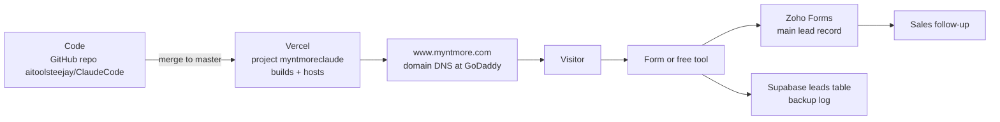
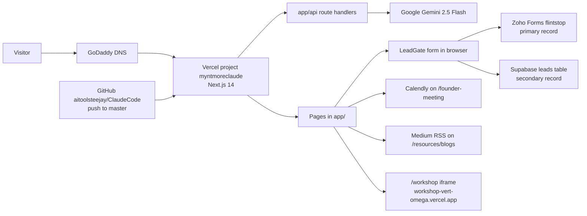

# Website Bible

<aside>
📖

**What this is:** [www.myntmore.com](http://www.myntmore.com) is Myntmore's company website. Its main job is to **get leads** (people who might become clients) through pages, free AI tools and "book a call" buttons. You (the Tech Ops intern) now own it: you keep it running, make changes and help it grow.

**Start here:** read "The website in 60 seconds", then "Most common jobs". Everything after that is reference: look things up when you need them. Grey arrows (▸) hide detail: click to open.

</aside>

<aside>
ℹ️

**About this page:** the single source of truth for the website. Last updated: September 30, 2026. Built from the repo README (aitoolsteejay/ClaudeCode), every website page in this handover, and live Vercel data.

**Rules for this page:** no secret values here (logins live in [🔐 Systems & Access](https://app.notion.com/p/7cd1a87e3e144a389f96190db58dd3c3?pvs=21)). If something is unknown, it is listed under Open questions, not guessed.

**Stale sources to ignore:** older docs that say "5 services / 6 blogs / 7 tools". Current counts are below.

</aside>

---

## ⏱️ 1. The website in 60 seconds

**In short:** people find a page, fill a form or use a free tool, and their details land in Zoho (and Supabase) so sales can follow up. The code lives on GitHub, Vercel turns it into the live site, and it is served at [www.myntmore.com](http://www.myntmore.com).

### How the website makes leads

| Step | What happens | Where / which tool |
| --- | --- | --- |
| 1. Visitor arrives | From Google, AI assistants (ChatGPT, Perplexity...), LinkedIn, cold email, events or paid ads | Any page: homepage, service, blog, case study, city page, `/lp/*` ad page |
| 2. Visitor acts | Fills a contact form, uses a free AI tool (after a short contact form called LeadGate), or books a call | Forms, `/tools/*`, `/founder-meeting` (Calendly booking) |
| 3. Lead is saved | Contact details are sent to **Zoho Forms** (the main record). Tool sessions are also logged in **Supabase** (a backup database) | Zoho ([growth@myntmore.com](mailto:growth@myntmore.com)) + Supabase `leads` table |
| 4. Sales follows up | The goal is a booked strategy call, then a client | Zoho + Calendly |

### Where the website lives



- **GitHub** holds the code (the "repo"). **Vercel** takes the code, builds the website and puts it online. **GoDaddy** points the name [myntmore.com](http://myntmore.com) at Vercel.
- The live site only changes when code is **merged into the `master` branch** on GitHub. See "Most common jobs" below.

### All key facts at a glance (URLs, IDs, stack, counts)

| Item | Value |
| --- | --- |
| Live URL | [www.myntmore.com](https://www.myntmore.com) (canonical host). `myntmore.com` 301-redirects to www. Also served at `myntmoreclaude.vercel.app`. |
| Other subdomains | `dashboard.myntmore.com` (Command Center) and `outreach.myntmore.com` (Outreach Tool) point to **other** Vercel projects, not this site. |
| Repo | [github.com/aitoolsteejay/ClaudeCode](https://github.com/aitoolsteejay/ClaudeCode) (push over SSH only) |
| Branches | `master` = production (auto-deploys). `workshop-redirect` = working branch. Merge via GitHub PR (manual). |
| Hosting | Vercel, team "aitoolsteejay's projects" (team id `team_gsSo95qOCAOfp7ZG6uQKGElO`), project `myntmoreclaude` (id `prj_vd4uktjtfBS9nfUVC2xxEAzYeIxA`), Node 24.x |
| Framework / stack | Next.js 14.2.3 (App Router) + TypeScript (strict) + Tailwind CSS 3 + shadcn/ui (Radix) + lucide-react + recharts + jspdf/html2canvas + sonner |
| AI | Google Gemini `gemini-2.5-flash` via `@google/genai` (server-side API routes) |
| Data | Supabase project `gapaawxbkfmpthfesuyw`, table `public.leads` (secondary lead log for the free tools). Menti Q&A is also Supabase-backed. **Free plan, no backups** (see Known issues). |
| Forms / CRM | Zoho Forms (org slug `flintstop`, forms owned by [growth@myntmore.com](mailto:growth@myntmore.com)) = the **primary** lead record |
| Booking | Calendly `calendly.com/founder-myntmore`, embedded only on `/founder-meeting` |
| Analytics | `@vercel/analytics` (Vercel Analytics) and **GA4** (installed on [myntmore.com](http://myntmore.com)). **GTM is not used.** Google Search Console + Bing Webmaster Tools for search; rankings are tracked in Search Console only. |
| DNS | GoDaddy (nameservers `domaincontrol.com`) |
| Owner account | Company account **aitoolsteejay** owns GitHub, Vercel and the Gemini key (confirmed 30 Sep 2026) |
| Size (README count) | ~165 routes · 7 services + DIY · 9 free AI tools · 26 blog posts · 26 case studies · 30 glossary terms · 9 `/lp` landing pages · 8 city pages · 3 unlisted pricing variants · 3 vCard pages · 5 career roles |
| Tests / CI | None. Manual gates: `npx tsc --noEmit` and `npm run build`. |
| Staging | None. Vercel preview URLs exist for non-master branches (behind Vercel login). |
| Domain scores | DA 5–8 (Moz), DR 46 (Ahrefs) |
| Latest production deploy | 30 Sep 2026, commit `b71c821` "Add Systems & AI Automation Intern role to careers" (READY) |

---

## 🧰 2. Most common jobs (step by step)

**In short:** these are the recipes you will use most. Every change follows the same path: edit on the `workshop-redirect` branch → check it builds → open a PR → merge to `master` → Vercel puts it live.

<aside>
⚠️

**Never push straight to `master`.** `master` is the live site: anything that lands there goes live automatically. Always work on `workshop-redirect`, then merge through a GitHub pull request (PR).

</aside>

<aside>
💡

**First time?** Do the one-time laptop setup in section 7 (Local development setup) before any of these jobs. Not sure a word means? See the Jargon buster (section 3).

</aside>

### Job A: Make a text change and publish it

1. In your terminal, go to the repo folder and switch to the working branch: `git checkout workshop-redirect`.
2. Find the file to edit using the "Where do I change X?" table in section 6. Example: homepage text is in `app/page.tsx` and the sections in `app/components/`.
3. Make the edit. Follow the copy rules: **no em dashes (—)**, and write proof numbers exactly as "12K+ meetings, $120M+ pipeline".
4. Start the site on your laptop with `npm run dev` and check the page at [http://localhost:3000](http://localhost:3000). Check on a phone-sized window too.
5. Run the two safety checks. Both must pass: `npx tsc --noEmit -p .` (type check) and `npm run build` (full build).
6. Save your work to Git and send it to GitHub: `git add .`, then `git commit -m "Short description"`, then `git push origin workshop-redirect`.
7. On GitHub, open a PR from `workshop-redirect` into `master` and merge it. **Nothing goes live until this is merged.**
8. In Vercel (project `myntmoreclaude` → Deployments), watch the new deployment reach **READY**.
9. Open the changed page on [www.myntmore.com](https://www.myntmore.com) and test it (forms, tools, mobile).

<aside>
💡

**"My change is not live"** is almost always an unmerged PR. Also check the Vercel build did not fail. If Git complains about `tsconfig.tsbuildinfo` during a merge, see "Merge conflict you will hit" in section 8.

</aside>

### Job B: Add a blog post

1. Copy an existing post folder to `app/blog/<new-slug>/page.tsx`. (Posts are plain code files, not a CMS.)
2. Write the post in the same structure: breadcrumb → coloured topic tag → H1 title → intro → 3-stat strip with sources → body sections → closing CTA box → `<AskYourAI>`.
3. Set the page title, description, keywords and canonical URL (`metadata`), and add Article schema (`buildArticleSchema`).
4. Link to **one free tool and one service** from the post, and link to the post from at least one existing page.
5. Add it to the blog listing on `/resources/blogs` and to `app/sitemap.ts` (with a real `lastModified` date from git).
6. Run the SEO triggered checklist (section 10), then publish with Job A. Blog drafts live in [BLOGS](https://app.notion.com/p/BLOGS-3eb4ee2c51c181129c66c1413b12e872?pvs=21).

### Job C: Add a new page (service, landing page, city, glossary term, career role, guide)

1. Decide the page type. Most pages are **a copy of an existing sibling page**: find the matching recipe in section 10 (Content model).
2. Copy the sibling folder, give it a new URL slug, and rewrite the content. Add data, do not build new UI.
3. Pick a primary keyword no other page uses (check `docs/keyword-map.md`).
4. Add the page to `app/sitemap.ts`, link it from at least one existing page, and update `public/llms.txt` if it is a service or major page.
5. Run the SEO triggered checklist (section 10), then publish with Job A.
6. After it is live, resubmit the sitemap in Google Search Console (Job E).

### Job D: Add a new free AI tool

1. Copy the simplest existing tool, **Lead Magnet Idea Generator**, as your template.
2. Follow the 8-step checklist "Add a new tool (tool #10)" in section 11: API route, client page, page file, LeadGate source, tools hub card, Supabase constraint, sitemap, dedicated Zoho form.
3. Also add it to `lib/tools-registry.ts`, `lib/tool-social-metadata.ts`, `public/llms.txt`, the keyword map and the Master Tracker.
4. Publish with Job A, then submit a test lead and confirm it lands in Zoho **and** Supabase.

### Job E: Weekly SEO and sitemap check

1. Confirm every new URL from this week is in `app/sitemap.ts`.
2. Open [www.myntmore.com/sitemap.xml](https://www.myntmore.com/sitemap.xml) on the live site and check the new URLs appear.
3. Resubmit the sitemap in Google Search Console (and Bing Webmaster Tools).
4. In Search Console, check the Pages / Coverage report for errors and fix them.
5. Do the weekly AI answer checks and other weekly tasks in section 16.

### Job F: The site is broken, what do I do?

1. **Stay calm and roll back first.** Vercel → `myntmoreclaude` → Deployments → find the last good production deployment (READY) → Instant Rollback / Promote to Production. The site is fixed in seconds.
2. **Find the cause.** Build failed? Read the Build Logs in Vercel and run `npm run build` on your laptop. A tool erroring? Check Vercel → Logs (runtime).
3. **Fix the code properly.** Run `git revert <bad-sha>` on `workshop-redirect`, open a PR and merge. Otherwise the next merge re-ships the bug.
4. **Leads missing?** Check Zoho submissions first (main record), then the Supabase `leads` table.
5. Still stuck? Use the full Troubleshooting table in section 18.

---

## 📚 3. Jargon buster

**In short:** plain-English meanings of the words used on this page. Skim it once; come back when a word is unclear.

- Open the glossary (51 terms)
    
    
    | Term | Plain meaning |
    | --- | --- |
    | **Repo (repository)** | The folder of all the website's code, stored on GitHub. Ours is `aitoolsteejay/ClaudeCode`. |
    | **Branch** | A separate copy of the code where you can work safely. `master` = the live site. `workshop-redirect` = our working branch. |
    | **Commit** | A saved snapshot of your changes, with a short message. |
    | **Push** | Sending your commits from your laptop up to GitHub. |
    | **PR (pull request)** | A request on GitHub to merge one branch into another (here: `workshop-redirect` into `master`). Merging it is what makes a change go live. |
    | **Merge / merge conflict** | Merge = combine changes. A conflict = Git cannot combine two edits to the same file on its own and asks you to choose. |
    | **Deploy / deployment** | Putting a version of the code online. Vercel does this automatically when `master` changes. |
    | **Production** | The live website real visitors see. |
    | **Preview deployment** | A private test copy Vercel builds for non-`master` branches. Needs a Vercel login to open. We have no separate staging site. |
    | **Rollback** | Switching the live site back to an earlier working deployment. |
    | **GitHub / Vercel / GoDaddy** | GitHub stores the code. Vercel builds and hosts the site. GoDaddy holds the domain name and DNS. |
    | **DNS** | The internet's address book: it points [myntmore.com](http://myntmore.com) at Vercel. |
    | **SSH / SSH key** | A secure way for your laptop to talk to GitHub. We push over SSH only (HTTPS pushes have failed). |
    | **Next.js** | The framework the site is built with (a toolkit on top of React). |
    | **TypeScript / type check** | JavaScript with extra safety checks. `npx tsc --noEmit -p .` runs those checks without building. |
    | **Build** | Turning the code into the final website files. `npm run build` does this and catches most breakage. |
    | **npm** | The tool that installs code libraries and runs commands like `npm run dev`. |
    | [**Localhost**](http://Localhost) (`localhost`) | The copy of the site running on your own laptop (e.g. [localhost:3000](http://localhost:3000)). Only you can see it. |
    | **Tailwind CSS** | A styling system where you style elements with short class names like `text-xs`. |
    | **Component** | A reusable building block of a page (e.g. Navbar, Footer, LeadGate). |
    | **Route** | A URL path on the site, like `/about-us`. In Next.js each route is a folder in `app/` with a `page.tsx`. |
    | **API route** | A server-side URL (under `app/api/`) that the browser calls to do work, like asking Gemini for tool results. Visitors never see it as a page. |
    | **Env var (environment variable)** | A setting or secret key stored outside the code (in Vercel settings or your `.env.local` file), e.g. `GEMINI_API_KEY`. |
    | **Supabase** | An online database service. We use its `leads` table as a backup log of tool sessions, and for Menti Q&A. |
    | **Database table / row** | Like a spreadsheet tab inside a database. One row = one entry (for `leads`: one tool session). |
    | **Schema (two meanings)** | 1) **Database schema**: the structure of a table (our `supabase/schema.sql`). 2) **Schema markup / JSON-LD**: hidden structured data on a page that tells Google what it is (Article, FAQ, Service...), built in `lib/schema.ts`. |
    | **RLS (Row Level Security)** | Supabase rules that decide who may read or change rows in a table. |
    | **Anon key** | The public Supabase key used in the browser. Safe to expose only if RLS rules are tight. |
    | **Zoho Forms / CRM** | Where every lead form submission is stored. The main lead record. Owned by [growth@myntmore.com](mailto:growth@myntmore.com). |
    | **LeadGate** | The short contact form visitors fill before using a free AI tool (`components/tools/shared/LeadGate.tsx`). |
    | **Gemini** | Google's AI model (`gemini-2.5-flash`) that powers the free AI tools. |
    | **Lead / lead magnet** | Lead = a potential client's contact details. Lead magnet = something free (like our AI tools) offered in exchange for them. |
    | **CTA (call to action)** | A button or link asking the visitor to act, e.g. "book a call". All booking CTAs go to `/founder-meeting`. |
    | **Redirect (301 / 308)** | Automatically sending one URL to another. Ours are permanent (308) and live in `next.config.js`. |
    | **Rewrite** | Showing content from another URL without changing the address bar (used once, for the DM Angle tool). |
    | **Sitemap (sitemap.xml)** | A list of all our pages for search engines, generated from `app/sitemap.ts`. We update it by hand. |
    | **robots.txt** | A file telling search and AI bots what they may crawl (`app/robots.ts`). |
    | **llms.txt** | A plain-text summary of the company and site for AI assistants (`public/llms.txt`). |
    | **Canonical URL** | The one official URL for a page, so Google does not see duplicates. |
    | **noindex** | A tag that hides a page from search results on purpose. |
    | **Orphan page** | A page no other page links to, so visitors and Google struggle to find it. |
    | **SEO** | Search Engine Optimisation: getting pages to rank on Google and Bing. |
    | **AEO** | Answer Engine Optimisation: getting our text picked as the direct answer (featured snippets, FAQ answers). |
    | **GEO** | Generative Engine Optimisation: getting ChatGPT, Claude, Perplexity and Gemini to mention and cite Myntmore. |
    | **E-E-A-T** | Google's quality signals: Experience, Expertise, Authoritativeness, Trust. For us: real founder credentials and consistent proof numbers. |
    | **Keyword cannibalisation / collision** | Two of our pages chasing the same keyword and competing with each other. Rule: one primary keyword per page. |
    | **Backlink / DA / DR** | Backlink = another site linking to us. DA (Moz) and DR (Ahrefs) = scores for how strong our backlinks are. |
    | **GSC (Google Search Console)** | Google's free tool to submit the sitemap and see indexing errors. Bing Webmaster Tools is the Bing version. |
    | **Core Web Vitals** | Google's speed and stability scores (LCP, INP, CLS). |
    | **Rate limiting** | Capping how often one person can call an API, to stop abuse. Our tool APIs do not have it yet. |
    | **Lovable** | A no-code app builder where older versions of some tools were made. |

---

## 🔑 4. Accounts & access needed

**In short:** you need access to GitHub, Vercel, Supabase, Zoho and Search Console to do the job. Logins are never stored here.

<aside>
⚠️

**Never paste a key or password into this page, the repo, or a chat.**

</aside>

All logins and who holds them are recorded in [🔐 Systems & Access](https://app.notion.com/p/7cd1a87e3e144a389f96190db58dd3c3?pvs=21). Domains are in [🌐 Domains](https://app.notion.com/p/cd3c49bf488e438385e7a2e375ba06fb?pvs=21).

### All services, what they are for, and the access you need

| Service | What it is used for | Account / identifier | What you need |
| --- | --- | --- | --- |
| GitHub | Source code, PRs, merges to master | Org `aitoolsteejay`, repo `ClaudeCode` | Write access + an SSH key added to your GitHub user |
| Vercel | Hosting, deploys, env vars, logs, domains, analytics | Team "aitoolsteejay's projects", project `myntmoreclaude` | Team member access (also needed to open preview URLs) |
| Supabase | `leads` table (tools), Menti Q&A | Main project `gapaawxbkfmpthfesuyw` (free plan, no backups). Standalone Profile Optimizer project `dbaxhgedupktogldzzpk`. | Dashboard access to read leads and run `supabase/schema.sql` |
| Zoho Forms / CRM | Primary lead record for every form | Org slug `flintstop`, owner [growth@myntmore.com](mailto:growth@myntmore.com) | Login to growth@ Zoho to create/edit forms and see submissions |
| Google Search Console | Sitemap submit, indexing, errors | Property for [www.myntmore.com](http://www.myntmore.com) | Owner or full user on the property |
| Bing Webmaster Tools | Sitemap submit for Bing (feeds ChatGPT search) | [www.myntmore.com](http://www.myntmore.com) | Access (checklist says set up) |
| GA4 | Visitor analytics on [myntmore.com](http://myntmore.com) (GTM is not used) | Owner of the GA4 property not confirmed (see Open questions) | Access to the GA4 property |
| Google AI Studio / Gemini | `GEMINI_API_KEY` for all AI tools | Key owned by aitoolsteejay | One fixed key, not rotated. Access to check the key and quota |
| Medium | Posts pulled onto `/resources/blogs` via RSS | [medium.com/@myntmore](https://medium.com/@myntmore) | Login to publish |
| Calendly | Founder call booking | [calendly.com/founder-myntmore](https://calendly.com/founder-myntmore) | Login to change event types / availability |
| GoDaddy | Domain registrar + DNS | [myntmore.com](http://myntmore.com) | Login to edit DNS records |
| Lovable | Old hosted tool versions (DM Angle, ROI, dummy site) | `mynt-more-angles.lovable.app`, `myntmore-roi.lovable.app`, `myntmoredummy.lovable.app` | Login (only needed while the DM Angle rewrite still points there) |
| Moz / Ahrefs / Ubersuggest | DA / DR checks (free checkers) | [moz.com/link-explorer](https://moz.com/link-explorer), [ahrefs.com/website-authority-checker](https://ahrefs.com/website-authority-checker), [neilpatel.com/ubersuggest](https://neilpatel.com/ubersuggest/) | Free accounts |

---

## 🏗️ 5. Architecture & tech stack

**In short:** the site is a Next.js app hosted on Vercel. Pages live in `app/`, AI tools call Gemini through server API routes, and leads go to Zoho (main) and Supabase (backup).

### Stack (every library and what it does)

| Layer | Choice |
| --- | --- |
| Framework | Next.js 14.2.3, App Router (`app/` directory). Only one dynamic route: `/plans/[code]`. |
| Language | TypeScript (strict). Path alias `@/*` = repo root (e.g. `@/lib/supabase`). |
| Styling | Tailwind CSS 3 **plus** inline `style={{}}` hex values for brand colours (both used side by side). All custom CSS, buttons and keyframes in `app/globals.css`. |
| Fonts | Inter (everything) + Caveat (handwritten annotations only), via `next/font/google` |
| UI primitives | shadcn/ui style in `components/ui/` (Radix: select, slider, tooltip, label, slot) |
| Icons / charts | `lucide-react` / `recharts` |
| AI | `@google/genai`, model `gemini-2.5-flash`, called only from `app/api/**/route.ts` |
| Database | `@supabase/supabase-js`, client in `lib/supabase.ts` (falls back to a placeholder project if env vars are missing, so it will not crash but will not save) |
| Validation | `zod` in forms (LeadGate). API routes validate by hand. |
| PDF export | `jspdf`  • `html2canvas` |
| Toasts | `sonner` |
| Analytics | `@vercel/analytics`, plus GA4 on [myntmore.com](http://myntmore.com) (no GTM) |
| Routing config | All redirects/rewrites and image formats (AVIF first, WebP fallback) live in `next.config.js`. No `vercel.json`. |
| Package manager | npm (`package-lock.json` committed) |

### How the pieces connect



### Request flow for a free AI tool

1. Visitor opens `/tools/<slug>` (server `page.tsx` renders `InnerLayout` + a `*Client.tsx`).
2. Client shows a landing section, then `LeadGate` (contact form).
3. On submit: hidden-iframe POST to the tool's Zoho form **and** a Supabase `leads` insert (row `id` returned).
4. Visitor fills the tool inputs. Client calls `POST /api/tools/<slug>`.
5. The route validates input, calls Gemini with a strict JSON `responseSchema`, returns JSON.
6. Client renders results and runs `supabase.from("leads").update({ inputs, outputs }).eq("id", leadData.id)`.

### Two component folders (not a mistake)

- `app/components/` = page-building blocks used sitewide (Navbar, Footer, Hero, FadeIn, StatTicker, InnerLayout, JsonLd, Breadcrumbs, LeadCaptureForm, AskYourAI, CopyBlock...). High blast radius.
- `components/` (top level) = tool UIs (`components/tools/*`), shadcn `ui/`, `pricing/`, `glossary/`, `case-studies/`. The tools were once separate projects and kept their own folder. If you cannot find something in one, check the other.

---

## 📁 6. Repository structure

**In short:** most of what you edit is in `app/` (pages), `app/components/` and `components/` (building blocks) and `lib/` (shared data). Use the "Where do I change X?" table to find the right file fast.

### Where do I change X?

| I want to change... | Edit this |
| --- | --- |
| Top navigation / megamenus | `app/components/Navbar.tsx` (`SERVICE_LINKS`, `RESOURCE_LINKS`, `NAV_LINKS` arrays at the top) |
| Footer | `app/components/Footer.tsx` |
| Homepage sections | `app/page.tsx`  • `app/components/` (`Hero`, `Services`, `Industries`, `WhoWeHelp`, `Testimonials`, `Results`, `CTABanner`, `LogoStrip`, `BenefitsMarquee`, `HowItWorks`, `SystemFlow`) |
| Site-wide default title/description/keywords | `app/layout.tsx` |
| A redirect | `next.config.js` `redirects()` (always `permanent: true`) |
| sitemap.xml / robots.txt | `app/sitemap.ts` / `app/robots.ts` |
| AI-readable site summary | `public/llms.txt` |
| A tool's name/URL/tagline everywhere | `lib/tools-registry.ts` |
| Free-tools hub cards | `app/resources/tools/page.tsx` (`FREE_TOOLS` array) |
| Which Zoho form a tool posts to | `components/tools/shared/LeadGate.tsx` (`ZOHO_FORM_ACTIONS`) |
| A tool's AI prompt | `app/api/tools/<tool>/route.ts` (ICP Builder: `components/tools/icp-builder/lib/prompts.ts`) |
| Pricing numbers or a new plan code | `PLANS` record in `app/plans/[code]/page.tsx` |
| Calendly embed | `app/founder-meeting/FounderMeetingClient.tsx` |
| Medium feed | `app/resources/blogs/page.tsx` |
| Accent colour rotation | `app/components/Industries.tsx` (canonical 6-colour list) |
| Events list / popup | `lib/events-data.ts`, `app/components/EventPopup.tsx` |

### Full folder tree

```
ClaudeCode/
  app/                        Next.js App Router, one folder per route (page.tsx + optional *Client.tsx)
    api/                      Server route handlers (Gemini tools, Menti, vCards)
      gemini/route.ts         Generic Gemini proxy (used only by ICP Builder) - NO AUTH
      tools/<tool>/route.ts   One per gated AI tool (dm-angles also has regenerate/route.ts)
      menti/{auth,reset,gist}/route.ts
      vcard/{tejas-jhaveri,jahnvi-jhaveri,enwil-fernandes}/route.ts
    components/               Sitewide shared components (Navbar, Footer, Hero, FadeIn, StatTicker...)
    tools/<slug>/             The 9 free tool pages (+ *Client.tsx)
    blog/<slug>/              26 blog posts (static JSX, not MDX)
    case-studies/             Index (CaseStudiesClient.tsx) + 26 case study pages
    careers/                  Listing (ROLES array) + one folder per role
    services/                 Index + 7 services + do-it-yourself
    lp/<vertical>/            9 paid-traffic landing pages (page.tsx + *Client.tsx, own LpLayout)
    resources/                Hub, blogs, tools, feed, guides/, glossary/<term>
    plans/[code]/page.tsx     The only dynamic route (PLANS record -> pricing variants)
    instagram-resources/      Social bio-link guides
    menti/, menti/room/       Live Q&A tool
    layout.tsx                Root layout: fonts, <Toaster/>, site-wide default metadata + keywords
    page.tsx                  Homepage
    globals.css               Colour tokens, .btn-dark/.btn-ghost, .card-hover-*, all keyframes, reduced-motion guards
    sitemap.ts                Generates sitemap.xml (manual list, real lastModified from git log)
    robots.ts                 Generates robots.txt
    not-found.tsx             Custom 404
  components/
    ui/                       shadcn/ui primitives
    tools/<tool>/             Each tool's UI pieces (LandingPage, forms, results)
    tools/shared/             LeadGate.tsx, RelatedTools
    pricing/                  GrowthPlansPricing.tsx (all /plans/* pages)
    glossary/                 GlossaryTerm.tsx (all 30 glossary pages)
    case-studies/             Shared case study chrome
  lib/
    schema.ts                 JSON-LD builders (buildFaqSchema, buildServiceSchema, buildArticleSchema...)
    tools-registry.ts         Single source of truth for the 9 tools (slug/name/href/tagline)
    faq-data.ts               Shared FAQ content
    events-data.ts            Data for /events + UpcomingEvents
    tool-social-metadata.ts   OG/social metadata for tools
    mentiAuth.ts              Password auth for /menti/room
    supabase.ts               Supabase client
    utils.ts                  cn() class merge helper
  public/                     Logos, client logos, photos, videos, llms.txt
  supabase/schema.sql         The leads table (idempotent, safe to re-run)
  docs/                       SEO ops docs: seo-aeo-geo-cadence.md, keyword-map.md, content-gaps.md, featured-snippet-audit.md
  .claude/skills/             Claude Code skills: frontend-design, design-motion-principles, apple-design
  next.config.js              Redirects (308), image formats
  tsconfig.tsbuildinfo        Committed build cache (causes merge conflicts, see Deploying)
  README.md                   Current, accurate
  HANDOFF.md                  RETIRED (Oct 2026), use this Bible
```

---

## 💻 7. Local development setup

**In short:** clone the repo over SSH, add a `.env.local` file with the 4 env var names, run `npm install`, then `npm run dev` to see the site on your laptop.

### One-time setup

1. Get GitHub write access to `aitoolsteejay/ClaudeCode` and add your SSH key to GitHub.
2. Clone over SSH (HTTPS pushes have failed before):
    
    ```bash
    git clone git@github.com:aitoolsteejay/ClaudeCode.git
    cd ClaudeCode
    git checkout workshop-redirect
    npm install
    ```
    
3. Create `.env.local` in the repo root (no `.env.example` is committed). Copy values from Vercel project settings or the password vault, never from chat:
    
    ```
    NEXT_PUBLIC_SUPABASE_URL=
    NEXT_PUBLIC_SUPABASE_ANON_KEY=
    GEMINI_API_KEY=
    MENTI_ADMIN_PASSWORD=
    ```
    
4. Confirm the remote is SSH: `git remote -v` should show `git@github.com:...`. If not: `git remote set-url origin git@github.com:aitoolsteejay/ClaudeCode.git`.

<aside>
⚠️

Copy env values from Vercel project settings or the password vault, **never from chat**.

</aside>

### Everyday commands

| Command | What it does |
| --- | --- |
| `npm run dev` | Dev server on [http://localhost:3000](http://localhost:3000) (3100 in the project's Claude tooling) |
| `npx tsc --noEmit -p .` | Type check. Run before every commit. |
| `npm run build` | Full production build. Catches most real breakage. Run before every push. |
| `npm run start` | Serve the production build locally |
| Lint / tests | None configured |

### What works without env vars

- Pages render. `lib/supabase.ts` uses a placeholder project, so lead saves silently do nothing.
- Every Gemini tool returns `GEMINI_API_KEY is not configured` (HTTP 500).

### Dev server gotchas

- **`.next` cache corruption** (build and dev touching the same `.next`): `rm -rf .next` and restart.
- **Zombie `next dev`** still bound to the port, serving old code: `lsof -nP -iTCP:3100 -sTCP:LISTEN` then `kill -9 <pid>`. Suspect this first for any "impossible" build error.

---

## 🚢 8. Deploying

**In short:** work on `workshop-redirect`, pass the two checks, push, merge a PR into `master`, and Vercel puts it live. If a deploy breaks the site, roll back in Vercel first, then fix.

### The workflow

1. Work on `workshop-redirect` (named after the `/workshop` page, but used for everything).
2. Before committing: `npx tsc --noEmit -p .` and `npm run build` must both pass.
3. Commit and `git push origin workshop-redirect` (SSH).
4. On GitHub, open a PR `workshop-redirect` into `master` and merge it. **This is manual. Nothing goes live until it is merged.**
5. Vercel auto-builds `master` and promotes it to production ([www.myntmore.com](http://www.myntmore.com)). Watch the deployment reach READY.
6. Open the changed pages on the live site and test (forms, tools, mobile).
7. If you added or changed pages: follow the SEO triggered checklist (section 13) and resubmit the sitemap.

<aside>
⚠️

**"My change is not live"** is almost always an unmerged PR. Compare `git log --oneline origin/master -5` with `git log --oneline -5` on `workshop-redirect`.

</aside>

### Merge conflict you will hit

`tsconfig.tsbuildinfo` (committed build cache) conflicts almost every merge. Safe fix:

```bash
rm tsconfig.tsbuildinfo && npx tsc --noEmit -p .
git add tsconfig.tsbuildinfo && git commit
```

### Previews, staging, env vars

- **No staging.** Pushing a non-master branch creates a Vercel preview deployment. Previews are behind Vercel SSO (protection is on for all deployments except custom domains), so you must be logged into the Vercel team to open them.
- **Env vars** are set in Vercel → project `myntmoreclaude` → Settings → Environment Variables. Names: `NEXT_PUBLIC_SUPABASE_URL`, `NEXT_PUBLIC_SUPABASE_ANON_KEY`, `GEMINI_API_KEY`, `MENTI_ADMIN_PASSWORD`. After changing one, **redeploy** or it will not take effect.

### Rollback

1. Vercel → `myntmoreclaude` → Deployments.
2. Find the last good production deployment (state READY, "rollback candidate").
3. Use Instant Rollback / Promote to Production on it. The site switches in seconds.
4. Then fix the code properly: `git revert <bad-sha>` on a branch, PR, merge. Otherwise the next master push re-ships the bug.

### Checking logs

- **Build failed:** Vercel → Deployments → the failed deployment → Build Logs. Reproduce locally with `npm run build`.
- **Tool errors in production:** Vercel → project → Logs (runtime). API routes log lines like `Error in dm-angles route:`, `Error in lead-magnet-ideas route:`, `Error in founder-presence route:`, `Error in case-study-generator route:`.
- **Leads missing:** check Zoho submissions first (primary), then the Supabase `leads` table.

### Recent production deploys (snapshot 30 Sep 2026)

| Commit | Change |
| --- | --- |
| `b71c821` | Add Systems & AI Automation Intern role to careers (`/careers/systems-ai-automation-intern`, own 3-step apply flow: Loom + resume + one-line question) |
| `26feff9` | Revamp the Resources hub and all 5 resource-type pages |
| `eac0e69` | Update pricing page tooltip copy for 3 rows |
| `5cf0122` | Add a third pricing plan variant `/plans/neptune` |
| `5cd4270` | Rename plan codes alpha/beta to mars/earth, with permanent redirects from old URLs |

---

## 🗺️ 9. Full site map

**In short:** every page on the site, grouped by type. Open a group to see its URLs and notes.

Legend: **noindex** = hidden from search on purpose. **Orphan** = not linked internally yet (open SEO item).

### Marketing & company pages

| Route | Purpose / notes |
| --- | --- |
| `/` | Homepage (`app/page.tsx`). Has the AskYourAI widget. |
| `/about-us` | About, Tejas Jhaveri bio and credentials. `/about` redirects here. |
| `/contact-us` | Contact form (Zoho). `/contact` redirects here. |
| `/founder-meeting` | Calendly embed. **Every "book a call" CTA must link here.** noindex. |
| `/1-on-1-consultation` | SEO-targeted booking page (keywords: 1 to 1 consultation, gtm audit). Orphan. |
| `/careers` | Careers listing, driven by a `ROLES` array |
| `/careers/senior-sales-head`, `/careers/lead-gen-strategist`, `/careers/gtm-strategist`, `/careers/hr-operations-intern`, `/careers/systems-ai-automation-intern` | Role pages (JobPosting schema). The last one was added 30 Sep 2026 with its own apply flow. |
| `/events` | Events list (`lib/events-data.ts`) |
| `/who-this-is-for`, `/how-to-choose-an-outbound-agency`, `/myntmore-framework`, `/dos-and-donts-of-outreach`, `/agency-vs-in-house` | Positioning / comparison content pages |
| `/careers-and-job-guide`, `/education-guide` | Long-form guides for students / early career (in `llms.txt`) |
| `/newsletter-subscribe` | Newsletter signup (signups go to Zoho) |
| `/feedback` | Full-page iframe of a Zoho feedback form. Orphan. |
| `/thank-you` and `/thankyou` | **Both exist.** Post-conversion pages (`/thankyou` is noindex, post-booking). Check links before deleting either. |
| `/privacy-policy` | Privacy policy |
| `/sitemap` | Human-readable HTML sitemap (different from `/sitemap.xml`) |
| 404 | `app/not-found.tsx` (real 404 status) |

### Services

| Route | Service |
| --- | --- |
| `/services` | Index of the 7 services |
| `/services/linkedin-outreach` | LinkedIn Outreach & Automation |
| `/services/cold-email` | Cold Email Infrastructure |
| `/services/sales-intelligence` | ICP Mapping & Lead Scoring (Sales Intelligence) |
| `/services/ai-lead-generation` | AI Lead Generation |
| `/services/personal-branding` | Personal Branding (`/personal-branding` redirects here) |
| `/services/<abm slug>` | Account-Based Marketing (exact slug not in sources) |
| `/services/<gtm slug>` | GTM Strategy (exact slug not in sources; uses honest "new, no data yet" framing) |
| `/services/do-it-yourself` | DIY variant |
| `/marketing-automation`, `/seo` | Adjacent services, standalone SEO pages (real content). Orphans. |

### Vertical landing pages (`/lp/*`, paid traffic, not in nav)

`/lp/agencies-it` · `/lp/agency-partners` · `/lp/financial-services` · `/lp/fundraising` · `/lp/insurance` · `/lp/manufacturers-exporters` · `/lp/pharma` · `/lp/recruitment-firms` · `/lp/saas-founders`

- Each is `page.tsx` + `*Client.tsx`, own `LpLayout` (not `InnerLayout`), own `Faq` and `FlowDiagram`.
- Same 9 verticals as the case studies. `saas-founders` and `manufacturers-exporters` intentionally use Indian example names.

### City pages (`/b2b-lead-generation-{city}`)

Mumbai · Delhi · Bengaluru · Pune · Hyderabad · Chennai · Kolkata · Ahmedabad

- Shared structure, `LocalBusiness` schema, FAQs. Local-market context only. **Not offices:** copy must say Myntmore serves all of India from Mumbai.

### Content (blog, resources, case studies, guides)

| Route | What / count |
| --- | --- |
| `/blog/<slug>` | 26 posts, each its own `page.tsx`. Includes `/blog/b2b-outbound-benchmark-report-2026` (evergreen, refresh periodically). |
| `/resources` | Resources hub (revamped 30 Sep 2026) |
| `/resources/blogs` | Blog listing + live "Also on Medium" section |
| `/resources/tools` | Free tools hub (`FREE_TOOLS` array) |
| `/resources/feed` | Feed hub |
| `/resources/guides/<slug>` | Long-form guides (`GuideTemplate.tsx`), plus bespoke `ai-tech-stack-jewellery` (106 tools, 14 categories) |
| `/resources/glossary/<term>` | 30 terms, all rendered by `components/glossary/GlossaryTerm.tsx` |
| `/case-studies` | Index (`CaseStudiesClient.tsx`, has AskYourAI) |
| `/case-studies/<slug>` | 26 real client case studies across the 9 verticals (e.g. 5 pharma: India/USA/UAE/Singapore/France) |
| `/GIAtech-stack` | Curated directory of 106 AI tools for jewellery businesses (SEO play). Orphan. |
| `/instagram-resources`, `/instagram-resources/claude-skills-guide` | Instagram bio-link pages (not in nav). Claude Skills Guide uses `CopyBlock`. |

### Free AI tools (`/tools/*`) - details in section 11

`/tools/roi-calculator` · `/tools/icp-builder` · `/tools/linkedin-optimizer` · `/tools/dm-angle-generator` · `/tools/battle-card-generator` · `/tools/case-study-generator` · `/tools/lead-magnet-ideas` · `/tools/posting-rhythm-builder` · `/tools/founder-presence-analyzer`

### Pricing (unlisted: noindex, not in nav/footer/sitemap)

| Route | What |
| --- | --- |
| `/plans/mars` | USD / international pricing |
| `/plans/earth` | INR / Indian pricing |
| `/plans/neptune` | Third USD variant (Starter $1,999, Growth $2,799, Lead Generation $2,499, Cold Email $2,600, Automation Tool $199) |
| `/plans/alpha`, `/plans/beta`, `/international-pricing`, `/indian-pricing` | Old URLs, permanently redirect to the new codes |

All share `components/pricing/GrowthPlansPricing.tsx` (props `currencyPrefix`, `currencySuffix`, `prices`). Add a variant by adding a key to `PLANS` in `app/plans/[code]/page.tsx`. **Never create a new pricing page.** The README still says alpha/beta; that is out of date.

### Standalone micro-sites

| Route | What |
| --- | --- |
| `/menti`, `/menti/room` | Live Mentimeter-style Q&A/polls for events (Supabase). Admin gated by `MENTI_ADMIN_PASSWORD` via `lib/mentiAuth.ts`; APIs `app/api/menti/{auth,reset,gist}`. |
| `/tejasjhaveri`, `/jahnvijhaveri`, `/enwilfernandes` | Digital business cards. Each pairs with `app/api/vcard/<name>/route.ts` serving a `.vcf` with the right content type (so "Add to Contacts" works on phones). |
| `/workshop` | Full-page iframe of the Workshop app (`workshop-vert-omega.vercel.app`). noindex. Orphan. |

### API routes (`app/api/`)

| Route | Used by |
| --- | --- |
| `POST /api/gemini` | ICP Builder only (generic proxy, no auth) |
| `POST /api/tools/dm-angles`  • `/regenerate` | DM Angle Generator |
| `POST /api/tools/battle-card-generator` | Battle Card Generator |
| `POST /api/tools/case-study-generator` | Case Study & Proposal Generator |
| `POST /api/tools/founder-presence` | Founder Presence Analyzer |
| `POST /api/tools/lead-magnet-ideas` | Lead Magnet Idea Generator |
| `POST /api/tools/profile-optimizer` | LinkedIn Profile Optimizer |
| `POST /api/tools/posting-rhythm` | Posting Rhythm Builder |
| `/api/menti/{auth,reset,gist}` | Menti admin |
| `/api/vcard/{tejas-jhaveri,jahnvi-jhaveri,enwil-fernandes}` | vCard downloads |

### Redirects & rewrites (`next.config.js`)

- All redirects `permanent: true` (real 308). Never use `next/navigation` `redirect()` for SEO redirects (it always sends 307).
- Groups: legacy renamed paths (`/about`, `/contact`, `/personal-branding`), retired roles/pages, legacy WordPress URLs from the old site, pricing code renames.
- Deliberately **not** redirected: discontinued services `/cro`, `/sem`, `/web-development` (pointing them at `/services` would look like a soft 404).
- The old Lovable rewrite for `/tools/dm-angle-generator` is no longer in effect: the live URL shows the new built-in page (confirmed 30 Sep 2026). If a leftover `rewrites()` rule or the `robots.ts` disallow for `/tools/dm-angle-generator/` is still in the code, it is safe to tidy up.

---

## ✍️ 10. Content model & how to add each content type

**In short:** most page types are one shared template plus data. To add a page, copy a sibling and change the content, then run the SEO triggered checklist below.

The site is a **content system**: many page types are one shared component + data. Add data, not new UI. Every item below ends with the **SEO triggered checklist** (next box).

<aside>
✅

**SEO triggered checklist (run on every page add or change)** - from `docs/seo-aeo-geo-cadence.md`

- [ ]  Pick a primary keyword not used by any other page (`docs/keyword-map.md`, zero collisions rule) and add it to the map
- [ ]  Title under ~60 characters including the automatic "| Myntmore" suffix; meta description under ~155 characters with a CTA; exactly one H1
- [ ]  Canonical URL set; schema from `lib/schema.ts` that fits (Article, FAQ, Service, HowTo, DefinedTerm, JobPosting, Breadcrumb, WebApplication, LocalBusiness, Event)
- [ ]  `<Breadcrumbs>` added (emits BreadcrumbList JSON-LD)
- [ ]  Entry in `app/sitemap.ts` with a real `lastModified` (from `git log -1 --format=%aI -- <path>`, never "now")
- [ ]  Linked from at least one existing page, and links out (bidirectional). Blogs link to one tool and one service.
- [ ]  FAQ answers snippet-formatted: 40-60 words, direct claim first, no hedge openers
- [ ]  `public/llms.txt` updated if a service, major page or URL changed
- [ ]  No fabricated numbers; no em dashes; mobile grid stacks (`grid-cols-1` base); tables wrapped in `overflow-x-auto`
- [ ]  `npx tsc --noEmit -p .` + `npm run build` pass; after deploy, resubmit sitemap in Search Console
</aside>

### Blog post

1. Copy an existing post folder: `app/blog/<new-slug>/page.tsx` (static JSX server component, not MDX).
2. Structure: breadcrumb → coloured topic tag (e.g. "LinkedIn Outreach · 6 min read") → H1 → intro → 3-stat strip with sources (`grid-cols-1 sm:grid-cols-3`) → body sections (array of `{heading, body}` or `{heading, list}`) → closing CTA box → `<AskYourAI>`.
3. Set `metadata` (title, description, keywords, canonical) and Article schema (`buildArticleSchema`).
4. Pick a tag colour from the accent rotation not used by neighbours.
5. Add it to the blog listing on `/resources/blogs` (check how the list is built in `app/resources/blogs/page.tsx`).
6. Run the SEO checklist. Drafts live in [BLOGS](https://app.notion.com/p/BLOGS-3eb4ee2c51c181129c66c1413b12e872?pvs=21).

### Case study

1. Copy an existing `app/case-studies/<slug>/page.tsx` (uses shared chrome in `components/case-studies/`).
2. Fill the `stats` array (rendered with `<StatTicker>`); pass pre-formatted strings like `"$1.2M"` or `"1,74,999"`.
3. **Real client results only.** No invented numbers or quotes.
4. Add it to the index (`app/case-studies/CaseStudiesClient.tsx`) under the right vertical, and link it from the matching `/lp/*` page.
5. SEO checklist.

### Service page

1. Create `app/services/<slug>/page.tsx` by copying a sibling.
2. Add Service schema, HowTo schema on the "how it works" section, FAQ schema.
3. Add to `SERVICE_LINKS` in `Navbar.tsx`, the `/services` index, the footer if relevant, and `public/llms.txt`.
4. Make sure its primary keyword does not collide with a `/lp/*` page.
5. SEO checklist.

### Landing page (`/lp/*`)

1. Copy an existing vertical folder: `page.tsx` + `*Client.tsx`, `LpLayout`, `Faq`, `FlowDiagram`.
2. Rewrite hero, stat strip, CTA for the vertical. CTAs go to `/founder-meeting`.
3. Link the matching case studies. Keep it out of the main nav.
4. SEO checklist (watch cannibalisation with `/services/*`).

### City page

1. Copy an existing `app/b2b-lead-generation-<city>/page.tsx`.
2. Change the city-specific industry context and FAQs. Keep `LocalBusiness` schema (buildLocalBusinessSchema).
3. Keep the "we serve all of India from Mumbai, no local office" wording.
4. Add to `llms.txt` locations list and the sitemap.

### Glossary term

1. Create `app/resources/glossary/<term>/page.tsx` rendering `<GlossaryTerm ... />` with the term's content as props/data.
2. **Extend `GlossaryTerm.tsx` or its data. Never fork it.**
3. Use `buildDefinedTermSchema`. Link it from related blogs.

### Career role

1. Add an entry to the `ROLES` array in `app/careers/page.tsx`.
2. Create `app/careers/<slug>/page.tsx`: breadcrumb → role tag → H1 → 4-item quick facts (Location / Type / CTC...) → Apply Now → About → What You'll Do → Who You Are → Skills checklist → Why Join → "Our values" grid → closing CTA.
3. JobPosting schema (`buildJobPostingSchema`) + sitemap entry.

### Pricing variant

Add a key to `PLANS` in `app/plans/[code]/page.tsx`. Keep it noindex and out of nav/sitemap.

### Guide

Use `GuideTemplate.tsx` under `app/resources/guides/<slug>/`. Question-phrased section headers help AEO.

### Free tool

See the 8-step checklist in section 11.

---

## 🤖 11. Free AI tools (lead magnets)

**In short:** 9 free tools give visitors something useful in exchange for their contact details. 8 use Gemini AI; the ROI Calculator is pure maths. All gated tools use LeadGate, which sends the lead to Zoho and Supabase. **Full step-by-step logic for every tool (inputs, maths, prompts and why):** [Lead Magnet Logic (Free Tools)](Lead%20Magnet%20Logic%20(Free%20Tools)%203ec4ee2c51c181ddb8a5f14259886650.md).

All 9 are marked "Complete and In Use" in [MASTER TRACKER](https://app.notion.com/p/MASTER-TRACKER-3eb4ee2c51c1814ea6eac3b964f033e7?pvs=21). Hub page: [myntmore.com/resources/tools](https://www.myntmore.com/resources/tools). Registry: `lib/tools-registry.ts` (feeds the "Try this next" cross-links). Per-tool manuals: [LEAD MAGNETS ON THE WEBSITE](LEAD%20MAGNETS%20ON%20THE%20WEBSITE%203eb4ee2c51c181d19faee4c3263060cd.md).

### Tool table (route, how it works, AI, form, known issues)

| Tool | Route / API | How it works | AI | Zoho form / LeadGate source | Notes & known issues |
| --- | --- | --- | --- | --- | --- |
| ROI Calculator | `/tools/roi-calculator` · no API | Pure client-side funnel maths: requests → accepted → replies → positive → meetings → deals → revenue, ROI, LTV vs effective LTV. PDF export (html2canvas + jspdf). Currencies incl. INR (lakh grouping). | None | Gate only on "Export Results" (`LeadGateModal`) · `roi_calculator`. Zoho form in growth@. | Adds a deliberate **+1 point** to the closing rate (`adjustedClosingRate`); the UI shows both the raw and adjusted rate. Bundle ~514kB. Standalone origin repo `aitoolsteejay/roi-calculator` (Lovable, `myntmore-roi.lovable.app`). |
| ICP Builder & Value Proposition Generator | `/tools/icp-builder` · `POST /api/gemini` | 3 screens: Intake → ICP Builder (up to 6 B2B/D2C ICPs with channel partners) → Value Prop. Prompts built client-side in `components/tools/icp-builder/lib/prompts.ts`. | gemini-2.5-flash via raw REST, temp 0.7, maxOutputTokens 16384. No JSON schema; the JSON is pulled out by `parseJsonArray`, which tracks bracket depth (not a regex). | `ICPbuilder` · `icp_builder` | Only tool with retries (1s, 2s, 4s + truncated fallback), in-flight dedup, 60s timeout, `sanitize()` strips em dashes. **`/api/gemini` is an open, unauthenticated proxy.** Saves progress after each step. |
| LinkedIn Profile Optimizer | `/tools/linkedin-optimizer` · `POST /api/tools/profile-optimizer` | Paste headline + About, role, ICP, tone. Returns clarity score, 3 headlines, rewritten About, positioning angles, keyword/ICP analysis, PDF. | gemini-2.5-flash | Its own Zoho form (added Oct 2026) · `profile_optimizer` | Standalone version: repo `aitoolsteejay/profile-optimizer`, Supabase `dbaxhgedupktogldzzpk`, edge function `optimize-profile` (10 req/hr per IP), unused `scrape-linkedin` (Firecrawl). |
| DM Angle Generator | `/tools/dm-angle-generator` · `POST /api/tools/dm-angles`  • `/regenerate` | Industry + ICP role + offer → 5 angles (Emotional, Authority, Social Proof, Curiosity, Value-First). Regenerate styles: shorter, more formal, more direct, more friendly. | gemini-2.5-flash, JSON schema | `DMAngleGenerator` · `dm_angle_generator` | Live URL shows the new built-in page (the old Lovable rewrite issue is resolved, 30 Sep 2026). Limits: industry/role 200 chars, offer 500. |
| Competitor Battle Card Generator | `/tools/battle-card-generator` · `POST /api/tools/battle-card-generator` | Competitor name/site + your company + offer. Call 1: live Google Search grounding (plain text). Call 2: structure into a battle card (JSON). | gemini-2.5-flash x2 (`tools: [{ googleSearch: {} }]`) | `Battlecardgenerator` · `battle_card_generator` | Returns 502 if research is empty. No citations shown. `battle_card_generator` is in the Supabase check constraint (fixed Oct 2026). |
| Case Study & Proposal Generator | `/tools/case-study-generator` · `POST /api/tools/case-study-generator` | Mode `case_study` or `proposal`. Turns project notes into a case study, or a prospect conversation into a proposal. | gemini-2.5-flash, JSON schema per mode | `CaseStudyGenerator` · `case_study_generator` | Prompt forbids invented numbers/quotes; investment is a fixed placeholder line. Limits 200/1000 chars. `case_study_generator` is in the Supabase check constraint (fixed Oct 2026). |
| Lead Magnet Idea Generator | `/tools/lead-magnet-ideas` · `POST /api/tools/lead-magnet-ideas` | Business, ICP, industry, tone → 3 ideas (title, pitch, whyItWorks, distribution). | gemini-2.5-flash, JSON schema | dedicated form · `lead_magnet_ideas` | Best simple template to copy for a new tool. Limits 1000/300/100/100. |
| Posting Rhythm Builder | `/tools/posting-rhythm-builder` · `POST /api/tools/posting-rhythm` | Lifestyle, tone, ICP, content strengths → best days/times (IST + GMT), cadence, weekly system, ideas, hooks, CTAs. | gemini-2.5-flash, JSON schema | dedicated form · `posting_rhythm_builder` | Standalone origin in a **personal** repo `sanyamg1305/posting-rhythm-builder` (deploy repo `aitoolsteejay/posting-rhtyhem`, `posting-rhythm-builder.vercel.app`). Move to aitoolsteejay. |
| Founder Presence Analyzer | `/tools/founder-presence-analyzer` · `POST /api/tools/founder-presence` | You vs up to 5 competitors on posting frequency + engagement. Score computed client-side (`freqRatio*50 + engRatio*50`); AI writes the narrative + 3 headline styles. | gemini-2.5-flash, JSON schema | `FounderPresence` · `founder_presence_analyzer` | Gap chart via recharts, score ring via SVG. Old standalone: `founder-competitive-presence-analyz.vercel.app`. |

Shared facts for all gated tools: Supabase table `leads` in project `gapaawxbkfmpthfesuyw`; no rate limiting and no retries (except ICP Builder); errors surface as sonner toasts; user must click again. The Gemini key did **not** expire on 20 May 2026 (the date in the Master Tracker); the tools still work (confirmed 30 Sep 2026).

Not on the website: **Campaign Strategizer** (`aitoolsteejay/campaign-strategy`) is an internal tool, "Complete and Not in Use".

### LeadGate (`components/tools/shared/LeadGate.tsx`) - read before touching any tool

- Props: `source`, `onComplete`, optional `heading` / `description`.
- Fields: First Name, Last Name, Designation, Email (**required**, email validated); Company, Phone, LinkedIn URL (optional). Validated with `zod` (`leadSchema`).
- On submit, in parallel:
    1. Real HTML form POST (`multipart/form-data`) into a hidden iframe (`target={ZOHO_IFRAME_NAME}`) to `ZOHO_FORM_ACTIONS[source]`. Page never navigates.
    2. Supabase insert: `source`, `name`, `email`, `phone`, `company_name`, `linkedin_url`, `metadata: { designation }`. Returns the row `id`.
- Then `onComplete(leadData)` with the `id`. The tool later updates that row with `inputs` and `outputs`.
- `LeadSource` type lists the allowed sources. `ZOHO_FORM_ACTIONS` is a `Record<LeadSource, string>`; unfinished tools point at `SHARED_ZOHO_FORM_ACTION`.
- Zoho field names are identical on every form: `SingleLine`, `SingleLine1`, `SingleLine2`, `SingleLine3`, `PhoneNumber_countrycode`, `Website`, `Email`. So switching a form is a one-line URL swap. Do not rename these `name=` attributes.

### The `leads` table (`supabase/schema.sql`)

- Columns: `id` uuid, `created_at`, `source` (check constraint), `name`, `email`, `phone`, `company_name`, `company_website`, `linkedin_url`, `metadata` jsonb, `inputs` jsonb, `outputs` jsonb.
- RLS: anonymous **insert and update** allowed (`using (true) with check (true)`); no anon select/delete. One row = one full tool session.
- The file is idempotent: re-run it in the Supabase SQL editor any time. To add a source you must drop and recreate the check constraint (the file already does this).

### Add a new tool (tool #10) - checklist

1. [ ] `app/api/tools/<name>/route.ts`: copy `lead-magnet-ideas` (validate, `new GoogleGenAI({ apiKey: process.env.GEMINI_API_KEY })`, `gemini-2.5-flash`, `responseMimeType: "application/json"` + `responseSchema`).
2. [ ] `app/tools/<name>/<Name>Client.tsx`: the lead → input → results flow (copy a simple one).
3. [ ] `app/tools/<name>/page.tsx`: `InnerLayout` + metadata + canonical + the client component.
4. [ ] `LeadGate.tsx`: add the source to `LeadSource` and `ZOHO_FORM_ACTIONS` (use `SHARED_ZOHO_FORM_ACTION` until a form exists).
5. [ ] `app/resources/tools/page.tsx`: add to `FREE_TOOLS` (unused accent colour + `card-hover-*` class; add the class to `globals.css` if missing).
6. [ ] `supabase/schema.sql`: add the source to the check constraint (both the create and the drop/add block), then run it in Supabase.
7. [ ] `app/sitemap.ts`: add the route.
8. [ ] Create the dedicated Zoho form in growth@ Zoho (same field names) and swap its URL into `ZOHO_FORM_ACTIONS`.

Also: add it to `lib/tools-registry.ts` and `lib/tool-social-metadata.ts`, `public/llms.txt`, the keyword map, WebApplication + HowTo schema, a demo GIF/screenshot, and a row in the Master Tracker. Record Loom 04.

---

## 🔌 12. Lead capture & integrations

**In short:** the outside services the site talks to. The most important: **Zoho Forms** (main lead record), **Supabase** (backup log), **Calendly** (bookings, only via `/founder-meeting`) and **Gemini** (AI tools).

<aside>
⚠️

**Every "book a call" button must link to `/founder-meeting`, never straight to [calendly.com](http://calendly.com).** This bug has come back before: check every new CTA.

</aside>

### All integrations: where used, where configured, rules

| Integration | Where it is used | Where configured | Rules / notes |
| --- | --- | --- | --- |
| **Zoho Forms** (primary CRM record) | All 8 gated tools (LeadGate), `LeadCaptureForm` (landing pages, contact), `/contact-us`, `/feedback` (iframe) | Hardcoded form action URLs in `LeadGate.tsx`, `LeadCaptureForm.tsx`, `contact-us/page.tsx`. No API key: plain HTML POST. | Org slug `flintstop`. All tool forms moved to [**growth@myntmore.com**](mailto:growth@myntmore.com): ROI Calculator, Battle Card, Case Study, ICP Builder, Founder Presence, Lead Magnet Ideas, DM Angle, lead magnet (see [ZOHO Form Ownership tracker](https://app.notion.com/p/ZOHO-Form-Ownership-tracker-3eb4ee2c51c1817a9eaddc7e41fc4a6a?pvs=21)). Autoresponder emails unreliable (see Known issues). |
| **Supabase** (secondary log) | `leads` table: contact + inputs + outputs per tool session. Also Menti. | `lib/supabase.ts`, `supabase/schema.sql`, env `NEXT_PUBLIC_SUPABASE_URL`, `NEXT_PUBLIC_SUPABASE_ANON_KEY` | Project `gapaawxbkfmpthfesuyw`. Read data only in the Supabase dashboard (no anon select). |
| **Calendly** | Every "book a call" CTA | Embedded once in `app/founder-meeting/FounderMeetingClient.tsx`: `data-url="https://calendly.com/founder-myntmore/web?primary_color=ffc947"`  • official widget script | **Rule: link CTAs to `/founder-meeting`, never straight to [calendly.com](http://calendly.com).** This bug has recurred; check every new CTA. Also `/1-on-1-consultation` embeds Calendly. |
| **Medium RSS** | "Also on Medium" section on `/resources/blogs` | Server-side fetch of `https://medium.com/feed/@myntmore`, parsed with a small regex extractor in `app/resources/blogs/page.tsx` | No RSS library on purpose (3 fields only). If Medium changes the feed format the section may go empty. |
| **Google Gemini** | 8 AI tools | `@google/genai` in `app/api/**`, env `GEMINI_API_KEY` | Key owned by aitoolsteejay. Server-only; never prefix with `NEXT_PUBLIC_`. |
| **AskYourAI widget** | Homepage, blog posts, case studies index (not individual case studies) | `app/components/AskYourAI.tsx` | "Ask ChatGPT / Claude / Perplexity about this page" buttons (GEO play) |
| **Menti Q&A** | `/menti`, `/menti/room` at events/talks | `lib/mentiAuth.ts`, `app/api/menti/{auth,reset,gist}`, env `MENTI_ADMIN_PASSWORD` | Simple shared-password admin. Rotate the password after events it was shared at. |
| **Workshop iframe** | `/workshop` | Page wraps `workshop-vert-omega.vercel.app` in an iframe (noindex) | The Workshop is a separate app (React + Vite + Supabase `workshop_sessions`  • its own `/api/gemini`). Its bugs live in that repo, not ClaudeCode. |
| **ROI Calculator** | `/tools/roi-calculator` | Ported into ClaudeCode (`components/tools/roi-calculator/`); originally `aitoolsteejay/roi-calculator` (Lovable) | Also used on sales calls via `myntmore-roi.lovable.app`. Keep maths in sync if you change one. |
| **DM Angle rewrite** | `/tools/dm-angle-generator` | Old `next.config.js` `rewrites()` → `mynt-more-angles.lovable.app` | ✅ Resolved 30 Sep 2026: the live URL now shows the new built-in page. |
| **vCards** | `/tejasjhaveri`, `/jahnvijhaveri`, `/enwilfernandes` | `app/api/vcard/<name>/route.ts` | Update phone/email in the route file when a person's details change. |
| **Promo widgets** | Sitewide | `ReelWidget.tsx` (floating Instagram reel, after 5s or 50% scroll, muted, dismissible), `EventPopup.tsx` (timed event promo), `NewsletterForm.tsx` | Update the reel/event when campaigns change. Newsletter signups go to **Zoho**. |
| **Vercel Analytics** | Sitewide | `@vercel/analytics` | View in Vercel → project → Analytics |

---

## 🔍 13. SEO / AEO / GEO governance

**In short:** the rules that help Google and AI assistants find and trust the site. Key habits: one keyword per page, keep the sitemap updated by hand, never invent numbers.

**Read `docs/seo-aeo-geo-cadence.md` before shipping any content change.** Companion docs: `docs/keyword-map.md` (every page's primary keyword, zero collisions, re-runnable check), `docs/content-gaps.md` (backlog of uncovered topics), `docs/featured-snippet-audit.md` (FAQ answers vs snippet format). Runbook: [SEO, AEO & GEO](https://app.notion.com/p/SEO-AEO-GEO-3eb4ee2c51c181ba8ad9f9a27d0ddee0?pvs=21).

### Hard rules

- One primary keyword per page, sitewide.
- Real `lastModified` per URL in `app/sitemap.ts` (from git). Never one identical "now" timestamp.
- `app/sitemap.ts` is **manual**: new pages are not added automatically (it once missed all tool pages and half the case studies).
- `robots.ts`: `allow: "/"` for all bots (GPTBot, ClaudeBot, PerplexityBot, Google-Extended allowed), one disallow for `/tools/dm-angle-generator/`.
- Redirects are 308 via `next.config.js`. Single canonical host www, HTTPS everywhere.
- `public/llms.txt` (company info, every service/tool/location, key resources) updated in the same commit as any structural change.
- No fabricated stats. Same numbers everywhere.
- Review/AggregateRating schema only after real third-party reviews exist.

### Schema builders (`lib/schema.ts`)

`buildLocalBusinessSchema`, `buildFaqSchema`, `buildServiceSchema`, `buildWebApplicationSchema`, `buildDefinedTermSchema`, `buildBreadcrumbSchema`, `buildWebsiteSchema`, `buildHowToSchema`, `buildArticleSchema`, `buildEventSchema`, `buildJobPostingSchema`. Rendered with `<JsonLd>`.

### Checklist status (done vs still open)

Checklist status (from [Myntmore SEO, AEO, GEO Checklist](MYNTMORE%20WEBSITE%202%200/Myntmore%20Website%20SEO/Myntmore%20SEO,%20AEO,%20GEO%20Checklist%203eb4ee2c51c181968119e05d9191f8e9.md))

| Area | Done | Still open |
| --- | --- | --- |
| Technical SEO | robots.txt, XML sitemap in GSC, Bing Webmaster Tools, sitemap only canonical 200s, noindex on utility pages, no crawl traps, flat URLs, breadcrumbs + schema, canonicals, duplicate sweep, single host, image formats, bundle check, TTFB, mobile parity, HTTPS, real 404, 308 legacy redirects, Organization/WebSite/Breadcrumb/FAQ/Service/JobPosting/HowTo/Article/Person schema | **Orphan pages** (`/1-on-1-consultation`, `/marketing-automation`, `/seo`, `/GIAtech-stack`, `/feedback`, `/workshop`); **Core Web Vitals** (LCP under 2.5s, INP under 200ms, CLS under 0.1) not measured; Review/AggregateRating deferred |
| On-page | Keyword map, intent tags, lp vs services cannibalisation check, title/description limits, one H1, real copy, E-E-A-T, consistent stats, alt text, tool demo GIFs, tool cross-links, no broken links, CTAs, proof near CTAs, logo strip | **Every blog links to one tool and one service** |
| Off-page | Blogs | Backlink audit + toxic check; competitor gap analysis; guest posts; fix stale **Edverise** listing (old pre-pivot stats); brand mention monitoring; press on the 2023-24 e-commerce to B2B pivot; `sameAs` social links in schema; community engagement (Reddit, Slack/Discord, LinkedIn groups); Google Business Profile (Mumbai) |
| AEO | FAQ schema on all FAQ pages; more comparison tables | Per-service FAQs (pricing model, timeline, minimum engagement); question-phrased headers on blogs/guides; HowTo schema on how-it-works (listed open here, done under Technical); track target featured snippets |
| GEO | E-E-A-T consistency; llms.txt kept current | Original benchmark report from anonymised client data (the 2026 report page exists; keep refreshing); fix Edverise; full structured data set; manual ChatGPT/Perplexity/Gemini tracking; Reddit/Quora presence + YouTube |

### Keyword map snapshot

Keyword map (from [Keywords on the website](MYNTMORE%20WEBSITE%202%200/Myntmore%20Website%20SEO/Keywords%20on%20the%20website%203eb4ee2c51c181dfb2c9f6e3c8703703.md); the repo's `docs/keyword-map.md` is the full master)

| Page | Keywords |
| --- | --- |
| Site-wide default (`app/layout.tsx`) | b2b lead generation, b2b lead generation agency, cold outreach agency, ai agency in mumbai, ai agency, personal brand building mumbai, account-based marketing, linkedin outreach, cold email agency, myntmore, tejas jhaveri, b2b pipeline, outbound sales agency, sales intelligence, icp mapping |
| Homepage | b2b lead generation, b2b lead generation agency, cold outreach agency, ai agency in mumbai, linkedin outreach, cold email agency, myntmore, outbound sales agency, account-based marketing |
| `/services` | b2b lead generation agency, b2b lead generation, ai agency in mumbai, outbound marketing agency |
| `/seo` | seo services, search engine optimization, seo agency mumbai, b2b seo, content seo |
| `/marketing-automation` | marketing automation, email automation, workflow automation, b2b marketing automation, outbound automation |
| `/1-on-1-consultation` | 1 to 1 consultation, b2b growth consultation, gtm audit, outreach consultation, tejas jhaveri |
| Blog: Predictable Lead Gen Engine | b2b lead generation, predictable pipeline, outbound system, lead gen framework, icp definition |
| Blog: Founder Personal Brand | founder personal brand, linkedin personal branding, personal brand building mumbai, founder linkedin strategy, b2b personal branding |
| Blog: LinkedIn Outreach Sequences | linkedin outreach, linkedin sequence, b2b linkedin, linkedin lead generation, linkedin dms, connection request templates |
| Blog: Cold Email Deliverability | cold email deliverability, email warmup, SPF DKIM DMARC, cold email spam, b2b cold email, sending domains |
| Blog: ICP Mapping | ICP mapping, ideal customer profile, b2b targeting, lead qualification, b2b outbound, sales targeting |
| Blog: LinkedIn Profile to Inbound Leads | linkedin profile optimization, linkedin personal branding, inbound leads linkedin, founder linkedin profile, b2b personal branding |
| Blog: B2B Lead Gen Metrics | b2b lead generation metrics, outbound kpis, cold email metrics, reply rate, meeting booked rate, pipeline metrics, lead gen dashboard |

Note: this Notion snapshot is older (it counted 9 blogs) and shows some overlaps with the site-wide default. The repo keyword map is the one that enforces zero collisions.

### Domain authority

- **DA 5-8 (Moz), DR 46 (Ahrefs).** The gap is common: Moz has not indexed the strongest links yet.
- Goal: raise both through quality backlinks. Target **2-5 backlinks a month**. Check monthly: [Moz Link Explorer](https://moz.com/link-explorer), [Ahrefs authority checker](https://ahrefs.com/website-authority-checker), [Ubersuggest](https://neilpatel.com/ubersuggest/).

### Monthly SEO boost plan

Monthly SEO boost plan ([🧠 Myntmore SEO Boost Plan](https://app.notion.com/p/Myntmore-SEO-Boost-Plan-3eb4ee2c51c1814a823ee1ae2bbd197a?pvs=21))

| Week | Tasks |
| --- | --- |
| Week 1 | Write 2 blog posts + list on 3 directories |
| Week 2 | Reach out to 10 websites for links + share blogs on Reddit/LinkedIn |
| Week 3 | Write 2 blog posts + ask 2 clients to link to Myntmore |
| Week 4 | Submit to 2 more directories + answer 3 HARO questions ([helpareporter.com](https://www.helpareporter.com/)) |

Directories to use: [Product Hunt](https://www.producthunt.com/), [StartupTalky](https://startuptalky.com/), [BetaList](https://betalist.com/), [Clutch](https://clutch.co/), [GoodFirms](https://www.goodfirms.co/), plus the lists at [futuregenapps.com](https://www.futuregenapps.com/directory-submission-sites-list) and [amazeinstitute.co.in](https://amazeinstitute.co.in/directory-submission-sites/). Communities: Indie Hackers, GrowthHackers, LinkedIn groups, and **70 subreddits** listed in [DIRECTORIES AND FORUMS](https://app.notion.com/p/DIRECTORIES-AND-FORUMS-3eb4ee2c51c181e89396e8a83a8e8a03?pvs=21) (e.g. r/startups, r/Entrepreneur, r/saas, r/B2B, r/marketing, r/SEO, r/IndiaTech, r/mumbai, r/bangalore, r/Emailmarketing, r/salesforce).

### AI visibility checklist (all still open)

AI visibility checklist ([Myntmore AI Visibility Checklist](MYNTMORE%20WEBSITE%202%200/Myntmore%20Website%20SEO/Myntmore%20AI%20Visibility%20Checklist%203eb4ee2c51c18194985adc65f384bf04.md), all still open)

1. **Third-party vouching:** Clutch profile + 5 reviews; G2 profile; GoodFirms + DesignRush; 10 clients post results naming Myntmore; Crunchbase profile; Tejas on 2-3 B2B podcasts.
2. **Who it is for:** a clear "who this is for (and not)" page (`/who-this-is-for` exists; check it covers "not for"); turn "agency vs in-house" into a comparison guide; "this isn't for you if..." note on each service page; "how to choose an outbound agency" guide (page exists).
3. **Data:** refresh the 2026 Benchmark Report every few months and give it a permanent menu spot; separate pages for own terms (TCM, Signal-Heavy Structuring, the 3-Second Rule); star-rating markup only after real reviews.
4. **Consistency:** add Tejas's LinkedIn, YouTube, Crunchbase to structured data; write "12K+ meetings, $120M+ pipeline" identically everywhere; submit sitemap to Bing.
5. **Measure:** monthly, ask ChatGPT, Claude, Perplexity and Gemini the same 3-5 questions (e.g. "best B2B outbound agency", "cold email agency Mumbai") and log if Myntmore appears; when Perplexity cites Myntmore, note which page it used.

---

## 🎨 14. Brand, design & copy

**In short:** cream backgrounds, brand gold accents, Inter font, bold headings. In copy: no em dashes, no invented stats, and the proof line is always "12K+ meetings, $120M+ pipeline".

### Copy rules

- **No em dashes (—) anywhere on the site.** Rewrite with a comma, period or colon. En dashes in number ranges ("5–16 LPA") are fine.
- Voice: direct, no corporate filler, no fake-casual hedges ("worth a proper look", "here's the thing"). Signature line: **"No pitch, no pressure."**
- Proof numbers, written exactly this way everywhere: **"12K+ meetings, $120M+ pipeline"**.
- No fabricated stats. New offerings get "new, no data yet" framing (see GTM Strategy and fundraising pages).
- Never reformat a pre-formatted number in code (keeps Indian grouping like `1,74,999`).
- Example names mix Indian and international; India-specific LPs keep Indian names.

### Colours (current site) and accent rotation

| Token | Hex | Use |
| --- | --- | --- |
| Cream background | `#F8F6F2` | Every page background (never pure white) |
| White card | `#FFFFFF` | Cards |
| Tan border | `#E8E2D9` | Borders, dividers |
| Near-black text | `#0A0A0A` | Headings, primary text |
| Body text | `#52525B` | Secondary text |
| Muted text | `#8C8279` / `#6B6B6B` | Captions |
| Disabled text | `#B8B0A7` | Disabled |
| **Brand gold** | `#F5B731` | Primary accent: CTAs, underlines, badges |
| Gold hover / dark | `#D97706` | Hover state |
| Gold tint | `#FEF9EC` | Light gold backgrounds |
| Tool / Calendly gold | `#FFC947` | Accent in the standalone tools, the Calendly embed (`primary_color=ffc947`), ROI funnel gradient (`#FFC947 → #FFB627 → #FFA500`), and TJ's Website 2.0 notes (sticky CTA button, icon accents) |

**Accent rotation** (per-item colours for service icons, tool cards, blog tags, role tags; canonical list in `app/components/Industries.tsx`): Blue `#3B82F6`, Purple `#7C3AED` (also `#a855f7`), Orange `#F97316`, Teal `#14B8A6`, Green `#10B981` (also `#16a34a`), Gold; extras LinkedIn blue `#0077b5`, Red `#ef4444`. Pick one not used by the neighbouring items. Do not invent new hex values.

### Typography & UI

- Font: Inter everywhere; Caveat only for handwritten annotations.
- Headings `font-black` (900), never `font-bold`/`font-extrabold`. H1: `text-4xl sm:text-5xl` (or `lg:text-6xl` on rich heroes). Eyebrow labels: `text-xs uppercase tracking-widest`.
- No forced `tracking-tighter` on headlines, no all-caps body text.
- Buttons in `globals.css`: `.btn-dark` (primary: white to cream gradient, gold border, shimmer on hover), `.btn-ghost` (secondary: transparent, gold border). Card hovers: `.card-hover-warm`, `-blue`, `-purple`, `-green`, `-teal`, `-orange`, `-linkedin`, `-dark`.
- Animations: hero load `hero-fade`, `hero-fade-d1`..`d4`; below the fold wrap in `<FadeIn delay={100}>`; numbers use `<StatTicker>` (never hand-roll a Ticker; it once mangled "$1.2M" into "1.2$M"); drawn-in SVG underline is duplicated by hand across pages (extract a shared `Underline` component if you touch it again); testimonials are a CSS marquee.
- `prefers-reduced-motion` is mandatory for every animation (CSS guard in `globals.css` + JS `matchMedia` early return).
- Mobile first: every `grid-cols-N` needs a `grid-cols-1` base unless cells are tiny. Tables always inside `overflow-x-auto`.
- Not bugs: big fixed-width blurred background blobs (`aria-hidden`, `pointer-events:none`) and `flex-shrink-0 w-[Npx]` marquee cards.

### CTA language (from Final TJ Notes)

| Placement | Recommended CTA |
| --- | --- |
| Hero + sticky header (primary) | **Engineer My Pipeline** (sticky: gold `#FFC947` button, black text, slight lift on hover) |
| Below hero, after metrics | **Explore the Engine** |
| After "Why Myntmore" | **Partner With Operators** |
| After services | **Deploy My Growth System** |
| Before testimonials / case studies | **See the Systems in Action** |
| Final section | **Let's Engineer Your Growth** (or "Start the Build") |
| Avoid | Get Started, Contact Us, Learn More, Book Now, Schedule a Call |

"Why Myntmore" pillars: 1) Engineered for Predictable Pipeline, 2) AI-Powered. Operator-Controlled., 3) Full-Funnel GTM Alignment. Positioning: "AI-Powered Growth Infrastructure".

### Website Optimization Prompt Library

Website Optimization Prompt Library ([🚀 Website Optimization Prompt Library](../Workshop/Workshop%20Related/%F0%9F%9A%80%20Website%20Optimization%20Prompt%20Library%203eb4ee2c51c181e7a02eee08259a627d.md))

Six AI Studio prompts, run in this order on a draft page: 1) Conversion Optimization, 2) Visual Hierarchy, 3) Modern UI Upgrade, 4) Mobile-First Optimization, 5) Consistency Check (bold, authoritative, approachable B2B tone), 6) Trust Markers & Social Proof. Do not accept "realistic placeholder" stats from prompt 6 on the live site: replace with real numbers.

---

## 🔮 15. Website 2.0 (plans, research, references)

**In short:** ideas and research for the next redesign. None of it is fully built yet: treat it as a backlog, not as how the site works today.

Parent: [MYNTMORE WEBSITE 2.0](MYNTMORE%20WEBSITE%202%200%203eb4ee2c51c181d98591e61e90e77b42.md). None of this is fully built yet; treat it as the backlog for the next redesign.

### Roadmap

Roadmap ([WEBSITE ROAD MAP](MYNTMORE%20WEBSITE%202%200/WEBSITE%20ROAD%20MAP%203eb4ee2c51c181d5bc21f8fb47c8ee6b.md))

- Scope: CRO (one CTA per page, short forms, trust signals, heatmaps, A/B tests), Content (pillars for Founders / Growth / RevOps, SEO structure), UI/UX (mobile first, WCAG AA, sticky CTAs), IA (Home, Services, Case Studies, Resources, About, Contact), visual system, custom dev, integrations.
- Platform note: the roadmap proposed Webflow (or WordPress). **The live site is Next.js on Vercel**; this was not adopted.

| Phase | Days | Deliverables |
| --- | --- | --- |
| Strategy | 5 | Discovery, competitor scan, ICPs, messaging pillars, sitemap, wireframes |
| Content | 5 | Page outlines, SEO brief, copy, meta + schema checklist |
| Design | 7 | UI kit, components, hi-fi screens, prototype |
| Development | 10 | Build, CMS, CSS, integrations, responsive |
| Testing & Launch | 3 | QA, performance, SEO checks, redirects, go-live |

Definition of Done items still relevant: GA4 + GSC + heatmaps (Hotjar/Clarity); UTM strategy on primary CTAs; LCP under 2.5s, CLS under 0.1, TBT under 300ms; CRM forms with hidden source/campaign fields; newsletter double opt-in; LinkedIn lead-gen webhook.

### Full team meeting suggestions

Full team meeting suggestions ([FULL TEAM MEETING NOTES](MYNTMORE%20WEBSITE%202%200/FULL%20TEAM%20MEETING%20NOTES%203eb4ee2c51c1812797a9f4a3b246dc99.md))

- **Home:** 2 CTAs (strategy call + quote form: name, number, email, plan, city); hero text + book a consultation; videos in "what our clients say"; Myntmore tech stack in the framework section; more interactive.
- **Services:** add video editing, social media, podcasts, ghostwriting; plan-wise deliverables with "get a quote".
- **Case studies:** sticky-notes wall, interactive scrolling.
- **About:** video of TJ.
- **Everywhere:** FAQs on every page; a Myntmore bot for navigation.

### Final TJ notes

Final TJ notes ([Final TJ Notes](MYNTMORE%20WEBSITE%202%200/Final%20TJ%20Notes%203eb4ee2c51c181199ae5d43e8964c263.md))

- CTA strategy: 6 zones on the homepage + sticky header (table in section 14).
- Services section concepts: **Growth Engine Blueprint** (interactive node diagram: GTM Strategy → Thought Leadership → Lead Generation → SDR Execution → Revenue Pipeline; best for dominance), **Choose Your Growth Stage** (3 cards: Pipeline / Authority / Strategy; best for conversion), **Infrastructure Layers** (Strategy, Positioning, Acquisition, Pipeline; best for enterprise feel).
- Other ideas: one-line live ticker (ask GPT for 20 options, pick the best), an ABM section on services, GIFs, footer SEO copy, text marquee, design references (screenshots on the page).

### Ideal user journey (Urvi)

Ideal user journey (Urvi) ([Myntmore Website – Ideal User Journey](MYNTMORE%20WEBSITE%202%200/URVI%20X%20MYNTMORE%20WEBSITE/Myntmore%20Website%20%E2%80%93%20Ideal%20User%20Journey%203eb4ee2c51c181489255cd638eae65f3.md))

- Goal: Awareness → Understanding → Trust → Interest → Action = **Book a Strategy Call**.
- Entry points: LinkedIn inbound, WhatsApp groups (Ascent, founder groups), WeWork community, referrals, cold email, social, performance marketing, workshops/events/webinars, cold calling.
- Page order: 1 entry → 2 hero (headline + primary + secondary CTA) → 3 credibility (logos, testimonials, metrics) → 4 problem context → 5 solution "How Myntmore works" (ICP → AI research → personalised LinkedIn outreach → automated follow-ups → qualified meetings) → 6 case studies → 7 founder/team → 8 service overview → 9 strategy call section → 10 calendar page with qualifying fields (name, email, company, size, target audience, current lead-gen methods) → 11 confirmation page (what happens next + resources).

### Competitor analysis

Competitor analysis ([Myntmore Website: Competitor Analysis](MYNTMORE%20WEBSITE%202%200/Myntmore%20Website%20Competitor%20Analysis%203eb4ee2c51c1818493ace15b236984dd.md))

Weighted scoring: Design 20%, Messaging 20%, UX 15%, Speed 10%, SEO 10%, Content 10%, Conversion 10% (each rated 1-5).

| Competitor | Built on | Pages | Score /35 | Main lesson |
| --- | --- | --- | --- | --- |
| [GrowedIn](https://www.growedin.com) | WordPress | 20 | 28 | Persona-specific pages and CTAs; newsletter; "Become a Client" questionnaire + calendar funnel |
| [Ohh My Brand](https://www.ohhmybrand.com/) | WordPress | 20 | 27 | Founder authority and press; active topical blog; free LinkedIn audit as lead magnet |
| [Gliped](https://gliped.com) | Custom code | 12 | 26 | Outcome-first hero; transparent bundles; numeric case blurbs; downloadable playbook |
| [The Growth Square](https://thegrowthsquare.in/) | Custom code | 25 | 25 | Social-first proof amplified on-site; repeated simple CTAs; 2-3 downloadable lead magnets |
| [GrowthWizards](https://growthwizards.co.in/) | WordPress | 30 | not scored | Practical blog content; weaker hero and CTAs |

Common gaps across all competitors: no pricing page, few downloadable proof assets, mobile speed 25-60. Myntmore's free tools and unlisted pricing already beat most of them.

### Reference pages (screenshots only)

[Home Page References](MYNTMORE%20WEBSITE%202%200/References%20and%20Competitor%20Analysis/Home%20Page%20References%203eb4ee2c51c1811fb76ef10a2b75197f.md) (funnel node diagram idea, inverted CTA before the footer, try Railway font for captions, standardise text sizes) · [Service Page References](MYNTMORE%20WEBSITE%202%200/References%20and%20Competitor%20Analysis/Service%20Page%20References%203eb4ee2c51c1816fb88ac1985da14040.md) · [Resources Page References](MYNTMORE%20WEBSITE%202%200/References%20and%20Competitor%20Analysis/Resources%20Page%20References%203eb4ee2c51c18100b938f8c957f3a518.md) · [Contact Us Page References](MYNTMORE%20WEBSITE%202%200/References%20and%20Competitor%20Analysis/Contact%20Us%20Page%20References%203eb4ee2c51c181888fbbc78ae827d8bc.md) · [Footer References](MYNTMORE%20WEBSITE%202%200/References%20and%20Competitor%20Analysis/Footer%20References%203eb4ee2c51c181d6b6f9d932b7cf6389.md). Structure prototype: [myntmoredummy.lovable.app](https://myntmoredummy.lovable.app/).

### Growth initiatives touching the site

Growth initiatives touching the site ([Growth Initiatives – MyntMore](https://app.notion.com/p/Growth-Initiatives-MyntMore-3eb4ee2c51c1819985e5c1cb4c38345d?pvs=21))

Top priority idea: an **SEO Agent** that audits the site, suggests blog topics from keyword gaps, finds backlink targets and writes a monthly report. Other ideas (cold calling, content repurposing, viral reel finder, feedback agent) are not website work.

---

## 🔁 16. Recurring website tasks

**In short:** the weekly, monthly and quarterly routine that keeps the site healthy and growing.

Master list: [🔁 Recurring Tasks](https://app.notion.com/p/8ca740ba253b458784073907050d3c6b?pvs=21). Runbooks: [SEO, AEO & GEO](https://app.notion.com/p/SEO-AEO-GEO-3eb4ee2c51c181ba8ad9f9a27d0ddee0?pvs=21), [Content (Blogs + Shorts)](https://app.notion.com/p/Content-Blogs-Shorts-3eb4ee2c51c1817a96bee6581958b364?pvs=21).

### Weekly

- [ ]  **AI answer checks:** ask ChatGPT and Grok (weekly) and Perplexity the saved Myntmore question list; note if Myntmore appears and who shows instead; log it.
- [ ]  **3-4 new pages:** pick them from the AI-check gaps and `docs/content-gaps.md`; build on `workshop-redirect`; run the SEO triggered checklist; PR and merge to master.
- [ ]  **4 blogs:** draft (see BLOGS page), add as `app/blog/<slug>/page.tsx`, link one tool + one service, add to sitemap.
- [ ]  **Sitemap + Search Console:** confirm new URLs are in `app/sitemap.ts`, open `/sitemap.xml` live, resubmit in GSC (and Bing), check Coverage/Pages errors and fix.
- [ ]  Check indexing and ranking changes in **Google Search Console** (the only ranking tool; results are not logged anywhere else).
- [ ]  One LinkedIn lead-magnet post (Profile Optimizer before/after, DM Angle teardown, Posting Rhythm carousel).
- [ ]  Confirm nothing is stuck unmerged on `workshop-redirect`.

### Monthly

- [ ]  Run the 4-week **SEO boost plan** (section 13), target 2-5 backlinks.
- [ ]  **AI visibility check:** same 3-5 questions in ChatGPT, Claude, Perplexity, Gemini; log results; note Perplexity source pages.
- [ ]  Check DA (Moz) and DR (Ahrefs); record the numbers.
- [ ]  API keys: test one Gemini tool end to end; check Gemini quota.
- [ ]  Vercel, GitHub and domain check (deploys green, domain renewal date at GoDaddy, SSL valid).
- [ ]  Supabase storage/usage and a quick look at recent `leads` rows vs Zoho submissions.
- [ ]  Test every lead form: submit a test lead on each tool and contact form, confirm it lands in Zoho.

### Quarterly / semi-annual (per `docs/seo-aeo-geo-cadence.md`)

- [ ]  Keyword-collision re-run against `docs/keyword-map.md`
- [ ]  Broken-link sweep
- [ ]  Featured-snippet audit of FAQ answers
- [ ]  E-E-A-T consistency sweep (founder credentials, the same proof numbers everywhere)
- [ ]  Refresh `/blog/b2b-outbound-benchmark-report-2026`
- [ ]  GSC error sweep (listed in the cadence doc; exact frequency is in that file)

---

## 🐞 17. Known issues, bugs, tech debt & security

**In short:** 21 known problems (2 now resolved), from high-risk security and backup gaps to small clean-ups. Fix the 🔴 High ones first.

<aside>
🔴

**Top risks:** (1) the Supabase `leads` table lets anyone with the public key insert and overwrite rows; (2) `POST /api/gemini` is an open AI proxy anyone can use, which risks our Gemini quota. Also high: (3) Supabase is on the free plan with **no backups**. Details in the table below.

</aside>

### Full issue list (21 items)

| # | Severity | Issue | Where | Fix / next step |
| --- | --- | --- | --- | --- |
| 1 | 🔴 High | `leads` table allows **anonymous insert and update** (`using (true) with check (true)`). Anyone with the public anon key can overwrite rows. | `supabase/schema.sql`, project `gapaawxbkfmpthfesuyw` | Move writes to a server API route using a server-only key, or restrict update to the row just inserted (e.g. a secret token column). Keep RLS on. |
| 2 | 🔴 High | `POST /api/gemini` is an **unauthenticated generic Gemini proxy** (any prompt). Quota abuse risk. | `app/api/gemini/route.ts` (ICP Builder) | Replace with fixed, ICP-specific routes that build prompts server-side; add rate limiting. |
| 3 | 🟠 Medium | No auth and **no rate limiting** on any `/api/tools/*` route. | All tool routes | Add per-IP rate limiting (e.g. Vercel KV / Upstash) and a check that the request came from a gated session. |
| 4 | ✅ Resolved | ~~Gemini key expiry listed as 20 May 2026 for several tools in the Master Tracker.~~ | Vercel env `GEMINI_API_KEY` | Resolved 30 Sep 2026: the key did not expire and the tools still work. Keep the monthly key test. |
| 5 | ✅ Resolved | **Zoho confirmation emails. Resolved Oct 2026:** confirmation emails now arrive. | `LeadGate.tsx` | Nothing to do. |
| 6 | ✅ Resolved | ~~DM Angle rewrite: `/tools/dm-angle-generator` proxied to `mynt-more-angles.lovable.app`, hiding the new local page.~~ | `next.config.js` `rewrites()`, `app/robots.ts` | Resolved 30 Sep 2026: the live URL now shows the new built-in page. Optional tidy-up: remove any leftover rewrite or robots disallow still in the code. |
| 7 | ✅ Resolved | **Supabase check-constraint gap. Resolved Oct 2026:** `battle_card_generator` and `case_study_generator` were added to the live `leads` source constraint, and leads from both tools now save. | `supabase/schema.sql` | Nothing to do. When you add a new tool, add its source to the constraint too. |
| 8 | 🟡 Low | Profile Optimizer still on the **shared Zoho form**. | `ZOHO_FORM_ACTIONS.profile_optimizer` | Create its own form in growth@ Zoho (same field names), swap the URL. |
| 9 | 🟡 Low | No tests, no CI, no staging. Type check is manual. | Repo | Add a GitHub Action running `npx tsc --noEmit`  • `npm run build` on PRs. |
| 10 | 🟡 Low | `tsconfig.tsbuildinfo` is committed and conflicts on most merges. | Repo root | Regenerate on conflict (section 8), or gitignore it. |
| 11 | 🟡 Low | `HANDOFF.md` was retired in Oct 2026. README pricing section still says alpha/beta (now mars/earth/neptune). | Repo | Update the README pricing section. |
| 12 | 🟡 Low | No `.env.example`; `lib/supabase.ts` silently falls back to a placeholder project when env vars are missing. | Repo | Commit a `.env.example` with names only. |
| 13 | 🟡 Low | Breadcrumbs on only ~60% of pages; 6 orphan pages; blog → tool/service links incomplete. | Content | SEO backlog (section 13). |
| 14 | 🟡 Low | Core Web Vitals never measured; ROI Calculator bundle ~514kB. | Performance | Run PageSpeed Insights on home, a blog, a tool; fix the worst. |
| 15 | 🟡 Low | Both `/thank-you` and `/thankyou` exist. | Routes | Find what links to each before removing one; redirect the loser. |
| 16 | 🟡 Low | SVG underline animation duplicated in many pages. | careers, case studies, services, blog listing, tools listing, Instagram guide | Extract a shared `Underline` component. |
| 17 | 🟡 Low | DA 5-8 / DR 46; stale Edverise directory listing with pre-pivot stats. | Off-site | Boost plan; contact Edverise. |
| 18 | 🟡 Low | Menti admin is a single shared password. | `lib/mentiAuth.ts` | Rotate after each event. |
| 19 | ℹ️ Related | Standalone tool repos: Posting Rhythm in personal repo `sanyamg1305` with hardcoded Supabase fallback and stale "Netlify" error text; Profile Optimizer repo commits `.env` (publishable key only) and has dead code + unused tables; Workshop app (behind `/workshop`) has RLS disabled on `workshop_sessions`, an open `/api/gemini`, and missing jewellery columns. | Other repos | Tracked in [💻 Apps & Repos (Vercel + GitHub)](https://app.notion.com/p/c38cf1ff94a94ff4901e4f8ef270dba0?pvs=21) and the handover "Fix first" list. |
| 20 | 🔴 High | Supabase is on the **free plan with no backups**. If the `leads` table or Menti data is deleted or overwritten (see issue 1), it cannot be restored. | Supabase project `gapaawxbkfmpthfesuyw` | Upgrade to a paid plan with backups, or schedule a regular export of the `leads` table. Until then, Zoho is the only reliable lead record. |

---

## 🩺 18. Troubleshooting guide

**In short:** find the symptom, read the likely cause, apply the fix. For a broken live site, always roll back first (Job F).

### Symptom → cause → fix table

| Symptom | Likely cause | Fix |
| --- | --- | --- |
| My change is not on the live site | PR `workshop-redirect` → `master` not merged, or the build failed | Compare `git log origin/master` vs branch; merge PR; check Vercel deployment state |
| Vercel build failed | Type error or bad import | Read Build Logs; run `npx tsc --noEmit -p .` and `npm run build` locally; fix and push |
| Site is broken after a deploy | Bad commit | Instant Rollback to the previous READY deployment, then `git revert` |
| Tool says "GEMINI_API_KEY is not configured" | Env var missing in that environment | Add it in Vercel (or `.env.local`), redeploy / restart |
| Tool fails with a generic error / 429 | Gemini quota, a revoked/changed key, or malformed JSON from the model (the key did not expire in May 2026) | Check Vercel runtime logs for "Error in <tool> route"; test the key in AI Studio; retry |
| Battle Card: "Could not research this competitor" | Search grounding returned nothing (502) | Try the competitor's full name + website; check logs |
| ICP Builder: "response could not be read" | Gemini did not return a JSON array | Retry; if frequent, tighten the prompt in `lib/prompts.ts` |
| Lead not in Zoho | Wrong/removed form URL in `ZOHO_FORM_ACTIONS`, or form changed in Zoho | Submit a test lead; compare the form's action URL in growth@ Zoho with the code; field names must match |
| Lead in Zoho but not in Supabase | Missing env vars, RLS change, or `source` not in the check constraint | Check Vercel env; run `supabase/schema.sql`; inspect browser console |
| Visitor got no confirmation email | Rare since the Oct 2026 fix (Known issue 5) | Check the lead reached Zoho and the email address is correct |
| A "book a call" button opens [calendly.com](http://calendly.com) directly | CTA linked to Calendly | Change the href to `/founder-meeting` |
| Calendly widget blank on `/founder-meeting` | Widget script blocked / event URL changed | Check `FounderMeetingClient.tsx` `data-url` and the Calendly event is active |
| "Also on Medium" section empty | Medium RSS changed or fetch failed | Open `https://medium.com/feed/@myntmore`; adjust the regex extractor |
| New page missing from Google | Not in `app/sitemap.ts`, not linked, or noindex | Add to sitemap with real `lastModified`, link it, resubmit in GSC, use URL Inspection |
| Stat shows "1.2$M" or Indian commas broken | Hand-rolled ticker | Use `<StatTicker>` with the pre-formatted string |
| Layout breaks on mobile | Grid without `grid-cols-1` base or table without scroll wrapper | Add `grid-cols-1 sm:grid-cols-N`; wrap tables in `overflow-x-auto` |
| Dev server shows old code / weird errors | Zombie `next dev` or `.next` corruption | `lsof -nP -iTCP:3100 -sTCP:LISTEN` → `kill -9 <pid>`; `rm -rf .next` |
| `git push` fails | HTTPS remote | Switch origin to `git@github.com:aitoolsteejay/ClaudeCode.git` |
| Merge conflict in `tsconfig.tsbuildinfo` | Committed build cache | `rm tsconfig.tsbuildinfo && npx tsc --noEmit -p .`, commit |
| Cannot open a preview URL | Vercel SSO protection on previews | Log in to the aitoolsteejay Vercel team |
| Domain not resolving | DNS record changed at GoDaddy or domain expired | Check GoDaddy DNS and Vercel → Domains (both apex and www must show verified) |
| ROI numbers "slightly off" | The built-in +1 point closing-rate uplift | Expected; explained in the UI |
| Supabase `leads` rows missing or overwritten | Free plan with no backups, and the table allows anonymous updates (Known issues 1 and 20) | Supabase cannot restore them. Use Zoho submissions as the source of truth; fix the table rules and add backups/exports |

---

## 🎥 19. Related Loom videos to record

**In short:** short screen recordings still to be made for the main website jobs. Add each link once recorded.

Track them in [🎥 Loom Videos to Record](https://app.notion.com/p/fc74d12d9bc544078f7d3e4d582d7541?pvs=21). Add each link here once recorded.

| Loom | What to show | Link |
| --- | --- | --- |
| 02 Website change & deploy | Clone, branch, edit a page, tsc + build, push, PR, merge, watch Vercel, rollback demo | (add) |
| 03 Add a blog / page + sitemap | Copy a blog folder, metadata + schema, links, `app/sitemap.ts`, `llms.txt`, resubmit in GSC | (add) |
| 04 Add an AI tool | The 8-step checklist, LeadGate source, Zoho form in growth@, schema.sql constraint | (add) |
| 09 Debugging | Vercel build and runtime logs, a failing tool, Zoho vs Supabase lead check, zombie dev server | (add) |
| 22 Weekly SEO + Search Console | Sitemap check, GSC resubmit, Pages report, AI answer checks, logging | (add) |
| 23 AI visibility | The monthly 3-5 question check in ChatGPT/Claude/Perplexity/Gemini and how to log it | (add) |

---

## ❓ 20. Open questions / unknowns

**In short:** things nobody has confirmed yet. Answer them when you can and move the answer into the right section.

- [x]  ~~Is GA4 or GTM installed anywhere?~~ Answered: GA4 yes, GTM no.
- [ ]  Who owns the GA4 property?
- [ ]  Exact slugs of the ABM and GTM Strategy service pages.
- [ ]  Which Supabase project backs Menti (`gapaawxbkfmpthfesuyw` or another)?
- [x]  Does the live `leads` check constraint include `battle_card_generator` and `case_study_generator`? Answered: yes, fixed in Oct 2026 (Known issue 7).
- [x]  ~~Does `/tools/dm-angle-generator` currently serve the Lovable app or the local page?~~ Answered: the new built-in page.
- [ ]  Do `/tools/linkedin-optimizer` and `/tools/posting-rhythm-builder` fully use the in-repo code, or still depend on the standalone apps (the Profile Optimizer repo removed its logo "to be embedded via iframe inside [myntmore.com](http://myntmore.com)")?
- [x]  ~~Is the Gemini key past its listed 20 May 2026 expiry?~~ Answered: no, it did not expire.
- [ ]  Where is the Gemini key's quota monitored?
- [x]  ~~Where does `NewsletterForm` send signups?~~ Answered: Zoho.
- [ ]  ROI Calculator Zoho form is listed as owned by growth@, but the tool has no gate. Is that form used anywhere?
- [x]  ~~Which tool is used for weekly indexing/ranking checks, and where are results logged?~~ Answered: Google Search Console only; results are not logged anywhere else.
- [ ]  Where is the saved "Myntmore question list" for AI answer checks?
- [ ]  Exact weekly/monthly/quarterly split in `docs/seo-aeo-geo-cadence.md` (read the file and copy it here).
- [ ]  Current total route count (README says ~165; new career and pricing pages were added since).
- [ ]  GoDaddy domain renewal date and who holds the GoDaddy login.
- [ ]  Who approves merges to master once Sanyam leaves?

**Answered on 30 Sep 2026 (from Sanyam):**

- **Analytics:** GA4 is installed on [myntmore.com](http://myntmore.com). GTM is not used.
- **Newsletter:** signups go to Zoho.
- **SEO rankings:** tracked in Google Search Console only. Results are not logged anywhere else (no Ahrefs/SEMrush, no sheet).
- **DM Angle Generator:** `/tools/dm-angle-generator` shows the new built-in page, so the old Lovable redirect issue is resolved (Known issue 6).
- **Gemini key:** did not expire on 20 May 2026; the tools still work (Known issue 4).
- **Supabase:** free plan, no backups (Known issue 20).
- **Company account:** aitoolsteejay is the company account for GitHub, Vercel and the Gemini key.

---

## 🔗 21. Related pages in this handover

**In short:** other handover pages that go deeper on access, runbooks, tools, SEO and Website 2.0.

**Hub & tracking:** [Myntmore Handover — Sanyam](https://app.notion.com/p/Myntmore-Handover-Sanyam-3eb4ee2c51c181be8493db88e803fbd6?pvs=21) · [✅ Handover Checklist](https://app.notion.com/p/bfde3c59483f4d5893b05e0b39f45d62?pvs=21) · [🎥 Loom Videos to Record](https://app.notion.com/p/fc74d12d9bc544078f7d3e4d582d7541?pvs=21) · [🔁 Recurring Tasks](https://app.notion.com/p/8ca740ba253b458784073907050d3c6b?pvs=21)

**Access & systems:** [🔐 Systems & Access](https://app.notion.com/p/7cd1a87e3e144a389f96190db58dd3c3?pvs=21) · [💻 Apps & Repos (Vercel + GitHub)](https://app.notion.com/p/c38cf1ff94a94ff4901e4f8ef270dba0?pvs=21) (rows: [myntmoreclaude](https://app.notion.com/p/myntmoreclaude-3eb4ee2c51c181d99d7dfa377ab0de72?pvs=21), [Website free AI tools (lead magnets)](https://app.notion.com/p/Website-free-AI-tools-lead-magnets-3eb4ee2c51c18165bf97c58ca9f6d1ce?pvs=21)) · [🌐 Domains](https://app.notion.com/p/cd3c49bf488e438385e7a2e375ba06fb?pvs=21)

**Runbooks:** [SEO, AEO & GEO](https://app.notion.com/p/SEO-AEO-GEO-3eb4ee2c51c181ba8ad9f9a27d0ddee0?pvs=21) · [Content (Blogs + Shorts)](https://app.notion.com/p/Content-Blogs-Shorts-3eb4ee2c51c1817a96bee6581958b364?pvs=21)

**Website docs:** [Myntmore Website — User Manual](Myntmore%20Website%20%E2%80%94%20User%20Manual%203eb4ee2c51c18175b0e2ff89bd491ce8.md) ([Myntmore Website — Technical Documentation](Myntmore%20Website%20%E2%80%94%20User%20Manual/Myntmore%20Website%20%E2%80%94%20Technical%20Documentation%203eb4ee2c51c181b6a3abefe0481526d2.md), [Myntmore Website — Non Technical Documentation](Myntmore%20Website%20%E2%80%94%20User%20Manual/Myntmore%20Website%20%E2%80%94%20Non%20Technical%20Documentation%203eb4ee2c51c1810cab4ff0108c19e301.md)) · [README — Myntmore Website (ClaudeCode repo)](README%20%E2%80%94%20Myntmore%20Website%20(ClaudeCode%20repo)%203eb4ee2c51c1812cb30fc12843643945.md) · [MASTER TRACKER](https://app.notion.com/p/MASTER-TRACKER-3eb4ee2c51c1814ea6eac3b964f033e7?pvs=21) · [ALL LOVABLE / Vercel LINKS](https://app.notion.com/p/ALL-LOVABLE-Vercel-LINKS-3eb4ee2c51c181e1943fc49047b5d1e0?pvs=21)

**Free tools:** [LEAD MAGNETS ON THE WEBSITE](LEAD%20MAGNETS%20ON%20THE%20WEBSITE%203eb4ee2c51c181d19faee4c3263060cd.md) · [Myntmore ROI Calculator — User Manual](LEAD%20MAGNETS%20ON%20THE%20WEBSITE/Myntmore%20ROI%20Calculator%20%E2%80%94%20User%20Manual%203eb4ee2c51c181b5a113eeaa70e0f743.md) · [**ICP Builder & Value Proposition Generator** - User Manual](LEAD%20MAGNETS%20ON%20THE%20WEBSITE/ICP%20Builder%20&%20Value%20Proposition%20Generator%20-%20User%20M%203eb4ee2c51c18108afaaf0730e111048.md) · [Myntmore LinkedIn Profile Optimizer — User Manual](LEAD%20MAGNETS%20ON%20THE%20WEBSITE/Myntmore%20LinkedIn%20Profile%20Optimizer%20%E2%80%94%20User%20Manual%203eb4ee2c51c18100a741fca094512f9c.md) · [**DM Angle Generator - User Manual**](LEAD%20MAGNETS%20ON%20THE%20WEBSITE/DM%20Angle%20Generator%20-%20User%20Manual%203eb4ee2c51c181bc97dffa0924b33319.md) · [**Competitor Battle Card Generator - User Guide**](LEAD%20MAGNETS%20ON%20THE%20WEBSITE/Competitor%20Battle%20Card%20Generator%20-%20User%20Guide%203eb4ee2c51c18197b03ec579e7faf86f.md) · [**Case Study & Proposal Generator - User Manual**](LEAD%20MAGNETS%20ON%20THE%20WEBSITE/Case%20Study%20&%20Proposal%20Generator%20-%20User%20Manual%203eb4ee2c51c181798e41d32e2e3fd213.md) · [**Lead Magnet Idea Generator - User Manual**](LEAD%20MAGNETS%20ON%20THE%20WEBSITE/Lead%20Magnet%20Idea%20Generator%20-%20User%20Manual%203eb4ee2c51c181cfb4eceec481b0fdf9.md) · [Myntmore Posting Rhythm Builder — User Manual](LEAD%20MAGNETS%20ON%20THE%20WEBSITE/Myntmore%20Posting%20Rhythm%20Builder%20%E2%80%94%20User%20Manual%203eb4ee2c51c181e78081fc9a354bfcfd.md) · [Founder Presence Analyser - User Manual](LEAD%20MAGNETS%20ON%20THE%20WEBSITE/Founder%20Presence%20Analyser%20-%20User%20Manual%203eb4ee2c51c181b28c81d18d2fb24257.md) · [Myntmore Campaign Strategizer - User Manual](LEAD%20MAGNETS%20ON%20THE%20WEBSITE/Myntmore%20Campaign%20Strategizer%20-%20User%20Manual%203eb4ee2c51c181b6a92ac67723cda350.md) (internal, not on site)

**SEO & growth:** [Myntmore Website SEO](MYNTMORE%20WEBSITE%202%200/Myntmore%20Website%20SEO%203eb4ee2c51c18149aa91ea847d18bdff.md) · [Myntmore SEO, AEO, GEO Checklist](MYNTMORE%20WEBSITE%202%200/Myntmore%20Website%20SEO/Myntmore%20SEO,%20AEO,%20GEO%20Checklist%203eb4ee2c51c181968119e05d9191f8e9.md) · [Keywords on the website](MYNTMORE%20WEBSITE%202%200/Myntmore%20Website%20SEO/Keywords%20on%20the%20website%203eb4ee2c51c181dfb2c9f6e3c8703703.md) · [Myntmore AI Visibility Checklist](MYNTMORE%20WEBSITE%202%200/Myntmore%20Website%20SEO/Myntmore%20AI%20Visibility%20Checklist%203eb4ee2c51c18194985adc65f384bf04.md) · [🧠 Myntmore SEO Boost Plan](https://app.notion.com/p/Myntmore-SEO-Boost-Plan-3eb4ee2c51c1814a823ee1ae2bbd197a?pvs=21) · [Information on DA & DR](https://app.notion.com/p/Information-on-DA-DR-3eb4ee2c51c181a6a93eddb2c748f8d9?pvs=21) · [DIRECTORIES AND FORUMS](https://app.notion.com/p/DIRECTORIES-AND-FORUMS-3eb4ee2c51c181e89396e8a83a8e8a03?pvs=21) · [Growth Initiatives – MyntMore](https://app.notion.com/p/Growth-Initiatives-MyntMore-3eb4ee2c51c1819985e5c1cb4c38345d?pvs=21) · [BLOGS](https://app.notion.com/p/BLOGS-3eb4ee2c51c181129c66c1413b12e872?pvs=21) · [🚀 Website Optimization Prompt Library](../Workshop/Workshop%20Related/%F0%9F%9A%80%20Website%20Optimization%20Prompt%20Library%203eb4ee2c51c181e7a02eee08259a627d.md) · [ZOHO Form Ownership tracker](https://app.notion.com/p/ZOHO-Form-Ownership-tracker-3eb4ee2c51c1817a9eaddc7e41fc4a6a?pvs=21)

**Website 2.0:** [MYNTMORE WEBSITE 2.0](MYNTMORE%20WEBSITE%202%200%203eb4ee2c51c181d98591e61e90e77b42.md) · [WEBSITE ROAD MAP](MYNTMORE%20WEBSITE%202%200/WEBSITE%20ROAD%20MAP%203eb4ee2c51c181d5bc21f8fb47c8ee6b.md) · [FULL TEAM MEETING NOTES](MYNTMORE%20WEBSITE%202%200/FULL%20TEAM%20MEETING%20NOTES%203eb4ee2c51c1812797a9f4a3b246dc99.md) · [Final TJ Notes](MYNTMORE%20WEBSITE%202%200/Final%20TJ%20Notes%203eb4ee2c51c181199ae5d43e8964c263.md) · [Myntmore Website – Ideal User Journey](MYNTMORE%20WEBSITE%202%200/URVI%20X%20MYNTMORE%20WEBSITE/Myntmore%20Website%20%E2%80%93%20Ideal%20User%20Journey%203eb4ee2c51c181489255cd638eae65f3.md) · [Myntmore Website: Competitor Analysis](MYNTMORE%20WEBSITE%202%200/Myntmore%20Website%20Competitor%20Analysis%203eb4ee2c51c1818493ace15b236984dd.md) · [References and Competitor Analysis](MYNTMORE%20WEBSITE%202%200/References%20and%20Competitor%20Analysis%203eb4ee2c51c1812a983ae491774187e0.md)