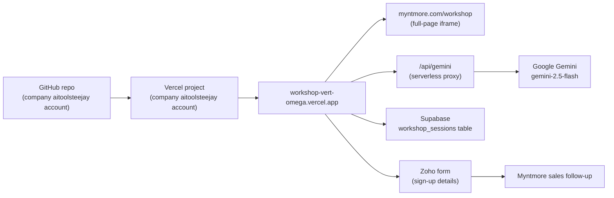
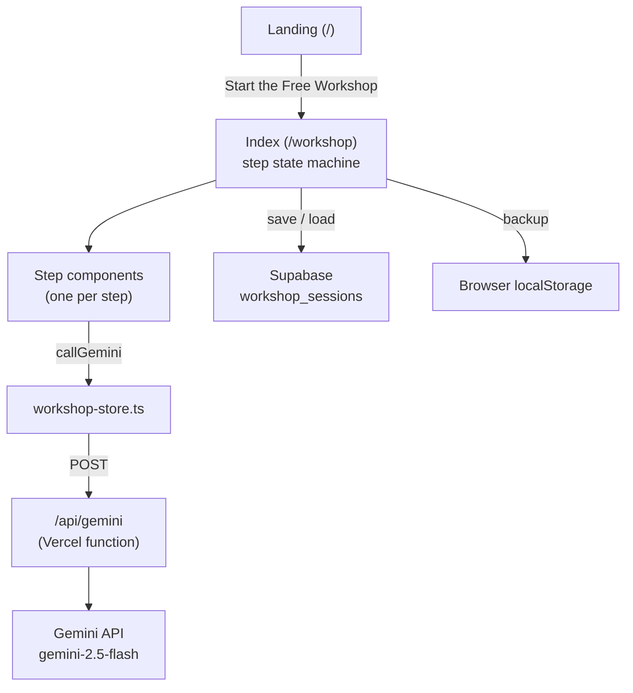

# Workshop Bible

<aside>
🎓

**What it is:** The Myntmore AI Workshop is a free website where a business owner answers questions about their business. At each step, Google's Gemini AI turns their answers into ready-to-use growth material (LinkedIn profile, ideal customers, pitch, website prompt, go-to-market plan, outreach plan). At the end they download everything as one PDF.

**Who this page is for:** the new Tech Ops & AI Automations intern who has to run, change and debug the Workshop alone.

**Why it exists:** it is a **lead magnet**. It is free, but every participant gives their name, email and phone at sign-up, and those leads go to Myntmore's sales team through a Zoho form.

*Last updated 30 Sep 2026.*

</aside>

---

## ⏱️ The workshop in 60 seconds

**In short:** a visitor signs up, goes through up to 9 screens of questions, and leaves with a PDF. Their answers and contact details are saved in a Supabase database table called `workshop_sessions`.

### The participant journey

1. **Landing page** (`/`): marketing page with one button, "Start the Free Workshop".
2. **Sign-up**: name, email, phone. This is the lead capture. It is saved even if they never finish.
3. **Step 1 – Business Basics**: industry, who they sell to (B2B / D2C / Both), business type, revenue, team size, main goal. No AI here.
4. **Step 2 – LinkedIn Profile**: AI scores their profile out of 100 and writes 3 new headlines and a new About section.
5. **Step 3 – Ideal Customer Profiles (ICPs)**: they describe 3 to 6 customer types; AI fills in pain points, buying triggers, objections, where to find them, and referral partners.
6. **Step 4 – Value Proposition**: AI writes a pitch per ICP.
7. **Step 5 – Website**: AI writes a ready-to-paste prompt for an AI website builder (like Lovable).
8. **Step 6 – Go-To-Market**: AI writes channels, a timeline and lead magnet ideas per ICP.
9. **Steps 7 and 8 – Jewellery Design + Jewellery Modelling** (jewellery businesses only): image-prompt builders.
10. **Step 9 – Outreach Playbook**: AI writes a LinkedIn cadence (B2B) or a content/channel plan (D2C).
11. **Step 10 – Final Screen**: a one-page summary and a **Download PDF** button.

Progress saves automatically. If they close the tab and come back on the **same device**, they see a "Welcome back" screen and can resume.

### Where it lives



| Thing | Where |
| --- | --- |
| Live app | [workshop-vert-omega.vercel.app](https://workshop-vert-omega.vercel.app) (landing at `/`, workshop at `/workshop`) |
| Public page | [myntmore.com/workshop](https://myntmore.com/workshop) wraps the app in a full-page iframe (the page is noindex). This is set up in the Myntmore website repo, not the Workshop repo. |
| Hosting | Vercel, on the company **aitoolsteejay** account (the same company account as everything else). It did not show up in the "projects" team when checked, so the exact team/project name is still to confirm. |
| Code | GitHub, on the company **aitoolsteejay** account. The exact repo name is still to confirm. |
| Data / leads | Supabase table `workshop_sessions` (name, email, phone, current step, and all answers). The sign-up details are also sent to a **Zoho form** for sales. |
| AI | Google Gemini `gemini-2.5-flash`, called only through the app's own `/api/gemini` function |

<aside>
📥

**Where the leads go:** every sign-up goes to two places at once. It becomes a row in `workshop_sessions` (Supabase), and it is also posted to a **Zoho form**, which is how Myntmore's sales team gets the lead and follows up. Supabase keeps the full answers; Zoho is where sales works. Who follows up and how fast is still an open question.

</aside>

---

## 🛠️ Most common jobs

**In short:** eight step-by-step recipes for the things you will actually be asked to do. Start here.

### 1. Run and test the workshop end to end

1. Open [workshop-vert-omega.vercel.app/workshop](https://workshop-vert-omega.vercel.app/workshop) in a **private/incognito window** (so an old session in your browser does not resume).
2. Sign up with a clearly fake test identity, e.g. name "TEST – your name", your own email with `+test` added.
3. Step 1: pick an industry and B2B. Click through every step and press every Generate button.
4. Watch each Generate. It should finish in well under a minute. If one spins for more than 90 seconds, note which step (see Troubleshooting).
5. On the Final Screen, click **Download PDF** and open the file. Check that every section is there.
6. Repeat once with **D2C** and once with a **jewellery** business, because those take different paths.
7. Open Supabase and check your test row exists (recipe 2).
- [ ]  Sign-up saved a row
- [ ]  Every Generate button returned content
- [ ]  PDF downloaded and opened
- [ ]  Tested B2B, D2C and jewellery paths

<aside>
⚠️

If you test the jewellery path, the PDF download will **silently do nothing**. That is a known bug (see Known issues), not something you broke. Also: jewellery answers are not saved to the database.

</aside>

### 2. Find a participant's answers or the lead list

1. **Just need the lead for sales?** Look in Zoho first. Every sign-up is sent there through the Zoho form, so new leads should already be waiting for sales. Use Supabase (steps below) when you need their full answers, or to check a lead that is missing from Zoho.
2. Log in to Supabase with the company account (see Accounts needed).
3. Open the project that holds the Workshop (to confirm which of the two company projects — see Open questions).
4. Go to **Table Editor → workshop_sessions**.
5. Use the filter: `user_email` contains the person's email. Their contact details are in `user_name`, `user_email`, `user_phone`.
6. `current_step` shows how far they got (1–10; 10 = reached the Final Screen).
7. Click a cell in a `*_data` column (e.g. `icp_data`) to read their answers and the AI output as JSON.
8. To export leads (for example, to check nothing is missing in Zoho): use the Table Editor's export to CSV, or the SQL query in the toggle below.
- SQL for a quick lead list
    
    Run in Supabase → SQL Editor. Read-only, safe.
    
    ```sql
    select session_id, user_name, user_email, user_phone, current_step
    from public.workshop_sessions
    where user_email is not null
    order by current_step desc;
    ```
    
    Find one person:
    
    ```sql
    select * from public.workshop_sessions
    where user_email ilike '%name@example.com%';
    ```
    
    The code loads "the most recent matching row" for a session, so one session ID could have more than one row. If you see duplicates, the newest one is the one the app uses.
    

<aside>
🔒

This table holds real people's names, emails and phones. Do not paste it into public places or share screenshots outside the team.

</aside>

### 3. Edit a question or an AI prompt

1. Find the step's file in `src/components/workshop/` (table in Repo structure). For example, the Value Proposition step is `Step4ValueProp.tsx`.
2. **To change a question or label:** search the file for the text you see on screen and edit it.
3. **To change what the AI is asked:** search the same file for `callGemini(`. The prompt text is built just above that line.
4. **To change the writing style everywhere** (tone, jargon rules, country advice): edit `src/lib/prompt-rules.ts`. It is added to nearly every prompt.
5. **To change dropdown lists** (industries, countries, how many ICPs allowed) or the affiliate links: edit `src/lib/constants.ts`.
6. Run it locally (see Local setup), test that step, then deploy (recipe 5).

<aside>
💡

Most steps expect Gemini to answer in **JSON** with specific field names. If you change a prompt, do not rename or remove fields the page reads, or you will get the "couldn't read the AI response" error. Step 5 (Website) is the one step that returns plain text.

</aside>

### 4. Change the PDF

1. Open `src/lib/pdf-export.ts`. It is one big function, `generatePDF(sessionData)` (~1,155 lines), that draws every page by hand with the jsPDF library.
2. Search for the section title you want to change (e.g. "Outreach").
3. Change text, fonts, colours or spacing there. The logo is loaded by `loadLogo()` from `public/workshop-static/`.
4. Test with a full B2B session with several ICPs (the biggest PDF), then deploy.

### 5. Deploy a change

1. Make the change on a branch, run `npm run lint`, `npm run test` and `npm run build` locally. All must pass.
2. Push to GitHub and merge into the main branch.
3. Vercel builds and deploys automatically (if the Vercel project is connected to the repo — confirm this).
4. Open the Vercel dashboard → the Workshop project → **Deployments** and wait for "Ready".
5. Open the live URL and [myntmore.com/workshop](http://myntmore.com/workshop) and run a quick test (sign-up + one Generate).
6. If it is broken: **roll back** (see Deploying & rollback).

### 6. Fix it when Gemini fails

1. Try one Generate yourself on the live site. Read the error text: it tells you if it is a timeout, a key problem, or rate limiting.
2. In Vercel → project → **Logs**, filter for `/api/gemini` and look at the error.
3. **"Key not configured" / 500:** check `GEMINI_API_KEY` exists in Vercel → Settings → Environment Variables (Production). If you change it, **redeploy**.
4. **Key rejected:** check the one Gemini key on the company [aitoolsteejay@gmail.com](mailto:aitoolsteejay@gmail.com) Google AI Studio account, make sure the Vercel variable matches it, and redeploy. (The old worry about keys expiring on 20 May 2026 is resolved: the key did not expire and the tools still work, as of 30 Sep 2026.)
5. **Rate-limited / quota:** check usage in Google AI Studio. Wait, or raise the quota/billing. Remember anyone can call `/api/gemini` (no protection), so a sudden spike may be abuse.
6. **Just stuck, no error:** a known issue on 3 screens. Ask the participant to refresh the page; their earlier answers are kept.

### 7. Run it for a live event or a client (e.g. the GIA version)

1. **One week before:** run recipe 1 fully. Check the Gemini key and quota.
2. If the audience is jewellery / gem people (like GIA), test the jewellery branch end to end first: save a jewellery answer and download the PDF. GIA events run on this same app through the jewellery branch.
3. Expect many people to press Generate at the same time. There is no rate limiting, so check the Gemini quota can handle ~10 calls per participant.
4. Share the link [myntmore.com/workshop](https://myntmore.com/workshop). Tell people to use one device and not clear their browser mid-workshop.
5. The GIA workshop is **the same app**, using the jewellery branch (Steps 7–8). The GIA content in Notion (see GIA workshop variant) is the facilitator script on top of it. There is no separate GIA app.
6. After the event, check the leads arrived in Zoho, and export from Supabase if anything is missing (recipe 2). Consider sending the takeaways (see Takeaway ideas).

### 8. What to do if it is broken

1. **Check it is really down:** open the live URL in incognito. Try the landing page, then sign-up, then one Generate.
2. **Whole site down:** Vercel → Deployments. If the newest deploy is failing or broken, promote the previous working one (rollback).
3. **Sign-up or saving fails:** Supabase may be paused, out of storage, or the env vars are wrong. Check the Supabase project status.
4. **Only AI fails:** go to recipe 6.
5. **Only the PDF fails:** see Troubleshooting.
6. Write down what happened, when, and what you did, and tell your manager.

---

## 📖 Jargon buster

**In short:** plain-English meanings of words you will see on this page and in the code.

| Word | What it means here |
| --- | --- |
| Lead magnet | Something free and useful given away to collect people's contact details. |
| Lead | A person who might buy. Here: anyone who signed up. |
| ICP (Ideal Customer Profile) | A description of one type of customer most likely to buy. |
| B2B / D2C | Selling to businesses / selling directly to individual consumers. |
| GTM (Go-To-Market) | The plan for how a business reaches and wins customers. |
| Value proposition | A clear statement of what you do for a customer and why you beat the alternatives. |
| Session | One visitor's run through the Workshop, saved under one ID. One session = one row in `workshop_sessions`. |
| Supabase | An online database service (Postgres). It stores the sessions. |
| Gemini | Google's AI model. It writes all the generated content. |
| Vercel | The hosting service that runs the website and the `/api/gemini` function. |
| Serverless function / proxy | A small piece of server code (`api/gemini.ts`) that calls Gemini for the browser, so the secret key never reaches the visitor's browser. |
| Environment variable (env var) | A setting (like a key) stored in Vercel, not in the code. Names starting `VITE_` are visible in the browser; others are secret and server-only. |
| RLS (Row Level Security) | Supabase rules that decide who may read or write which rows. It is currently **off** on `workshop_sessions`. |
| localStorage | A small storage area inside the visitor's browser. The app keeps the session ID and a backup copy there. |
| JSON / JSONB | A text format for structured data. Each step's answers are stored as one JSONB column. |
| Migration | A SQL file that changes the database structure (e.g. adds a column). Kept in `supabase/migrations/`. |
| Deploy / rollback | Putting a new version live / going back to the previous version. |
| Iframe | A web page shown inside another web page. [myntmore.com/workshop](http://myntmore.com/workshop) shows the Workshop this way. |
| Affiliate link | A tracked link that earns Myntmore a commission if someone signs up through it (here: Clay and Apollo). |
| Timeout / race condition | Giving up after waiting too long / a bug where two things happen at almost the same time and one gets lost. |

---

## 🧭 Every step explained

**In short:** each step takes the visitor's answers plus everything from earlier steps, sends it to Gemini with shared writing rules, and shows the result. Steps 1 and 7 do not call the AI.

| Step | File | Visitor gives | Gemini produces | AI calls |
| --- | --- | --- | --- | --- |
| Sign-up | `WelcomeScreen.tsx` | Name, email, phone | Nothing. Creates the session row (the lead). | 0 |
| 1 Business Basics | `Step1Onboarding.tsx` | Industry, selling to (B2B/D2C/Both), business type (Product/Service/Hybrid), revenue range, team size, main goal | Nothing. Context for all later steps. | 0 |
| 2 LinkedIn Profile | `Step2Profile.tsx` | Current headline + About (or "I don't have one"), rough offer description, tone | 3 polished versions of the offer to pick from; then a 0–100 score on 5 criteria (clarity, specificity, differentiation, proof, execution), 3 headlines, a new About section | 2 |
| 3 Ideal Customer Profiles | `Step3ICP.tsx` (largest, ~813 lines) | 3–6 ICPs. B2B: roles, company size, industry, geography. D2C: free-text description (AI-polished into 3 picks). Extra city questions for India. | Per ICP: who they are, pain points, buying triggers, objections, where to find them, referral/co-selling partners | 2 |
| 4 Value Proposition | `Step4ValueProp.tsx` | Nothing new (uses Step 3) | Per ICP: before/after story, 3-step system, why competitors fail, positioning statement, elevator pitch, CTA. Plus a partner pitch if there are referral partners. | 1 |
| 5 Website | `Step5Website.tsx` | Brand name, 2 brand colours, optional screenshot of a site they like | A full ready-to-paste prompt for an AI website builder (e.g. Lovable), a library of one-click follow-up prompts, a short FAQ. Returns plain text, not JSON. | 1 |
| 6 Go-To-Market | `Step6GTM.tsx` | Nothing new (uses Steps 1–4) | Per ICP: channels and partner strategy, execution timeline, lead magnet and event ideas | 3 (in parallel) |
| 7 Jewellery Design | `StepJewelleryDesign.tsx` | Tags: jewellery type, style, material, gemstone, mood | No AI. The app assembles a product-photo prompt; the visitor pastes it into Gemini's own image tool. | 0 |
| 8 Jewellery Modelling | `StepJewelleryModelling.tsx` | Jewellery type | 4 image prompts: on-model, close-up, lifestyle, one fun/creative concept | 1 |
| 9 Outreach Playbook | `Step7Outreach.tsx` (yes, named "7") | Up to 2 messaging angles | Per ICP: LinkedIn connect-and-follow-up cadence (B2B) or channel/content plan (D2C), example openers, what to avoid | 1 |
| 10 Final Screen | `FinalScreen.tsx` | Nothing | No AI. One-page summary + Download PDF. | 0 |

<aside>
💡

File names do not match the step numbers on screen. The Outreach screen (step 9) lives in `Step7Outreach.tsx`. To find every AI call quickly, search the code for `callGemini(`.

</aside>

- How the AI part works (technical)
    
    Every AI step follows the same pattern: data from earlier steps comes in as props → the component builds a prompt string → `callGemini()` → parse the JSON reply → `sanitizeAIOutput()` → show it → `onSave()` sends it up to `Index.tsx`, which saves it.
    
    **Shared writing rules** (`src/lib/prompt-rules.ts`) are added to nearly every prompt:
    
    - `NO_JARGON_RULE` – short sentences, plain English, a banned buzzword list.
    - `PERSONALISATION_RULE` – always use the user's real name, company, industry and offer.
    - `GEO_AWARENESS_RULE` – adapt channels and tone to the target country (India, USA, UK, Europe, Middle East, SEA, Australia).
    - `BUSINESS_TYPE_RULE` – adapt to "Selling To" (D2C/B2B/Both) and "Business Type" (Product/Service/Hybrid).
    
    **Cleaning:** `src/lib/sanitize.ts` removes em-dashes, asterisks and # signs from every AI reply before it is shown or saved.
    
    **`callGemini(prompt, systemPrompt?, image?)`** in `src/lib/workshop-store.ts`:
    
    - Identical calls already running are merged (dedup), so double-clicks do not fire twice.
    - Up to 3 attempts with 1s and 2s waits (the 4s value in `RETRY_DELAYS` is never used).
    - Last resort: one more try with the prompt cut to 2,000 characters and any image dropped.
    - No `AbortController`: a hung request is never cancelled.
    - Most Generate buttons also race the call against a 60–90 second timeout (copied into each file). Three places do not (see Known issues).
    - `describeGeminiError(e)` turns errors into friendly messages (timeout / key / rate limit / network). `AI_PARSE_ERROR_MESSAGE` is shown when the reply is not valid JSON.
    
    **`api/gemini.ts`** (server): POST only; 400 if no `prompt`; 500 if `GEMINI_API_KEY` is missing. Calls `gemini-2.5-flash:generateContent` with `temperature: 0.7`, `maxOutputTokens: 16384`. No login, no rate limit.
    

---

## 💎 Jewellery branch

**In short:** Steps 7 and 8 are an extra detour for jewellery businesses. They make image-generation prompts. They are also where the two worst bugs live.

- **Step 7 – Jewellery Design:** the visitor clicks tags (type, style, material, gemstone, mood). The app builds a photorealistic product-photography prompt itself. There is no AI call in the app. The visitor copies the prompt into Gemini's image tool.
- **Step 8 – Jewellery Modelling:** the visitor picks a jewellery type. Gemini writes 4 prompts showing the piece worn in different ways.
- In the PDF these appear as a "Bonus Add-Ons" section.

<aside>
✅

**Fixed in Oct 2026:** answers from Steps 7–8 now save to the database, and jewellery sessions get their PDF. The GIA workshop uses this same branch, so test both before every GIA event.

</aside>

- Open detail: how the app decides to show the jewellery steps
    
    The sources say these steps are "for jewellery businesses only" but do not say exactly how the app decides (for example, from the industry picked in Step 1). Check `src/pages/Index.tsx` and `src/lib/constants.ts` to confirm. Listed in Open questions.
    

---

## 📄 PDF export

**In short:** `src/lib/pdf-export.ts` draws the whole PDF by hand in the browser when the visitor clicks Download. Jewellery sessions work since the Oct 2026 fix.

- One function, `generatePDF(sessionData)`, ~1,155 lines, using the jsPDF library (no template).
- Contents: cover page, table of contents, one section per completed step (ICPs, Value Props, Website Prompt, GTM Strategy, Outreach Playbook) and "Bonus Add-Ons" for jewellery.
- It runs all at once on the click. For big sessions (many ICPs), the browser tab can freeze for a moment. That is normal.
- The pdf-export.ts:1087 bug (fixed in Oct 2026): what it was
    
    Around **line 1087**, the code uses a variable called `jewelleryDesign`, but that variable is never created in the function (only `addonsPrompt` and `modellingData` are). Any session that used Step 7 throws a `ReferenceError` there.
    
    The caller does not wait for or catch errors from `generatePDF`, so the visitor sees **nothing at all**. You can see the error in the browser console (F12 → Console).
    
    **Fix:** replace `jewelleryDesign?.selections` with the real source of the Step 7 selections (the jewellery design data in `sessionData`). Then add a `try/catch` around the `generatePDF` call in `FinalScreen.tsx` that shows an error message, so future failures are visible.
    
    Test with a jewellery session before and after.
    

---

## 🗄️ Data model

**In short:** one Supabase table, `workshop_sessions`. One row per session. Contact details in plain columns, each step's answers in its own JSONB column.

| Column | What it holds |
| --- | --- |
| `session_id` | Random ID made in the browser (`crypto.randomUUID()`) |
| `user_name`, `user_email`, `user_phone` | The lead's contact details from sign-up (`user_phone` was added by the second migration) |
| `current_step` | How far they got |
| `onboarding_data` | Step 1 |
| `profile_data` | Step 2 |
| `icp_data` | Step 3 |
| `value_prop_data` | Step 4 |
| `website_data` | Step 5 |
| `gtm_data` | Step 6 |
| `outreach_data` | Step 9 |
| `jewellery_design_data`, `jewellery_modelling_data` | Steps 7–8 (jewellery). Added in Oct 2026. |

<aside>
🔓

**Row Level Security is OFF** on this table. Because the public (anon) key is in the browser, anyone who knows how could read or change every lead's data. See Known issues & security.

</aside>

- How saving works (technical)
    - No logins. The session ID in `localStorage["workshop_session_id"]` is the only "key" to a session.
    - `createSession(name, email, phone)` inserts the row and writes a backup to `localStorage["workshop_backup"]`.
    - On reload: `getSessionId()` → `loadSession(id)` gets the most recent matching row. If Supabase fails, it falls back to the local backup (`loadBackup()`).
    - `step` in `Index.tsx` is the whole screen state: `-1` loading, `-2` "welcome back", `0` sign-up, `1..10` steps. `goToStep(s)` also saves `current_step`.
    - `saveField(field, data)` updates the screen at once, then `debouncedSave` saves 1 second later. It uses **one shared timer for all fields**, so two different fields saved within the same second can lose the first one.
    - `useAutosave` (in `src/hooks/use-autosave.ts`) also saves every 10 seconds, even if nothing changed.
    - Every Supabase save error is only logged to the console. The visitor is never told.
- How the jewellery columns were added (fixed in Oct 2026)
    
    Add a new migration file in `supabase/migrations/` (follow the existing timestamped name format) with:
    
    ```sql
    alter table public.workshop_sessions
      add column if not exists jewellery_design_data jsonb,
      add column if not exists jewellery_modelling_data jsonb;
    ```
    
    Apply it to the live project (Supabase SQL Editor or CLI). Then regenerate `src/integrations/supabase/types.ts` (Supabase CLI or dashboard) and commit it.
    

---

## 🔑 Accounts needed

**In short:** you need access to six things. Logins are in the Systems & Access database, not on this page.

| Account | Why you need it | Status / note |
| --- | --- | --- |
| Vercel | Deploys, env vars, logs, rollback | Company aitoolsteejay account. It was not found in the "projects" team, so the exact team/project name is still to confirm. |
| GitHub | The code | Company aitoolsteejay account. Exact repo name still to confirm. |
| Supabase | Leads and answers (`workshop_sessions`) | Company account, on the **free plan with no backups**. There are 2 projects: one for lead magnets, one for everything else. Which holds the Workshop is not confirmed. |
| Google AI Studio | The Gemini key and quota | Company account. Same key name is used by 5 apps. |
| Zoho | Where sign-ups land for sales (via a Zoho form) | Company account. Which exact Zoho form: to confirm. |
| Razorpay | Planned paywall only | Not set up yet. |

[🔐 Systems & Access](https://app.notion.com/p/7cd1a87e3e144a389f96190db58dd3c3?pvs=21)

---

## 🏗️ Architecture & stack

**In short:** a React website (built with Vite) that runs in the browser, one small server function for the AI, and a Supabase database. All hosted on Vercel.



| Part | Tool |
| --- | --- |
| Build tool | Vite 5 (`@vitejs/plugin-react-swc`) |
| Framework | React 18 + TypeScript |
| Pages | React Router 6, two routes: `/` and `/workshop` |
| Styling | Tailwind CSS + shadcn/ui (Radix underneath) |
| Animation | Framer Motion |
| State | Mostly React `useState`. TanStack Query is installed but hardly used. |
| Database | Supabase (Postgres), session storage only, no user accounts |
| AI | Google Gemini `gemini-2.5-flash` via `api/gemini.ts` |
| PDF | jsPDF, hand-built layout |
| Tests | Vitest + Testing Library; Playwright config present (E2E coverage may be minimal) |
| Lint | ESLint 9 flat config + typescript-eslint |
| Hosting | Vercel (`vercel.json` SPA rewrite; `/api/gemini` deploys with the same build) |

---

## 📁 Repo structure

**In short:** the screens are in `src/components/workshop/`, the brain is `src/pages/Index.tsx`, and the helpers (AI, saving, PDF, prompts) are in `src/lib/`.

- Full folder map
    
    ```
    api/
      gemini.ts                    The only server function - proxies every Gemini call
    src/
      pages/
        Landing.tsx                Marketing page at "/"
        Index.tsx                  The whole workshop at "/workshop" - one state machine
        NotFound.tsx
      components/
        workshop/
          WelcomeScreen.tsx         Sign-up / resume
          Step1Onboarding.tsx       Step 1 (no AI)
          Step2Profile.tsx          Step 2 LinkedIn
          Step3ICP.tsx              Step 3 ICPs (~813 lines)
          Step4ValueProp.tsx        Step 4
          Step5Website.tsx          Step 5
          Step6GTM.tsx              Step 6
          StepJewelleryDesign.tsx   Step 7 (no AI)
          StepJewelleryModelling.tsx Step 8
          Step7Outreach.tsx         Step 9 on screen
          FinalScreen.tsx           Step 10 + PDF button
          ProgressBar.tsx, ProgressSidebar.tsx, WorkshopFooter.tsx, RestartButton.tsx
          MultiSelect.tsx, LoadingSpinner.tsx, InfoTooltip.tsx
        ui/                         shadcn-generated, do not hand-edit
      hooks/
        use-autosave.ts             Saves every 10s
        use-toast.ts, use-mobile.tsx
      lib/
        workshop-store.ts           Supabase save/load + callGemini()
        prompt-rules.ts             Shared AI writing rules
        sanitize.ts                 Cleans AI output
        pdf-export.ts               PDF builder (~1155 lines)
        constants.ts                Industries, countries, ICP limits, affiliate links
        audience.ts                 B2B/D2C badge styles
        utils.ts, clipboard.ts
      integrations/supabase/
        client.ts                   Generated Supabase client
        types.ts                    Generated DB types (missing jewellery columns)
      test/                         Vitest specs
    supabase/migrations/            2 SQL migrations (out of date vs the app)
    public/workshop-static/         Logo and images
    playwright.config.ts, playwright-fixture.ts
    vercel.json                     SPA rewrite
    vite.config.ts, vitest.config.ts, tailwind.config.ts, tsconfig*.json
    ```
    

| I want to change… | Open this file |
| --- | --- |
| A question, label or button on a step | That step's file in `src/components/workshop/` |
| What the AI is asked in one step | Same file, near `callGemini(` |
| AI tone/style everywhere | `src/lib/prompt-rules.ts` |
| Industries, countries, ICP limits, affiliate links | `src/lib/constants.ts` |
| Step order or flow | `src/pages/Index.tsx` |
| The PDF | `src/lib/pdf-export.ts` |
| The landing page | `src/pages/Landing.tsx` |
| Gemini model or settings | `api/gemini.ts` |

---

## 💻 Local setup

**In short:** install, add the env var names below with real values from the password vault, run `npm run dev`. For AI to work locally you also need `vercel dev`.

1. Install Node.js and Git. Clone the repo.
2. `npm install`
3. `cp .env.example .env` and fill in the three Supabase values.
4. `npm run dev` starts the site. The AI button will **not** work with this alone.
5. For AI locally: install the Vercel CLI and run `vercel dev`, with `GEMINI_API_KEY` in a separate server-only local env file.

| Env var name | Browser or server? | Where to get it |
| --- | --- | --- |
| `VITE_SUPABASE_URL` | Browser | Supabase → Project Settings → API → Project URL |
| `VITE_SUPABASE_PUBLISHABLE_KEY` | Browser | Supabase → Project Settings → API → anon/public key |
| `VITE_SUPABASE_PROJECT_ID` | Browser | Supabase → Project Settings → General → Reference ID |
| `GEMINI_API_KEY` | **Server only** | Google AI Studio → API keys |

<aside>
🚫

Never rename `GEMINI_API_KEY` to start with `VITE_`. Anything starting `VITE_` is put into the public website code and anyone could steal it. Never commit `.env` files to GitHub.

</aside>

- npm scripts
    - `npm run dev` – dev server
    - `npm run build` – production build to `dist/`
    - `npm run build:dev` – build in development mode
    - `npm run preview` – serve the production build locally
    - `npm run lint` – ESLint
    - `npm run test` – Vitest once; `npm run test:watch` – watch mode
    
    Tests mock Supabase and `workshop-store` (see `src/test/example.test.ts`), because the real client needs live env vars.
    

---

## 🚀 Deploying & rollback

**In short:** Vercel builds the site and the `/api/gemini` function together. If a deploy breaks things, promote the last good deployment.

### Deploy

1. Merge your change into the main branch on GitHub.
2. Vercel builds automatically (if the project is linked to the repo). The build runs `npm run build`.
3. Check Vercel → Deployments shows **Ready**, then test the live site.

### Rollback

1. Vercel → Workshop project → **Deployments**.
2. Find the last deployment that worked.
3. Click the **⋯** menu → **Promote to Production** (or use Instant Rollback).
4. Test the live site. Then fix the bad change in code.
- First-time setup of a new Vercel project
    1. Import the repo into Vercel (Vite preset is auto-detected).
    2. Add all four env vars for Production, Preview and Development.
    3. Deploy. `vercel.json` makes `/workshop` work on refresh; `/api/gemini` is deployed automatically.
    4. If the URL changes, the iframe on [myntmore.com/workshop](http://myntmore.com/workshop) must be updated in the website repo.

<aside>
💡

Changing an env var in Vercel does **not** change the live site until you redeploy.

</aside>

---

## 🔌 Integrations

**In short:** Supabase stores data, Gemini writes content, Clay and Apollo affiliate links earn commission, and the leads go to Myntmore's sales team through a Zoho form.

| Integration | What it does | Where in code |
| --- | --- | --- |
| Supabase | Stores every session: lead details and answers. No logins. | `src/lib/workshop-store.ts`, `src/integrations/supabase/` |
| Google Gemini | Writes all AI output (`gemini-2.5-flash`) | `api/gemini.ts`, `callGemini()` in `workshop-store.ts` |
| Clay and Apollo affiliate links | Links to two outbound sales tools shown in the GTM/outreach output. Earn a commission on sign-ups. | `src/lib/constants.ts` |
| Myntmore sales / CRM | Every sign-up is also posted to a Zoho form, so sales gets the lead and follows up to sell the paid agency service | The sign-up code (exact file to confirm; start with `WelcomeScreen.tsx` and `createSession` in `workshop-store.ts`) |
| [myntmore.com](http://myntmore.com) | Shows the app in an iframe at `/workshop` | Myntmore website repo (see Website Bible) |
| Razorpay | Planned paywall. Not built. | None yet |

---

## 💳 Razorpay paywall & coupons (planned, not built)

**In short:** there is a full design for charging for the Workshop, with coupons and free-trial switches. **None of it exists in the code.** Sign-up stays free so a lead is still captured.

<aside>
🚧

**Not built.** There is no `paid` column, no `api/razorpay-*` files, no `PaymentScreen.tsx`. Do not tell anyone the Workshop is paid.

</aside>

### The planned flow

1. Sign-up (free, unchanged) creates the session with `paid = false`.
2. **New Payment screen.** Optional "Have a coupon code?" link.
3. Full-bypass coupon → marked paid, skip Razorpay. Otherwise → Razorpay Checkout popup.
4. Payment verified on the server and by Razorpay's webhook → `paid = true`.
5. Steps 1–10 as today.

The natural place to add it: right after `WelcomeScreen`'s `onStart` in `Index.tsx` (today it goes straight to `setStep(1)`).

- Planned files, database changes and env var names
    
    **New files**
    
    - `api/razorpay-order.ts` – creates the Razorpay order. The server decides the price, never the browser.
    - `api/razorpay-verify.ts` – checks the payment signature after checkout, sets `paid = true`.
    - `api/razorpay-webhook.ts` – called by Razorpay directly when money settles (`payment.captured`). The real source of truth.
    - `PaymentScreen.tsx` – the new screen.
    - New helpers in `workshop-store.ts`, e.g. `createOrder(sessionId, couponCode?)`, `verifyPayment(...)`.
    
    **New columns on `workshop_sessions`:** `paid` (boolean, default false), `amount_paid` (integer, paise), `coupon_code`, `razorpay_order_id`, `razorpay_payment_id`.
    
    **New `coupons` table:** `id`, `code` (unique, uppercased), `discount_type` (`percent` / `fixed` / `full_bypass`), `discount_value`, `max_redemptions`, `times_redeemed`, `max_redemptions_per_email` (default 1), `expires_at`, `active`, `label`, `created_at`.
    
    **Env var names (values never here):** `VITE_RAZORPAY_KEY_ID` (browser), `RAZORPAY_KEY_ID`, `RAZORPAY_KEY_SECRET`, `RAZORPAY_WEBHOOK_SECRET`, `WORKSHOP_PRICE_PAISE` (all server-only). Possible switches: `PAYMENT_GATE_ENABLED`, `FREE_UNTIL`.
    
    **Coupon checks, in order:** exists and active → not expired → under max redemptions → this email has not used it too often. Use one atomic `update ... returning *` so a shared coupon cannot be used past its cap.
    
    **Free trials:** recommended = a global on/off switch (`PAYMENT_GATE_ENABLED`) plus 100%-bypass coupons for individuals. Quota ("first N free") and date-based (`FREE_UNTIL`) versions are possible but not recommended.
    

### Before anyone builds it

- [ ]  Start Razorpay KYC early (can take days)
- [ ]  Build and test fully in **test mode** first
- [ ]  Two rules: the server sets the price; never trust the browser's "payment worked" alone
- [ ]  Decide the open questions in the design doc (upgrade CTA for free users, CRM flag for coupon leads, invoicing for ₹0 bypasses, go-live checklist)

Full design: [Workshop Payment Gate: Razorpay Setup, Coupons & Free Trials](Workshop%20Related/Workshop%20Payment%20Gate%20Razorpay%20Setup,%20Coupons%20&%20Fr%203eb4ee2c51c181e69c07f29eb1d2db37.md)

---

## 💍 GIA workshop variant & add-ons

**In short:** a version of the workshop content customised for GIA (gem and jewellery) professionals, plus six add-on exercises. It is written in Notion as a facilitator framework. It runs on **the same Workshop app**, using the jewellery branch (confirmed 30 Sep 2026). There is no separate GIA app.

### The 6 GIA steps

1. **Tell us about your GIA business** – specialty (retail, estate, lab grading, appraisals, wholesale), clients, revenue stage, growth goal.
2. **Optimise your online presence** – LinkedIn headline formula `[GIA Credential] helping [ICP] [achieve outcome]`, Instagram bio and 3 content pillars, website/Google Business Profile and local SEO.
3. **Gem niche ICP & value prop** – "I help [ICP] who [problem] get [outcome] through [GIA-backed method]."
4. **GTM & gem education lead magnets** – e.g. "How to Read a GIA Grading Report", "The 4Cs Explained Simply".
5. **AI product visuals** – Gemini prompt template for jewellery model shots.
6. **Website copy & outreach playbook** – homepage prompt template and outreach advice per client type.

### The 6 add-ons

| Add-on | What it does |
| --- | --- |
| A – Prompt a Stone | Photo + description of a gem → AI drafts a preliminary grading observation for the gemologist to correct |
| B – Design from a Stone | Show a client several AI-rendered design ideas for their stone in the meeting |
| C – Translate the Certificate | Turn a GIA report into plain language a buyer understands |
| D – The Trust Post | Turn daily work into educational LinkedIn posts |
| E – AI Appraisal Assistant | Draft the written appraisal narrative after the physical exam |
| F – Natural vs Lab | Tailored explainers of lab-grown vs natural diamonds for brides, retailers, investors |

<aside>
⚠️

The GIA workshop runs through the jewellery steps of this same app, so the PDF bug and the missing jewellery columns hit **every GIA participant**. Fix both before a GIA session.

</aside>

Source pages: [GIA AI Marketing Workshop](GIA%20AI%20Marketing%20Workshop%203eb4ee2c51c181969babf6493dee42ed.md) · [ADD ONS](GIA%20AI%20Marketing%20Workshop/ADD%20ONS%203eb4ee2c51c181818573dce766edcfe8.md)

---

## 🎁 Takeaway ideas & prompt library

**In short:** ideas for extra things to give participants after the workshop, plus a set of follow-up prompts for improving the website the AI builds. These are ideas, not built features.

### Takeaway ideas

1. **"Steal our assets" email** – 3 best cold email templates, 2 high-converting lead magnet examples, a more detailed outreach playbook.
2. **A short Loom** showing how to use lead magnets and send outreach.
3. **Workshop insights** across all participants – common ICP mistakes, biggest gaps, best ideas. (You could pull this from `icp_data` in Supabase.)

### Website Optimization Prompt Library

Six prompts to paste into the AI website builder after the first draft, in this order: Conversion Optimization → Visual Hierarchy → Modern UI Upgrade → Mobile-First → Consistency Check → Trust Markers & Social Proof. Step 5 already includes a library of one-click follow-up prompts in the app.

Source pages: [Workshop Takeaway Ideas](Workshop%20Related/Workshop%20Takeaway%20Ideas%203eb4ee2c51c1813497bbd219bbeecfb5.md) · [🚀 Website Optimization Prompt Library](Workshop%20Related/%F0%9F%9A%80%20Website%20Optimization%20Prompt%20Library%203eb4ee2c51c181e7a02eee08259a627d.md)

---

## 🔁 Recurring tasks

**In short:** there is no Workshop-specific recurring task in the Recurring Tasks database. These checks are suggested, based on how the app works and the monthly rhythm on the hub.

| How often | Task |
| --- | --- |
| Weekly | Check new sign-ups in `workshop_sessions` also arrived in Zoho (catches a broken Zoho form early) |
| Weekly | Quick smoke test: sign-up + one Generate on the live site |
| Monthly | Check the Gemini key still works and usage/quota in Google AI Studio (part of the monthly API keys check) |
| Monthly | Check Supabase storage and that the project is not paused (part of the monthly Supabase check). Suggestion: also export `workshop_sessions` to CSV and keep it somewhere safe, since the free plan has no backups. |
| Monthly | Check the Vercel project and the [myntmore.com/workshop](http://myntmore.com/workshop) iframe still load (part of the monthly Vercel/domain check) |
| Before any event | Full end-to-end test (recipe 1) on B2B, D2C and jewellery |

[🔁 Recurring Tasks](https://app.notion.com/p/8ca740ba253b458784073907050d3c6b?pvs=21)

---

## 🐞 Known issues & security

**In short:** two security holes (open AI endpoint, RLS off), one hosting risk (no database backups) and a list of bugs. Bugs 1–4 below (PDF, jewellery columns, timeouts, save race) were fixed in Oct 2026; the rest are still open.

### Security

| Issue | Risk | Fix |
| --- | --- | --- |
| `api/gemini.ts` has **no auth and no rate limit** | Anyone who finds the URL can use up the company Gemini quota or run up a bill | Add a rate limit (per IP / per session) and check requests come from the Workshop (origin check or a signed session token) |
| **RLS off** on `workshop_sessions` | The public key is in the browser, so anyone technical could read or edit every lead's name, email, phone and answers | Turn on RLS **with policies** (see warning below) |
| Session ID is the only "credential" | Whoever has the ID can load that session | Acceptable for now; revisit with RLS |

<aside>
🛑

**Do not just switch RLS on.** With RLS on and no policies, the browser can no longer insert or update rows, and **sign-up and saving will break for everyone**. Write the policies first (or move saves to a server function), test on a copy, then enable. Tracked in the checklist task "Lock down unauthenticated Gemini endpoints".

</aside>

### Hosting & data risks

*Confirmed 30 Sep 2026. The fixes below are suggestions, not decisions.*

| Risk | What could happen | Suggested fix |
| --- | --- | --- |
| Supabase is on the **free plan with no backups** | If rows are deleted, overwritten (RLS is off) or the project is lost, every lead and answer is gone for good. Free projects can also be paused when inactive, which stops sign-ups. | Suggestion: regular CSV exports of `workshop_sessions` as a stop-gap, and ask whether to move to a paid plan with backups. |

### Bugs (ranked by impact)

1. **PDF fails for jewellery sessions** – `pdf-export.ts` ~line 1087 uses undeclared `jewelleryDesign`. Silent. **Fixed (Oct 2026).**
2. **Jewellery answers lost** – `jewellery_design_data` / `jewellery_modelling_data` columns do not exist. Saves fail silently, and the next load overwrites the local backup too. **Fixed (Oct 2026).**
3. **No timeout on 3 AI calls** – the "polish into 3 options" boxes in `Step2Profile.tsx` (~line 90) and `Step3ICP.tsx` `D2CDescriptionBox` (~line 752), and `StepJewelleryModelling.tsx` (~line 65). A hung call leaves the screen stuck; only a reload helps. **Fixed (Oct 2026).**
4. **Double-save race** – `debouncedSave` in `Index.tsx` uses one timer for all fields; two saves within ~1 second can drop the first. **Fixed (Oct 2026).**
5. **"Loaded from local backup" warning** is calculated two different ways (`Index.tsx` ~44 vs ~54); it sometimes does not show and sometimes always shows.
6. **Empty ICP list** – `Step6GTM.tsx` and `Step7Outreach.tsx` do not check for zero ICPs (Step 4 does).
7. **GTM errors are generic** – `Step6GTM.tsx` does not use `describeGeminiError`, so every failure shows the same message.
8. **Stale reply overwrites newer one** in the "polish into 3 options" boxes (no request guard).
9. **Copy-paste code** – timeout/JSON parsing, copy buttons, tag chips and the polish flow are duplicated across files.
10. No request can be cancelled (no `AbortController`); retry backoff is ~3s, not ~7s.
- [x]  Fix the PDF bug (line ~1087)
- [x]  Add the two jewellery columns + regenerate `types.ts`
- [x]  Add timeouts to the 3 AI calls
- [x]  Give each field its own save timer
- [ ]  Protect `/api/gemini`
- [ ]  Enable RLS with policies

Tracked in: [Workshop bugs: PDF export (pdf-export.ts:1087), jewellery columns, step timeouts, save race](https://app.notion.com/p/Workshop-bugs-PDF-export-pdf-export-ts-1087-jewellery-columns-step-timeouts-save-race-3eb4ee2c51c18155a860dc4b6f86c47b?pvs=21) · [Lock down unauthenticated Gemini endpoints (Workshop api/gemini.ts, ICP Builder /api/gemini, Campaign Strategizer)](https://app.notion.com/p/Lock-down-unauthenticated-Gemini-endpoints-Workshop-api-gemini-ts-ICP-Builder-api-gemini-Campaig-3eb4ee2c51c181468670f86708ed60c9?pvs=21)

---

## 🩺 Troubleshooting

**In short:** find your symptom, check the cause, apply the fix. Always open the browser console (F12 → Console) first; most errors show up there.

| Symptom | Likely cause | Fix |
| --- | --- | --- |
| Generate button spins forever | Gemini is slow or down | Refresh the page (answers are kept). |
| Every Generate fails with a key/config error | `GEMINI_API_KEY` missing, wrong or expired in Vercel | Update the key in Vercel env vars, redeploy (recipe 6) |
| "Rate limited" or failures during an event | Gemini quota hit (many people at once, or abuse of the open endpoint) | Check AI Studio usage; wait or raise quota |
| "Couldn't read the AI response" (parse error) | Gemini returned text that is not valid JSON, often after a prompt edit | Retry. If it keeps happening, check your prompt still asks for the exact JSON fields |
| GTM step shows a vague error | Known: `Step6GTM.tsx` does not map errors | Check Vercel logs for the real `/api/gemini` error |
| GTM or Outreach fails right away | No ICPs were saved in Step 3 | Go back to Step 3 and generate ICPs |
| Tab freezes briefly on Download | PDF is built all at once; big sessions take time | Normal. Wait. |
| Participant cannot resume on another device | Resume only works in the same browser (session ID is in localStorage) | Expected. They must restart, or you read their answers in Supabase |
| Sign-up fails / nothing saves | Supabase paused, full, or wrong `VITE_SUPABASE_*` values; or RLS turned on without policies | Check the Supabase project status and env vars; check RLS |
| AI does not work locally | `npm run dev` does not run `/api/gemini` | Use `vercel dev` with a local `GEMINI_API_KEY` |
| [myntmore.com/workshop](http://myntmore.com/workshop) is blank but the [vercel.app](http://vercel.app) URL works | Iframe problem on the website side | Check the website repo's `/workshop` page (see Website Bible) |
| `/workshop` gives 404 on refresh | `vercel.json` rewrite missing or changed | Restore the SPA rewrite in `vercel.json` |

---

## 🎥 Related Loom video

**In short:** Loom 27 is planned but not recorded yet.

[19 · The Workshop app: running it and fixing it](https://app.notion.com/p/19-The-Workshop-app-running-it-and-fixing-it-3eb4ee2c51c181bca95fdd2aaa878ec1?pvs=21) – 5–10 min, status "To record". Should show: how a participant goes through it, where leads land, the PDF export, known bugs, the Razorpay plan. Add the link here when it exists.

---

## ❓ Open questions

**In short:** things nobody has written down yet. Find the answer, then update this page.

- [x]  Which GitHub repo holds the Workshop code? *Answered on 30 Sep 2026: the company aitoolsteejay GitHub.*
- [ ]  What is the exact GitHub repo name for the Workshop?
- [x]  Which Vercel account/team hosts workshop-vert-omega? *Answered on 30 Sep 2026: the company aitoolsteejay Vercel account.*
- [ ]  Which exact Vercel team/project name is it under? (It was not in the "projects" team when checked.)
- [ ]  Is the Vercel project connected to GitHub for automatic deploys, and which branch is production?
- [ ]  Which Supabase project holds `workshop_sessions` — the lead-magnets project or the other one?
- [x]  How do Workshop leads reach sales / Zoho CRM? *Answered on 30 Sep 2026: each sign-up is posted to a Zoho form as well as saved in Supabase.*
- [ ]  Who in sales follows up on Workshop leads, and how fast? Which exact Zoho form is it?
- [x]  Is the Gemini key used by the Workshop still valid (many keys listed a 20 May 2026 expiry)? *Answered on 30 Sep 2026: it did not expire, and the tools still work.*
- [ ]  Is the Workshop's Gemini key shared with other apps?
- [ ]  Does the table have a created-at timestamp column? (Not listed in the migrations description.)
- [ ]  How does the app decide to show the jewellery steps (7–8)?
- [x]  Is there a separate app or deployment for the GIA workshop, or is it run with the standard app plus the Notion framework? *Answered on 30 Sep 2026: same app, using the jewellery branch. No separate app.*
- [ ]  What exactly are the Clay and Apollo affiliate links and who owns those affiliate accounts?
- [ ]  Is the paywall still planned? If yes, what price, and who approves go-live?
- [ ]  How many sessions/leads exist today, and is anyone tracking completion rate?
- [ ]  Is there any privacy notice / consent text on the sign-up screen for storing phone numbers?

---

## 🔗 Related handover pages

**In short:** where to go next.

- [Myntmore Handover — Sanyam](https://app.notion.com/p/Myntmore-Handover-Sanyam-3eb4ee2c51c181be8493db88e803fbd6?pvs=21) (hub)
- [Myntmore AI Workshop](https://app.notion.com/p/Myntmore-AI-Workshop-3eb4ee2c51c18134825fc29d01fceb0f?pvs=21)
- [README — Myntmore Workshop (workshop app)](README%20%E2%80%94%20Myntmore%20Workshop%20(workshop%20app)%203eb4ee2c51c181c8a992e646187f6bd5.md)
- [Myntmore Workshop - User Manual](Myntmore%20Workshop%20-%20User%20Manual%203eb4ee2c51c181518e1be42554bd3403.md) → [Myntmore Workshop - Technical Documentation](Myntmore%20Workshop%20-%20User%20Manual/Myntmore%20Workshop%20-%20Technical%20Documentation%203eb4ee2c51c181c9b0bde22e595b12b7.md) · [Myntmore Workshop - Non Technical Documentation](Myntmore%20Workshop%20-%20User%20Manual/Myntmore%20Workshop%20-%20Non%20Technical%20Documentation%203eb4ee2c51c18129a8cad5fed1294494.md)
- [Workshop Related](Workshop%20Related%203eb4ee2c51c181bd9982e7750c29f51a.md)
- [Workshop Payment Gate: Razorpay Setup, Coupons & Free Trials](Workshop%20Related/Workshop%20Payment%20Gate%20Razorpay%20Setup,%20Coupons%20&%20Fr%203eb4ee2c51c181e69c07f29eb1d2db37.md)
- [GIA AI Marketing Workshop](GIA%20AI%20Marketing%20Workshop%203eb4ee2c51c181969babf6493dee42ed.md) · [ADD ONS](GIA%20AI%20Marketing%20Workshop/ADD%20ONS%203eb4ee2c51c181818573dce766edcfe8.md)
- [Website Bible](../Website/Website%20Bible%203eb4ee2c51c1816395c4f569bc88f4f2.md) (the [myntmore.com/workshop](http://myntmore.com/workshop) iframe)
- [Locate 4 apps not in the aitoolsteejay 'projects' team (workshop, campaign tracker, posting rhythm, founder presence)](https://app.notion.com/p/Locate-4-apps-not-in-the-aitoolsteejay-projects-team-workshop-campaign-tracker-posting-rhythm--3eb4ee2c51c181bba9b1ef85eb8fa1f5?pvs=21)
- Systems & Access rows: [Vercel](https://app.notion.com/p/Vercel-3eb4ee2c51c1817a8af3c98bb6b3a08e?pvs=21) · [Supabase](https://app.notion.com/p/Supabase-3eb4ee2c51c181e59fd6cffd1f190380?pvs=21) · [Google AI Studio (Gemini)](https://app.notion.com/p/Google-AI-Studio-Gemini-3eb4ee2c51c1811e8faff04102060247?pvs=21) · [Razorpay (planned)](https://app.notion.com/p/Razorpay-planned-3eb4ee2c51c181f5b410e04a62ccc288?pvs=21)
- Databases: [✅ Handover Checklist](https://app.notion.com/p/bfde3c59483f4d5893b05e0b39f45d62?pvs=21) · [🎥 Loom Videos to Record](https://app.notion.com/p/fc74d12d9bc544078f7d3e4d582d7541?pvs=21) · [💻 Apps & Repos (Vercel + GitHub)](https://app.notion.com/p/c38cf1ff94a94ff4901e4f8ef270dba0?pvs=21)